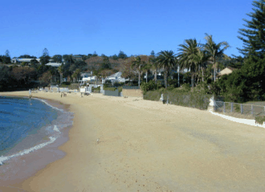
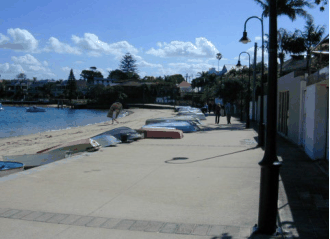
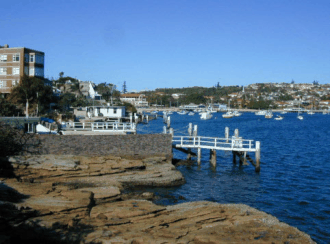
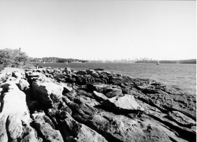

#### C3.3.2 Townscape

The subdivision and development pattern of Watsons Bay has evolved since settlement on the gently sloping western side of the peninsula. The pattern is clearly influenced by the topography and drainage patterns. The built form retains the character of a low-scaled early 19th and 20th century village, enhanced by natural vegetation and parklands, including the continuous park along the ridgeline and cliff tops.

The townscape of Watsons Bay primarily retains a village character with harbour views and glimpses and a backdrop of extensive areas of vegetation along exposed ridgelines. Distinct precincts are evident throughout the area and individual streetscapes are varied in terms of architectural style, visual elements and the use of individual sites.

#### Objectives

O1 To ensure that historic development patterns are retained and conserved.

O2 To ensure that any block subdivision and new development reflects historic development patterns and the character and village scale of Watsons Bay.

O3 To ensure that the character of each precinct and streetscape is retained.

O4 To ensure that new development creates opportunities for the vegetation backdrop along ridgelines to be enhanced.

O5 To ensure that significant views over the township are retained, particularly in terms of the visual character of roofscapes.

Camp Cove Beach

> [Picture on page 22: a picture, saved as a picture (images/chapter-c3-watsons-bay-heritage-conservation-area-page-22-21.gif, 150 dpi).]

Marine Parade North promenade

> [Picture on page 22: a picture, saved as a picture (images/chapter-c3-watsons-bay-heritage-conservation-area-page-22-23.gif, 150 dpi).]

Rock shelves and jetties  along Pacific Street

waterfront

> [Picture on page 22: a picture, saved as a picture (images/chapter-c3-watsons-bay-heritage-conservation-area-page-22-26.gif, 150 dpi).]

Rock shelves at Green (Laings) Point

> [Picture on page 22: a picture, saved as a picture (images/chapter-c3-watsons-bay-heritage-conservation-area-page-22-28.gif, 150 dpi).]
