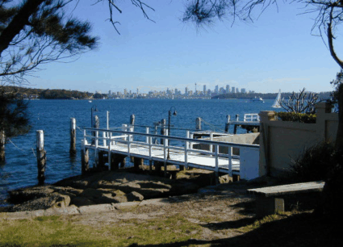
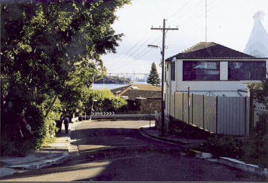

#### C3.3.3 The waterfront

Watsons Bay has been a recreation and tourist destination from as early as 1803, with the location of hotels, promenades and parks giving strong emphasis on water related activities such as swimming and boating. Many private properties also have water frontage, access and/or visual links to the harbour foreshore.

Strong visual maritime linkages are reinforced by the many maritime structures including wharves, jetties, boatsheds, swimming baths and promenades that remain along the waterfront, as well as a yacht club. The promenades characterise the publicly accessible foreshore area that forms the interface between the harbour and private land. The following objectives and controls apply to the waterfront, inclusive of the intertidal zone.

#### Objectives

O1 To ensure that publicly owned foreshore areas are retained within the public domain and are not privatised.

O2 To ensure that opportunities are created for continuous links along the foreshore via open space and publicly accessible areas.

O3 To conserve maritime structures that contribute to the heritage significance of the area.

O4 To ensure significant views and vistas to and from the waterfront are retained.

O5 To protect the scenic quality of the natural landscape and built environment when viewed from Sydney Harbour.

O6 To conserve the natural land and water interface.

O7 To reinforce the natural character of the foreshore.

O8 To protect environmentally sensitive marine environments and habitats.

Existing views across the harbour

towards the city from Victoria Wharf Reserve Existing view to the harbour

> [Picture on page 23: a picture, saved as a picture (images/chapter-c3-watsons-bay-heritage-conservation-area-page-23-25.gif, 150 dpi).]

> [Picture on page 23: a picture, saved as a picture (images/chapter-c3-watsons-bay-heritage-conservation-area-page-23-26.gif, 150 dpi).]
