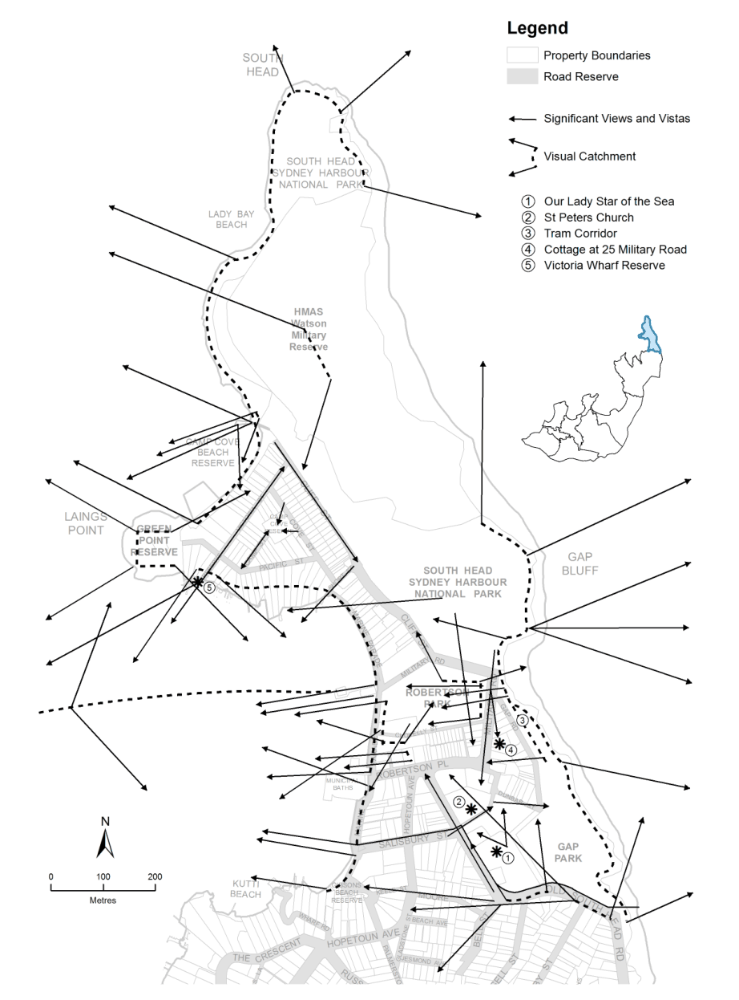

#### C3.3.4 Views and vistas

Watsons Bay contains important views and vistas.  These are identified in Map 4 below.

Of particular note are the views to and from the harbour, views over Watsons Bay from the higher locations within the area and the views between buildings, through parklands and along streetscapes.

The area is characterised by a series of significant visual gateways, due mainly to its topography and dramatic landscape.

Visual gateways include the sweeping view of the entire area from Belah Avenue on the bend along Old South Head Road, high above Watsons Bay and the views from Gap Park. Views into and out of Robertson Park, which form a visual gateway and distinctive public area between the northern and southern ends of the conservation area, are also significant.

#### Objectives

O1 To ensure that identified significant public views and vistas are retained.

O2 To ensure that new development does not block identified significant views and vistas.

O3 To create opportunities for new views and vistas within the public domain.

O4 Where possible, to reinstate views and vistas that are currently blocked.

O5 To ensure that distinctive visual gateways within the conservation area are retained.

O6 To encourage view sharing as a means of ensuring equitable access to views from dwellings.

MAP 4  Significant public views and vistas

> [Picture on page 25: a picture, saved as a picture (images/chapter-c3-watsons-bay-heritage-conservation-area-page-25-2.gif, 150 dpi).]
