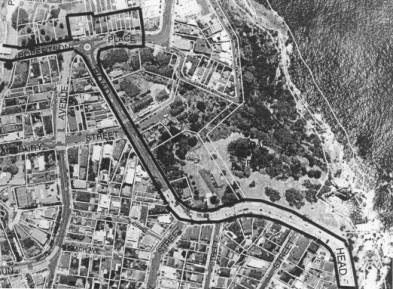
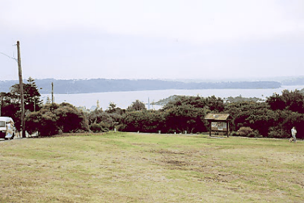
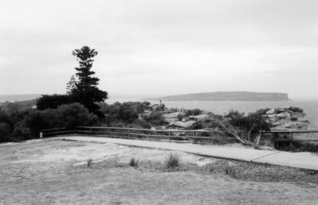
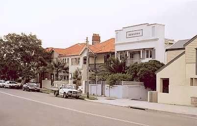
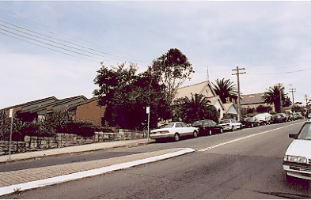

#### C3.4.1 Precinct A: Entrance

#### Character statement

This precinct stretches from the south end of Upper Gap Park along Old South Head Road to Robertson Place. This area serves as a spectacular gateway to Watsons Bay with a sense of arrival enhanced by elevated views and vistas over Watsons Bay and Upper Gap Park Reserve to the Heads (Figures 1, 2 and 3).

The two storey housing on the north side of Robertson Place terminates the descent into Watsons Bay along Old South Head Road. The historic road alignments of Old South Head Road and Robertson Place have been retained, although the early form of Robertson Place has been altered by the change in levels around a visually intrusive roundabout.

Contrasting built elements within the precinct create a visually diverse streetscape.  There is a significant grouping of historic buildings on the north side of Robertson Place, comprising three two storey Federation period semi-detached dwellings, a pair of originally single story Victorian period weatherboard semi-detached dwellings and “Keronga”,  a 1920s two storey (plus basement) residential building (Figure 4). The group is relatively consistent in its scale and alignment. Setbacks to each building, although varied, incorporate a set pattern that reflects the road alignment. A contemporary residence, within which remnants of a 1830s stone cottage remain, visually detracts from the group of earlier buildings.

A single detached house at the intersection of Hopetoun Avenue (within the Salisbury Street/Hopetoun Avenue Precinct) and the low-scaled (two storey) retirement housing (within the Vaughan Village Precinct) on the east side of the precinct are both set within gardens behind a low sandstone block wall. This fencing is characteristic of the fencing within this precinct, which consists mainly of sandstone block or rendered brick (Figure 5).

A small sandstone obelisk commemorates the completion of the construction of (Old) South Head Road to Watsons Bay in 1811.

Although partly obscured by the single storey yacht club, significant public views west from Robertson Place to the public baths and Sydney Harbour have been maintained.

FIGURE 1  Aerial view of the precinct

> [Picture on page 37: a picture, saved as a picture (images/chapter-c3-watsons-bay-heritage-conservation-area-page-37-29.gif, 150 dpi).]

FIGURE 2  View over Upper Gap Park

and Watsons Bay to the Harbour

> [Picture on page 37: a picture, saved as a picture (images/chapter-c3-watsons-bay-heritage-conservation-area-page-37-32.gif, 150 dpi).]

#### FIGURE 3

View over Upper Gap Park to the Heads

> [Picture on page 38: a picture, saved as a picture (images/chapter-c3-watsons-bay-heritage-conservation-area-page-38-3.gif, 150 dpi).]

#### FIGURE 4

Two storey housing on north side of Robertson Place

> [Picture on page 38: a picture, saved as a picture (images/chapter-c3-watsons-bay-heritage-conservation-area-page-38-6.gif, 150 dpi).]

FIGURE 5  Old South Head Road featuring

low sandstone wall stepping up both sides

> [Picture on page 38: a picture, saved as a picture (images/chapter-c3-watsons-bay-heritage-conservation-area-page-38-9.gif, 150 dpi).]

#### PRECINCT CONTROLS

The precinct specific controls supplement the general controls for development in Section C3.5. If there is an inconsistency between the precinct controls and the general controls, the precinct controls take precedence.

#### Topography and vegetation

C1 Existing scale relationships are to be maintained between more elevated properties along Old South Head Road and the properties lower down along Robertson Place.

C2 No change in existing building heights is permitted for properties fronting Robertson Place.

#### Townscape

C3 Existing subdivision patterns along Robertson Place are to be retained. Any proposal to create a new lot or amalgamate lots must be of a size (in area and dimensions) which reflects the characteristics of historically relevant lots adjoining and in the vicinity of the site.

C4 Historic road alignments of Old South Head Road and Robertson Place are to be retained.

#### Views and vistas

C5 Existing views from the public domain are to be retained over roofs to the harbour from the elevated areas of the precinct, including those along Old South Head Road.

C6 Existing roofscapes (pitched roofs) are to remain uncluttered by intrusive structures so as to not to detract from views to and from elevated areas of the public domain.

#### Contributory items

Note: Heritage items as identified in Schedule 5 of Woollahra LEP 2014 are also contributory items. Refer to clause 5.10 of the LEP for heritage conservation controls.

| Contributory items |  |
|---|---|
| 1 Robertson Place | 2 storey Inter-War flat building ‘Keronga’ |
| 3 Robertson Place | 2 storey Federation semi-detached dwelling |
| 5 Robertson Place | 2 storey Federation semi -detached dwelling |
| 7 Robertson Place | 2 storey Federation semi -detached dwelling |
| 9 Robertson Place | 2 storey Federation semi -detached dwelling |
| 11 Robertson Place | 2 storey Federation semi -detached dwelling |
| 13 Robertson Place | 2 storey Federation semi -detached dwelling |
| 15 Robertson Place | Single storey Victorian semi -detached dwelling |
| 17 Robertson Place | Single storey Victorian semi -detached dwelling |
| 19 Robertson Place | 2 storey Edwardian semi -detached dwelling |
| 21 Robertson Place | 2 storey Edwardian semi -detached dwelling |
| 23 Robertson Place | Portions of an early Victorian cottage [1839] within a 3 storey contemporary house |
| Old South Head Road | Bus shelters |

C7 Contributory items (i.e. includes heritage items) are to be retained.

C8 Changes to contributory items is limited to sympathetic alterations and additions consistent with the built form controls for contributory items in Section C3.6 of this chapter.

#### Inter-War flat buildings or multi dwelling housing

For Inter-War flat buildings, refer to Clause 3.6 Contributory items: additional built form controls.

#### Built form

The following controls apply to new dwellings, or the main new building on the site. Separate controls apply to secondary structures such as new garages, carports, ancillary buildings and the like.

#### Building siting and alignment

Streetfront setbacks

C9 Existing streetfront setback patterns are to be maintained, particularly those associated with the group of historic buildings on the north side of Robertson Place (Figure 4).

C10  New buildings are to be orientated parallel with adjacent properties (not parallel to the street frontage) to maintain existing streetscape patterns.

Side boundary setbacks

C11  New buildings adjacent to, and within, Robertson Place are to achieve a similar setback pattern to the contributory items located on the north side of Robertson Place.

#### Building height

C12  The height of new buildings is to be no greater than the predominant height of contributory items within the streetscape and in any case is limited to two storeys.

C13 Existing views from the elevated areas of the precinct (from the upper areas of Old South Head Road overlooking Watsons Bay to the harbour) are not to be obstructed by higher development below. New buildings on land fronting Robertson Place are to be no higher than the predominant height of existing buildings.

#### Building form

C14  Rectilinear plan and traditional pitched roof forms are to be used to relate to the established streetscape character.

#### Building materials and details

C15  The following materials are appropriate for new buildings:

a) Walls: rendered brick or sandstone.

b) Pitched roofs (dwellings): slate or tiled with unglazed terracotta or dark earth tones.

#### Landscaping and site coverage

C16  New buildings are to retain and reinforce the typical garden layouts of the front building setbacks with paths, small trees, shrubs and, where space permits, lawns.

C17  The building footprint plus paved surfaces (patios, pathways, tennis courts and swimming pools together) must not exceed 75% of the site area, in order to provide 25% of the site area for landscaped area, including plantings.

#### Fences and walls

C18  Where existing, original square top picket fencing is to be retained.

C19  Fencing should be limited to traditional timber paling, or rendered or bagged masonry walls (or, where evidence of previous use exists, composite masonry/timber.  Fences should step down in height to 1.2m at front boundary line.

#### Car parking and access

C20  Garages and carports are to be set back behind the front of the main building, preferably at the rear of the property.

C21  Hardstand car parking spaces are not to be forward of the main building.

C22  No new garages or carports are to be constructed for existing contributory items, where these would adversely affect the form and presentation of the item.
