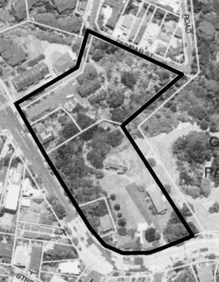
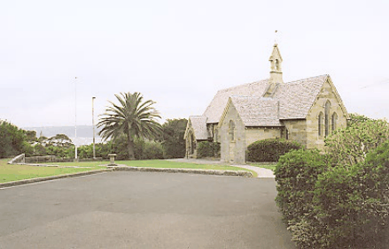
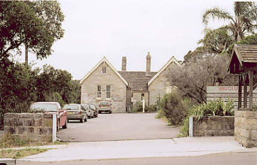
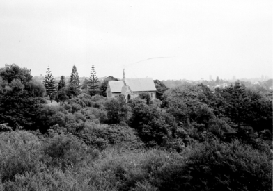
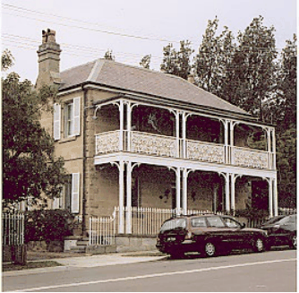
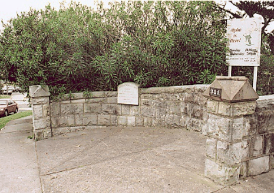

#### C3.4.2 Precinct B: Church Group

#### Character statement

This precinct, bounded by Old South Head Road, Gap Park, Dunbar Street and Vaughan Village, presents one side of the gateway to Watsons Bay. It consists of a predominantly natural landscape with pockets of cultural landscaping and post-1970s native plantings that are sympathetic to those contained within Upper Gap Park (Precinct P) behind.

The precinct civic nature includes a significant group of post 1850s church and former school buildings, located on an exposed rocky plateau. Cultural plantings include figs, palms and coral trees, although only the Moreton Bay fig and very old coral trees have identified heritage value. Private plantings of Oleander and Metrosideros also exist in the street verges.

Low sandstone block perimeter walls line the east side of the Precinct and are a dominant part of the streetscape for this part of Old South Head Road. A section of sandstone kerbing opposite the intersection of Salisbury Street has also been retained.

#### FIGURE 6

Aerial view of the precinct

> [Picture on page 42: a picture, saved as a picture (images/chapter-c3-watsons-bay-heritage-conservation-area-page-42-16.gif, 150 dpi).]

#### FIGURE 7

Church buildings within a setting of cultural plantings

> [Picture on page 42: a picture, saved as a picture (images/chapter-c3-watsons-bay-heritage-conservation-area-page-42-19.gif, 150 dpi).]

FIGURE 8  Sandstone buildings, perimeter walls

and entrance, Old South Head Road

> [Picture on page 42: a picture, saved as a picture (images/chapter-c3-watsons-bay-heritage-conservation-area-page-42-22.gif, 150 dpi).]

#### FIGURE 9

View of precinct from Upper Gap Park

> [Picture on page 42: a picture, saved as a picture (images/chapter-c3-watsons-bay-heritage-conservation-area-page-42-25.gif, 150 dpi).]

FIGURE 10  Contributory item on Old South Head

Road illustrating dominant materials, including

sandstone blockwork and slate roofing.

> [Picture on page 43: a picture, saved as a picture (images/chapter-c3-watsons-bay-heritage-conservation-area-page-43-4.gif, 150 dpi).]

#### FIGURE 11

Low sandstone block memorial wall and entrance

> [Picture on page 43: a picture, saved as a picture (images/chapter-c3-watsons-bay-heritage-conservation-area-page-43-7.gif, 150 dpi).]

#### PRECINCT CONTROLS

The precinct specific controls supplement the general controls for development in Section C3.5. If there is an inconsistency between the precinct controls and the general controls, the precinct controls take precedence.

#### Topography and vegetation

C1 Areas of surviving natural bushland, as well as cultural plantings, are to be retained and reinforced (Figure 9).

#### Townscape

C2 The historic road alignment of Old South Head Road is to be retained.

#### Views and vistas

C3 Existing views of the church buildings (particularly the church and its bell tower, former school and residence) within the surrounding area are to be retained (Figure 9), as identified in Map 4 of this chapter.

C4 Existing views over roofs to the harbour are to be retained from the upper levels of the precinct, including those from Old South Head Road.

C5 Roofs are to remain uncluttered by intrusive structures or services so as to retain views to and from the upper levels of the precinct.

#### Contributory items

Note: Heritage items as identified in Schedule 5 of Woollahra LEP 2014 are also contributory items. Refer to clause 5.10 of the LEP for heritage conservation controls.

C6 Heritage items are to be retained.

#### Built form

The following controls apply to new dwellings, or the main new building on the site. Separate controls apply to secondary structures such as new garages, carports, ancillary buildings and the like.

#### Building siting and alignment

C7 Extensive landscaped areas are to be retained between existing buildings of a civic character.

C8 Location and orientation of new buildings are to be consistent with controls or policies included in any conservation management plan or plan of management applying to the land.

C9 New buildings are to be located and oriented to be consistent with controls or policies included in any conservation management plan or plan of management applying to the land.

#### Building height

C10  The height of new buildings is to be equal to, or less than, the ridge line of contributory items (not including spires) within the precinct, but may not exceed two storeys.

C11  Building heights are to reflect natural landform and topography of the precinct. Existing views from upper levels of the precinct are not to be obstructed by new development.

#### Building form

C12  The form of new buildings is to relate to that of adjacent contributory items.

C13  Rectilinear plan and traditional pitched roof forms are to be used to relate to the established streetscape character.

#### Building character

C14  The design and character of new buildings is to relate to that of contributory items and their civic character and use.

#### Building materials and details

C15  The following materials are appropriate for new buildings:

a) Walls: sandstone or rendered masonry/brickwork of similar tone to sandstone.

b) Pitched roofs: slate or tiled in dark grey tones or metal roofs in a slate grey colour.

#### Landscaping and private open space

C16  The provision of expansive areas of landscaped area will retain the setting and curtilage of buildings of civic character.

C17  Plantings around the periphery of the precinct, especially on top of the hard sandstone plateau, are to comprise of substantive native plants commonly found on coastal headlands, including within Gap Park Reserve. Refer to Section 3.5.6 Landscaping and private open space.

#### Fences and walls

C18  Front fencing within the precinct is to be limited to low sandstone walls no higher than 0.9m above ground level.

C19  Where security or privacy is needed, higher sandstone side and rear walls are permitted to a maximum of 1.8m.

#### Car parking and access

C20 To retain the open, green character of the precinct, no additional public car parking is to be provided, except where it can be provided within the envelope of new buildings.

C21  Where possible, existing vehicular access to building complexes within the precinct is to be utilised if new development is required.

C22  Landscaping and materials used in vehicular parking and access areas within the precinct are to follow guidelines outlined in any conservation management plan and conservation policy relevant to the property and landholding.
