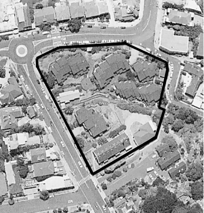
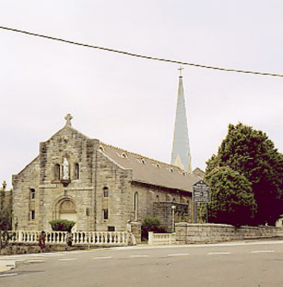
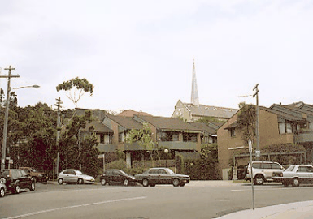
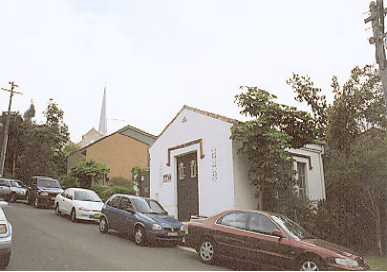
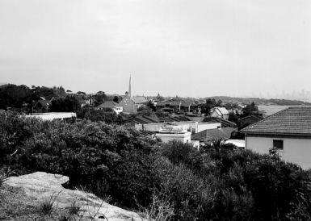
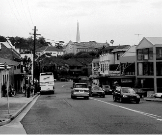

#### C3.4.3 Precinct C: Vaughan Village

#### Character statement

This precinct is bounded by Robertson Place, Old South Head Road, Dunbar Street and the adjoining Church Precinct. It is defined by a stone wall around the perimeter of the Roman Catholic Church property, terminating at a distinctive “Spanish Mission” style substation at the north east corner.

The precinct consists of a complex of contributory items, including the sandstone ‘Our Lady Star of the Sea’ Church, a presbytery, a Spanish Mission-styled substation and the small former St Anthony’s Chapel facing Old South Head Road.

The (non-contributory) retirement village sited around St Anthony's Chapel is contemporary in character (typical of 1980s brick and tile roofed retirement housing). Although the two to three storey dwellings are divided into small groups, the pattern and form of development is uncharacteristic of the historic subdivision and development pattern of Watsons Bay.

The gardens and landscape that surrounds the retirement housing softens the visual impact of buildings and provide a landscape buffer to the historic church and chapel and include significant sandstone fencing and retaining walls.

FIGURE 12  Aerial view of the precinct

> [Picture on page 46: a picture, saved as a picture (images/chapter-c3-watsons-bay-heritage-conservation-area-page-46-18.gif, 150 dpi).]

FIGURE 13  ‘Our Lady Star of the Sea’

> [Picture on page 46: a picture, saved as a picture (images/chapter-c3-watsons-bay-heritage-conservation-area-page-46-20.gif, 150 dpi).]

FIGURE 14  Vaughan Village with the spire of

‘Our Lady Star of the Sea’ church behind

> [Picture on page 47: a picture, saved as a picture (images/chapter-c3-watsons-bay-heritage-conservation-area-page-47-3.gif, 150 dpi).]

FIGURE 15  Spanish Mission-styled electricity

substation

> [Picture on page 47: a picture, saved as a picture (images/chapter-c3-watsons-bay-heritage-conservation-area-page-47-6.gif, 150 dpi).]

FIGURE 16  View to Vaughan Village

from Upper Gap Park

> [Picture on page 47: a picture, saved as a picture (images/chapter-c3-watsons-bay-heritage-conservation-area-page-47-9.gif, 150 dpi).]

FIGURE 17  Significant view to

church spire from Commercial Precinct

> [Picture on page 47: a picture, saved as a picture (images/chapter-c3-watsons-bay-heritage-conservation-area-page-47-12.gif, 150 dpi).]

#### PRECINCT CONTROLS

The precinct specific controls supplement the general controls for development in Section C3.5. If there is an inconsistency between the precinct controls and the general controls, the precinct controls take precedence.

#### Topography and vegetation

C1 Existing scale relationships of buildings are to be maintained between the higher levels of the precinct (church buildings) and the lower levels (retirement housing), i.e. the church buildings are to retain their visual dominance and landmark value.

C2 The existing extent of landscaping is to be retained.

C3 The ‘buffer’ effect of landscape screening to retirement village housing is to be retained.

#### Views and vistas

C4 Existing views over roofs to the harbour are to be retained from the upper levels of the public domain, including those from Old South Head Road.

C5 Roofs are to remain uncluttered by intrusive structures or services in order to retain views to and from the upper levels of the precinct.

C6 Significant public views to the church spire from the public domain are to be retained. This includes views from within the precinct and from adjacent areas, in particular, the Military Road Commercial Centre (Figures 16 and 17).

#### Contributory items

Note: Heritage items as identified in Schedule 5 of Woollahra LEP 2014 are also contributory items. Refer to clause 5.10 of the LEP for heritage conservation controls.

| Contributory items |  |
|---|---|
| Lot 1 DP 231114 – facing Dunbar Street | Single storey Interwar Spanish Mission-styled substation #592 |

C7 Contributory items (i.e. including heritage items) are to be retained.

C8 Change to contributory items is limited to sympathetic alterations and additions consistent with the controls in Section C3.6 and with management policies contained within any conservation management plan applying to the items.

C9 Given the size of the retirement village and the historic and civic nature of the church buildings and their settings within this area, a conservation management plan should be prepared for each landholding or property listed as a heritage or contributory item. A similar management plan should be prepared for the retirement village. These plans should include consideration of master planning options to provide policies for sympathetic future redevelopment.

#### Alterations and additions to existing buildings

C10  Additions to existing retirement village buildings are to be constructed of the same recessive materials (including wall materials and roof cladding).

#### Built form

The following controls apply to new dwellings, or the main new building on the site. Separate controls apply to secondary structures such as new garages, carports, ancillary buildings and the like.

#### Building siting and alignment

C11  Extensive landscaped areas are to be retained between existing buildings, particularly the church buildings in the upper level of the precinct.

C12  No new buildings are to be constructed unless in accordance with an approved management

plan. They should be located and orientated to be consistent with policies within any conservation management plan or management plan applying to the land.

#### Building height

C13  The height of new buildings is to be limited to 2 storeys in order to retain the dominance of contributory items within the precinct and to prevent obstruction of significant views to the church spires. No building is to be taller than the ridge line or parapet of adjacent heritage items.

C14  Building heights are to reflect the natural landform and topography of the precinct. Existing views from the upper levels of the precinct are not to be obstructed by new development (Figure 16).

#### Building form

C15  The height and form of new buildings is to relate to contributory items within the precinct.

C16  Rectilinear plan forms and traditional pitched roof forms are to be used in order to relate to the established character.

#### Building character

C17  The design and character of new buildings is to relate to that of contributory items in the vicinity.

#### Building materials and details

C18  The following materials are appropriate for new buildings:

a) Walls: sandstone or rendered masonry or brick in neutral mid-tone colours.

b) Pitched roofs: slate or tiled in dark grey tones.

#### Landscaping and private open space

C19  Retain setting and curtilage between contributory items through provision of expansive landscaped areas.

C20  Existing areas of ‘buffer’ landscaping are to be retained and where possible, new areas created. Refer to Section 3.5.6 - Landscaping and private open space.

#### Fences and walls

C21  Fencing within the church area in the upper levels of the precinct is to be limited to low sandstone retaining walls no higher than 0.9m above ground level.

C22  Perimeter fencing is to be limited to sandstone blockwork of the same height as existing.

C23  Side and rear fences are not to be constructed in the upper levels of the precinct. Fencing in this area should be used only as a landscape feature or as a gateway to the precinct. Side and rear fencing within the lower levels of the precinct is to be a maximum height of 1.8m, consisting of paling, picket, brick or sandstone (or composite) construction.

#### Car parking and access

C24  In order to retain the open green character of the precinct, additional car parking areas within are not permitted.

C25  Where possible, existing vehicular access to building complexes within the precinct is to be utilised if new development is required.

C26  Landscaping of, and materials used in, vehicular parking and access areas within the precinct should be consistent with guidelines included in any conservation management plan or management plan for Vaughan Village.
