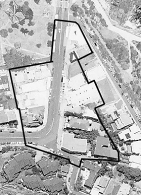
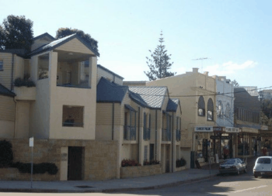
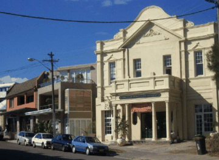
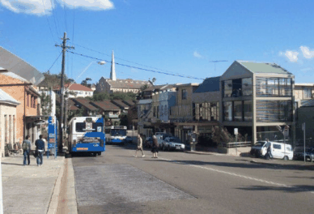
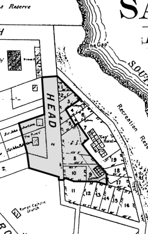
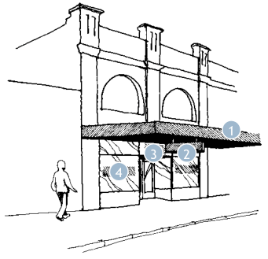
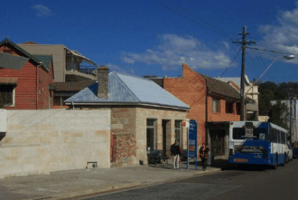
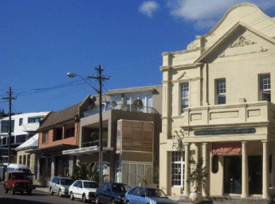
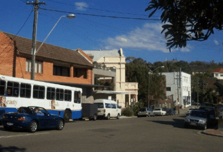

#### C3.4.4 Precinct D: Commercial and residential flat buildings

#### Character statement

Centred on historic Military Road which linked South Head Road to the defence and navigational establishments and the village of Camp Cove, the precinct extends from Gap Road in the north to Robertson Place in the south, and is bounded by properties with frontage to Military Road (Figure 18).

The precinct contains the Military Road commercial centre of Watsons Bay. The visually distinctive former town hall, built on sites associated with the 1887 subdivision around the later demolished Gap Hotel, is surrounded by a group of residential flat buildings. Buildings are aligned close to or at street frontage, thereby forming a relatively enclosed streetscape (or ‘hard’ built

edge) comprising mainly two to three storey buildings set below the high ridge of Upper Gap Park.

The former town hall, a single storey sandstone shop with timber cottage behind, a group of Inter-War shops and residential flat buildings contribute positively to the streetscape. The silhouette of the parapets of the former town hall and Inter-war shops opposite define the streetscape, giving visual prominence to the former town hall and definition to the height of buildings within the streetscape (Figures 19 and 20). The taller height and assertive forms of some of the newer development challenges the prominence of these historic elements within the streetscape.

The Gap Bluff Precinct of the Sydney Harbour National Park and the spire of ‘Our Lady Star of the Sea’ church visually terminate the streetscape at the north and south ends respectively (Figure 21). While the mix of building styles and forms create an architecturally diverse streetscape, it is very uneven in terms of form, character and detail, which detracts from the contributory items within the streetscape.

#### FIGURE 18

Aerial view of the precinct

> [Picture on page 51: a picture, saved as a picture (images/chapter-c3-watsons-bay-heritage-conservation-area-page-51-27.gif, 150 dpi).]

FIGURE 19  West side of Military Road,

residential flats and Inter-War shops

> [Picture on page 51: a picture, saved as a picture (images/chapter-c3-watsons-bay-heritage-conservation-area-page-51-30.gif, 150 dpi).]

FIGURE 20  East side of Military Road,

with former town hall prominent.

> [Picture on page 52: a picture, saved as a picture (images/chapter-c3-watsons-bay-heritage-conservation-area-page-52-3.gif, 150 dpi).]

FIGURE 21  Streetscape with spire above

> [Picture on page 52: a picture, saved as a picture (images/chapter-c3-watsons-bay-heritage-conservation-area-page-52-5.gif, 150 dpi).]

FIGURE 22  Extract from the

1887 ‘Watsons Bay’ subdivision plan

> [Picture on page 52: a picture, saved as a picture (images/chapter-c3-watsons-bay-heritage-conservation-area-page-52-8.gif, 150 dpi).]

#### FIGURE 23

An example of appropriate shopfront signage

> [Picture on page 52: a picture, saved as a picture (images/chapter-c3-watsons-bay-heritage-conservation-area-page-52-11.gif, 150 dpi).]
> Words printed on the picture (title and legend, copied from the PDF):
> 1
> 2
> 3
> 4

1 Awning fascia sign 2 Under awning sign 3 Top hamper sign 4 Painted or etched

window

FIGURE 24  25 Military Road with

weatherboard cottage (11 Gap Road) behind

> [Picture on page 53: a picture, saved as a picture (images/chapter-c3-watsons-bay-heritage-conservation-area-page-53-3.gif, 150 dpi).]

FIGURE 25  East side of Military Road,

north of the Town Hall

> [Picture on page 53: a picture, saved as a picture (images/chapter-c3-watsons-bay-heritage-conservation-area-page-53-6.gif, 150 dpi).]

FIGURE 26  Looking south towards the Town Hall

> [Picture on page 53: a picture, saved as a picture (images/chapter-c3-watsons-bay-heritage-conservation-area-page-53-8.gif, 150 dpi).]

#### PRECINCT CONTROLS

The precinct specific controls supplement the general controls for development in Section C3.5. If there is an inconsistency between the precinct controls and the general controls, the precinct controls take precedence.

#### Topography and vegetation

C1 New development is not to alter the existing scale relationships between the high natural ridge of Gap Park on the eastern side and the lower scaled buildings below.

C2 Mixed shrub and groundcover beds in footpaths, as well as private planter boxes attached to building facades or on low walls, detract from the streetscape and should be removed.

#### Townscape

C3 The surviving subdivision pattern is to be retained, including width and depth of allotments that provides evidence of 1887 subdivision around the Gap Hotel (Figure 22).

C4 The overall consistency of building alignment is to be retained (i.e. built close to or at the street frontage).

C5 The cohesiveness of the centre is to be reinforced. New development is to respect the scale, massing and architectural character of adjacent heritage and contributory items.

C6 Infill development within the neighbourhood business zone is to be of traditional ‘main street’ form, with shops at ground level and housing or commercial space above.

C7 The location of outdoor footpath dining must maintain continuity of public access.

C8 The number of signs is to be limited to avoid visual clutter on individual premises and within the streetscape.

#### Signage and advertising (commercial buildings)

Signs are to be:

C9 Located at ground level on shopfronts (hampers), awnings and under awnings (Figure 23).

C10  Designed to fit within the existing architectural elements of buildings and not obscure architectural features.

C11  Designed to an appropriate size and scale for the building on which they are to be erected.

C12  Painted and, where illumination is desired, externally spot lit.

C13  Fixed to buildings in a manner that does not damage significant building fabric.

Signs are to:

C14  Identify the building and its use only. General trade advertising signs are not permitted.

C15  Incorporate style, lettering and colours that complement the style and character of the building to which they are attached.

Signs are not to be:

C16  Located on windows other than to indicate the name and nature of the business. Window signs are to be discrete and of a professional design quality. Views to the interior of the building are not to be obscured unduly.

C17  Fixed above awning level.

C18  Painted on previously unpainted surfaces of heritage and contributory items.

C19  Standardised corporate signage.

C20  Internally lit, neon or with flashing lights. Small and discrete internally illuminated signs may be installed within shopfronts.

#### Views and vistas

C21  Existing public views over roofs to the harbour from Gap Park are to be retained, including views from the former tram corridor.

C22  The vista from Military Road to Gap Park and cottage behind the sandstone commercial building at 25 Military Road is to be retained (Figure 24).

C23  Roofs are to remain uncluttered by intrusive structures and services in order not to detract from the significant views from Gap Park towards the harbour.

#### Contributory items

Note: Heritage items as identified in Schedule 5 of Woollahra LEP are also contributory items. Refer to clause 5.10 of the LEP for heritage conservation controls.

| Contributory items |  |
|---|---|
| 3 Military Road | 2 storey 1920s Inter-War flat building over retail |
| 10 Military Road | 2 storey Federation styled housing over retail |
| 12A Military Road | 2 storey Federation styled housing over retail with original shopfront |

C24  Contributory items (i.e. includes heritage items) are to be retained.

C25  Change to contributory items is limited to sympathetic alterations and additions consistent with the controls in Section C3.6.

C26  Reconstruction of the original window configuration in the Inter-War period shops group is encouraged and should occur concurrently when development is proposed for those buildings.

C27  Original significant shopfronts at 10 Military Road are to be retained.

C28  Existing setbacks from the street are to be maintained.

#### Built form

The following controls apply to new dwellings, or the main new building on the site. Separate controls apply to secondary structures such as new garages, carports, ancillary buildings and the like.

#### Building siting and alignment

Street front and side boundaries — east side

C29  New buildings are to be built to the street alignment to the north of the former Town Hall, with exception of the allotment immediately adjacent (Figure 25). South of the former town hall building, new buildings are to be set back to match the existing residential flat building alignment, up to the corner site, which should be built to the street alignment (Figure 26).

Street front and side boundaries — west side

C30  New buildings are to be built to the street alignment and to side boundaries on all levels. Existing gaps in the street wall are to be infilled when further development occurs to those properties.

Rear setbacks

C31  Building setbacks from rear should relate to existing setback pattern on adjoining blocks and maintain amenity of neighbouring residential property.

#### Building height

Note: Maximum building height is specified in Woollahra LEP 2014.

#### Building form

C32  New buildings are to be built with parapeted rectilinear forms in order to relate to similar contributory items and to achieve greater unity within the streetscape.

C33 New building forms are not to be so visually assertive in the streetscape that the historic character is eroded.

C34  New buildings on the west side of Military Road are to be constructed with awnings.

C35  New buildings on the east side of Military Road are to be subservient in form and height to those of the former town hall in order to retain its visual prominence in the streetscape.

C36  The location and mix of uses in the precinct should ensure adequate residential amenity in terms of sunlight access and visual and acoustic privacy.

#### Building character

C37  Facades are to be modulated into vertically proportioned bays and openings.

#### Building materials and details

C38  Walls above awnings are to be rendered and painted masonry. Sandstone or ceramic tiles are permitted at ground level.

#### Landscaping and site coverage

Commercial buildings

C39  Landscaping is not appropriate at street frontage.

Residential flat buildings, manor houses, multi dwelling housing and multi dwelling housing (terraces)

C40  Landscaped area is permitted in front of residential flat buildings, manor houses, multi dwelling housing and multi dwelling housing (terraces), except at the street corners.

C41 The building footprint plus paved surfaces (patios, pathways, tennis courts) and swimming pools together must not exceed 75% of the site area in order to provide 25% of the site area for landscaped area, including planting.

C42 Planting should be carefully selected to ensure that the mature height and canopy spread is not excessive for the limited space available.  Refer to Section 3.5.6 Landscaping and private open space.

#### Fences and walls

C43  Low masonry walls of a maximum height of 1.2m are to be provided along the street alignment to new residential development on the east side, south of the town hall. Materials are to be sandstone or match the building finish to which they relate.

C44  Side and rear fences, when not street fronting, are to be traditional timber paling fences or masonry walls of 1.8m maximum height, rendered and painted.

#### Car parking and access

C45  No new driveways from Military Road are permitted.

C46  No new garages are permitted on the street frontage.

C47  The existing multiple garages fronting the east side of Military Road are to be replaced/relocated when development occurs to those sites.

#### Site facilities and aerial devices

C48  Servicing of the commercial buildings is to be provided from the rear, where possible.

#### Inter-War flat buildings or multi dwelling housing

For Inter-War flat buildings, refer to Clause 3.6 Contributory items: additional built form controls.
