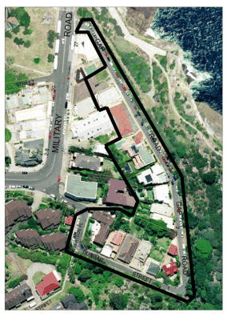
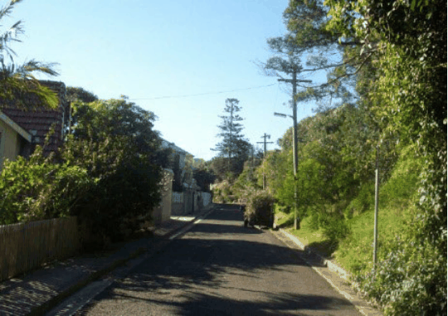
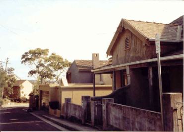
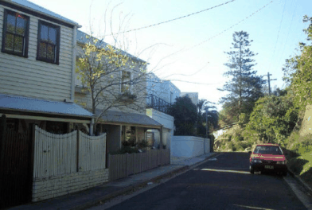
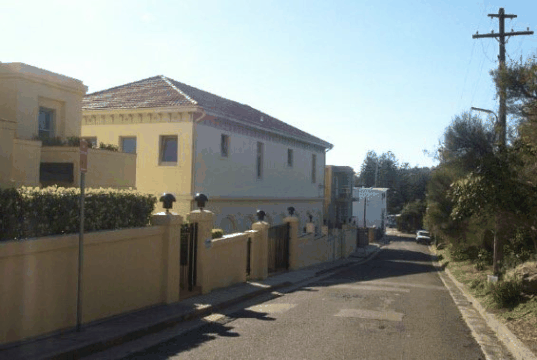
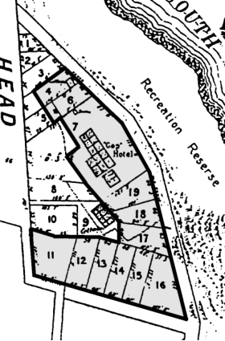
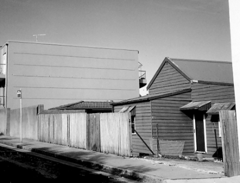
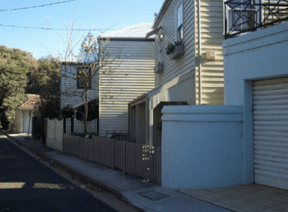
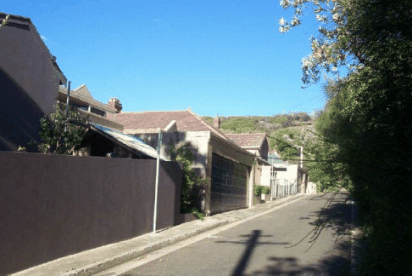
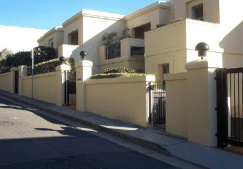

#### C3.4.5 Precinct E: Gap Road/Dunbar Street

#### Character statement

The precinct is bounded by the historic road alignments of the present Gap Road and Dunbar Street, along the boundaries of early land grants to the east and south. The development pattern provides evidence of the 1887 subdivision and development around the Gap Hotel, including the former Masonic Hall, built on the site of the demolished hotel.

The streetscape, enclosed by two narrow roads at the base of Gap Reserve, features buildings set close to the street on one side,  and a cliff face on the other. These are bordered by native plants at various stages of maturity among sandstone outcrops.

There are very few cultural plantings within the public domain, most being native plantings that have joined with existing native vegetation in Upper Gap Park above.

Contrasts between buildings create four visually distinctive components that contribute to the present character:

1\. Single storey cottages dating from the late 19th century to early-mid 20th century at the southern end of Gap Road and the north side of Dunbar Street (Figure 29).

2\. Two storey Victorian timber cottages on Gap Road (originally single storey) with later additions, built close to the street frontage, forming a small cohesive group (Figure 30).

3\. The rear of the former Masonic Lodge is at the north end of Gap Road and is surrounded by, two and three storey non-contributory residential and commercial buildings (Figure 31).

4\. An early Federation, single storey timber cottage at the rear of 25 Military Road (11 Gap Road), which also forms part of Precinct E, its setting diminished by the tall blank end walls of adjacent contemporary buildings (Figure 33).

Buildings are set behind a range of different fences that vary in height and materials. The streetscape is enhanced by vistas to the church spires and Upper Gap Park from Dunbar Street. The streetscape is disrupted by intrusive later buildings and structures, including unsympathetic garages along the street front.

FIGURE 27  Aerial view of the precinct FIGURE 28  Gap Road with Upper Gap Park at right

> [Picture on page 59: a picture, saved as a picture (images/chapter-c3-watsons-bay-heritage-conservation-area-page-59-2.gif, 150 dpi).]

> [Picture on page 59: a picture, saved as a picture (images/chapter-c3-watsons-bay-heritage-conservation-area-page-59-3.gif, 150 dpi).]

#### FIGURE 29

Single storey cottages on Dunbar Street

> [Picture on page 59: a picture, saved as a picture (images/chapter-c3-watsons-bay-heritage-conservation-area-page-59-6.gif, 150 dpi).]

FIGURE 30  Group of two storey Victorian

timber cottages on Gap Road

> [Picture on page 59: a picture, saved as a picture (images/chapter-c3-watsons-bay-heritage-conservation-area-page-59-9.gif, 150 dpi).]

#### FIGURE 31

Rear of the former Masonic Lodge with residential flats adjacent

> [Picture on page 59: a picture, saved as a picture (images/chapter-c3-watsons-bay-heritage-conservation-area-page-59-12.gif, 150 dpi).]

FIGURE 32  Extract from the 1887

‘Watsons Bay’ subdivision plan

> [Picture on page 59: a picture, saved as a picture (images/chapter-c3-watsons-bay-heritage-conservation-area-page-59-15.gif, 150 dpi).]

FIGURE 33  Early Federation period weatherboard

cottage at the rear of 25 Military Road (11 Gap

Road)

> [Picture on page 60: a picture, saved as a picture (images/chapter-c3-watsons-bay-heritage-conservation-area-page-60-4.gif, 150 dpi).]

#### FIGURE 34

Two storey weatherboard cottages on Gap Road

> [Picture on page 60: a picture, saved as a picture (images/chapter-c3-watsons-bay-heritage-conservation-area-page-60-7.gif, 150 dpi).]

#### FIGURE 35

Single storey scale of built form in Dunbar Street

> [Picture on page 60: a picture, saved as a picture (images/chapter-c3-watsons-bay-heritage-conservation-area-page-60-10.gif, 150 dpi).]

#### FIGURE 36

Buildings in Gap Road North

> [Picture on page 60: a picture, saved as a picture (images/chapter-c3-watsons-bay-heritage-conservation-area-page-60-13.gif, 150 dpi).]

#### PRECINCT CONTROLS

The precinct specific controls supplement the general controls for development in Section C3.5. If there is an inconsistency between the precinct controls and the general controls, the precinct controls take precedence.

#### Topography and vegetation

C1 New development is not to alter the existing scale relationships between the high natural ridge of Upper Gap Park on the east side and the lower scaled buildings below.

C2 Vehicular laybys and parking spaces are not to be carved out of the public reserve sides of the streets.

C3 No street verge plantings are to be introduced within this precinct as the roads and footpaths are too narrow.

#### Townscape

C4 The remaining subdivision pattern is to be retained, including the width and depth of allotments. This will provide evidence of the 1887 subdivision around the Gap Hotel (Figure 32).

C5 The visual prominence of the rear of the former Masonic Lodge is to be retained.

#### Views and vistas

C6 The height of new buildings, and additions to existing buildings, is to be limited in order to ensure that public views are retained over roofs from Gap Park to the harbour including views from the former tram corridor.

C7 Roofscapes are to remain uncluttered by intrusive structures or services such as satellite dishes and air conditioners, in order not to detract from views from Gap Park over the precinct to the harbour.

C8 Fences adjoining the timber cottage at the rear of 25 Military Road (11 Gap Road) are to be sufficiently transparent to retain views to this item.

#### Contributory items

Note: Heritage items as identified in Schedule 5 of Woollahra LEP 2014 are also contributory items. Refer to clause 5.10 of the LEP for heritage conservation controls.

| Contributory items |  |
|---|---|
| 2 Dunbar Street | Single storey Victorian weatherboard cottage |
| 4 Dunbar Street | Single storey semi -detached Edwardian dwelling |
| 5 Dunbar Street | Single storey semi-detached Edwardian dwelling |
| 2 Gap Road | Single storey Victorian weatherboard semi-detached dwelling extended to 2 storey |
| 3 Gap Road | Single storey Victorian weatherboard semi-detached dwelling extended to 2 storey |
| 4 Gap Road | Single storey Victorian weatherboard semi -detached dwelling extended to 2 storey |
| 8 Gap Road | 2 storey Federation Italian renaissance styled former Masonic lodge |

C9 Contributory items (i.e. heritage items and contributory items) are to be retained.

C10  Changes to contributory items is limited to sympathetic alterations and additions consistent with the controls in Section C3.6.

#### Built form

The following controls apply to new dwellings, or the main new building on the site. Separate controls apply to secondary structures such as new garages, carports, ancillary buildings and the like.

#### Building siting and alignment

Streetfront and side boundaries – Gap Road, south, and inclusive, of No.5 and the north side of Dunbar Street

C11  New buildings are to be set back in line with adjacent contributory items and provide for landscaped area in front yards behind fences or walls.

C12  The front walls of new buildings are to be orientated parallel with the street frontage, in order to distinguish the group of early cottages on Gap Road.

Streetfront and side boundaries – Gap Road, north of No 5, commencing at No. 6

C13  New buildings are to be set back to match or stand behind the front wall of the former Masonic Lodge in order to maintain its visual prominence in the streetscape, with the exception of the corner site, which should be built to the street alignment.

Rear setbacks

C14  The rear alignment of buildings is to be similar to adjacent development and maintain the amenity of neighbouring residential property.

#### Building height

C15  Building height is not to exceed two storeys and is not to visually disrupt the cliff line when viewed from the Harbour.

Gap Road south, and inclusive, of No.5 and the north side of Dunbar Street.

C16  Any new buildings on Gap Road are to relate sympathetically to the scale of the significant timber cottage.

C17  A single storey scale is to be maintained along Dunbar Street, as viewed from the street, to relate sympathetically to the established scale of the streetscape.

Gap Road, north of No. 5, commencing at No 6

C18  New buildings on the west side of Gap Road, are to be within the height plane established by the eaves line of the former Masonic Lodge, in order to retain its visual prominence in the streetscape (Figure 33).

C19  The height of development is to be stepped down to two storeys on the lot adjoining the timber cottage (rear of 25 Military Road) to provide a transition in scale between the three storey and single storey building.

#### Building form

Gap Road south, and inclusive, of No.5 and the north side of Dunbar Street

C20 The form and scale of new buildings is to respect the massing of adjacent significant dwellings. Traditional pitched roof forms, such as hips and gables, are to be used.

Gap Road, north of No.5, commencing at No. 6

C21  Rectilinear or cubic forms are to be used to relate to the established character (Figure 36).

C22  The mass of new buildings is to be broken up to avoid long uninterrupted parapet lines.

C23  The mass of side walls is to be broken up adjacent to contributory items including the weatherboard cottage, to avoid large blank walls, and to provide an appropriate setting for the cottage (Figure 33).

#### Building character

Gap Road south, and inclusive, of No.5 and the north side of Dunbar Street

C24  New buildings are to relate to the character established by adjacent significant detached and semi -detached dwellings.

Gap Road, north of No.5, commencing at No 6

C25  New buildings are to relate to the character established by the well-articulated dwellings and residential flats (Figure 36).

#### Building materials and details

C26  The following materials are appropriate for new buildings:

a) Walls: Painted or exposed weatherboards for dwellings, or rendered and painted brickwork or masonry for larger buildings.

b) Pitched roofs for small dwellings: corrugated steel, slate, tiles in unglazed terracotta or dark earth tones.

#### Landscaping and site coverage

C27  Planting should be carefully selected to ensure that the mature height and canopy spread will not be excessive and will not block views to the harbour from the adjacent Gap Park. Refer to Section 3.5.6 Landscaping and private open space.

C28 The building footprint plus paved surfaces (patios, pathways, tennis courts and swimming pools together) are not to exceed 80% of the site area. This is in order to provide 20% of the site area for landscaped area, including plantings.

Residential flat buildings, manor houses, multi dwelling housing and multi dwelling housing (terraces)

C29  For residential flat buildings, manor houses, multi dwelling housing (terraces) and multi dwelling housing, the building footprint plus paved surfaces (patios, pathways, tennis courts and swimming pools together) are not to exceed 70% of the site. This is area in order to provide 30% of the site area for landscaped area, including plantings.

#### Fences and walls

Gap Road south, and inclusive, of No.5 and the north side of Dunbar Street

C30  Front fences are to be 1.2m max in height. Materials and detailing are to be in keeping with the building to which they relate, including rendered and painted masonry and wooden pickets, where relevant.

Gap Road north of No.5, commencing at No.6

C31 Fences are to be articulated masonry walls, 1.5m maximum in height, with 50% transparency above 1.2m in height.

Rear boundary fences

C32  Rear boundary fences, where the rear boundary is not at street frontage, are to be 1.8m maximum traditional timber paling fences or rendered masonry walls.

#### Car parking and access

C33  Garages and carports are not to be built to street alignment, and are to be set back behind the building whether attached or free-standing. The exception to this condition is the timber weatherboard cottage at the rear of 25 Military Road, which is subject to heritage considerations.

#### Site facilities and aerial devices

C34  Site servicing to commercial buildings on Military Road that do not have access to Gap Road to be provided from kerbside parking in Military Road.
