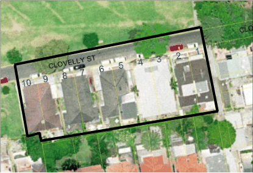
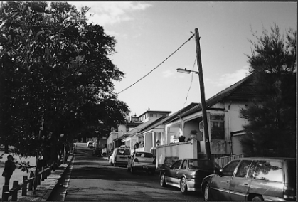
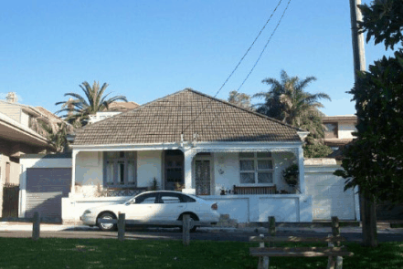
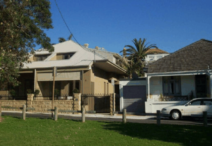
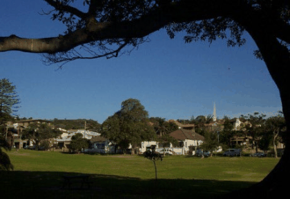
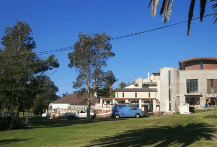
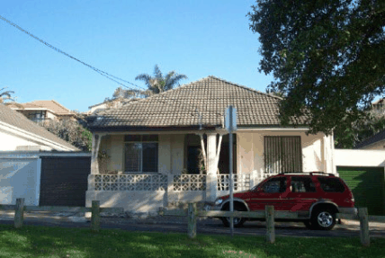

#### C3.4.6 Precinct F: Clovelly Street

#### Character statement

The precinct extends from the rear of the commercial building at the corner of Military Road and encompasses the residential properties on the south side of Clovelly Street. Two distinct groups of one and two storey buildings form a low-scaled built edge to the adjacent major landscaped open spaces, Robertson Park and Robertson Place.

The groups, set back slightly from the street frontage and stepping down toward the open space around Dunbar House, establish a repetitive rhythm in the streetscape. Views to the water are filtered through the trees that line Robertson Park on the north side of the street (Figure 38).

The two groups comprise: A pair of two storey semi-detached dwellings that have been substantially altered at Nos. 1 and 2 Clovelly Street. They provide a transition in scale from the taller commercial building on the corner with Military Road to the single storey pairs of semi-detached dwellings further to the east. A group of single storey semi-detached dwellings (dating from 1908) with simple hipped roof and verandah form, that provide a sympathetic built edge to Robertson Park and define the curtilage of Dunbar House (Figure 39). Within this group is a pair of non-contributory newer semi-detached dwellings that have a different scale, form and character to contributory items in the group, particularly in oblique views (Figure 40).

Although altered, the form and detail of the original buildings can still be understood. There is potential to recover more of their original character by encouraging the removal of unsympathetic alterations and the reconstruction of missing elements.

FIGURE 37  Aerial view of the precinct

> [Picture on page 65: a picture, saved as a picture (images/chapter-c3-watsons-bay-heritage-conservation-area-page-65-24.gif, 150 dpi).]

FIGURE 38  Precinct streetscape

> [Picture on page 65: a picture, saved as a picture (images/chapter-c3-watsons-bay-heritage-conservation-area-page-65-26.gif, 150 dpi).]

FIGURE 39  One of three pairs of single storey semis

> [Picture on page 66: a picture, saved as a picture (images/chapter-c3-watsons-bay-heritage-conservation-area-page-66-2.gif, 150 dpi).]

FIGURE 40  One of three pairs of single storey

semis

> [Picture on page 66: a picture, saved as a picture (images/chapter-c3-watsons-bay-heritage-conservation-area-page-66-5.gif, 150 dpi).]

FIGURE 41  View from Robertson Park

> [Picture on page 66: a picture, saved as a picture (images/chapter-c3-watsons-bay-heritage-conservation-area-page-66-7.gif, 150 dpi).]

FIGURE 42  View from Robertson Place

> [Picture on page 66: a picture, saved as a picture (images/chapter-c3-watsons-bay-heritage-conservation-area-page-66-9.gif, 150 dpi).]

FIGURE 43  Side boundary setbacks

wide enough for parking at side of houses

> [Picture on page 66: a picture, saved as a picture (images/chapter-c3-watsons-bay-heritage-conservation-area-page-66-12.gif, 150 dpi).]

#### PRECINCT CONTROLS

The precinct specific controls supplement the general controls for development in Section C3.5. If there is an inconsistency between the precinct controls and the general controls, the precinct controls take precedence.

#### Topography and vegetation

C1 The planting of street trees in the footpath in front of the cottages is not permitted due to the narrow width of the pedestrian area and because street plantings on the south of Clovelly Road would obscure the cottages from Robertson Park detracting from their contribution to the streetscape.

#### Townscape

C2 The existing allotment size and configuration are to be kept in order that the early, small-scale ‘cottage’ character of the precinct remains.

C3 The low-scaled backdrop and transition to the parks formed by two groups of one and two storey buildings is to be retained (Figures 41 and 42).

C4 The overall consistency of housing is to be retained. This encompasses the repetitive rhythm of the two groups of buildings in the streetscape established by the building height, form, alignment and character, including the hipped roofs, open verandahs at ground floor and the side setbacks of the original single storey semi-detached dwelling, which are wide enough to accommodate parking (Figure 43).

C5 All original sandstone kerbing and guttering is to be retained in front of the cottages.

#### Views and vistas

C6 Roofs are to remain uncluttered by intrusive structures and services so as not to detract from public views from Robertson Park, or from views to the harbour from more elevated portions of the public domain above.

#### Contributory items

Note: Heritage items as identified in Schedule 5 of Woollahra LEP 2014 are also contributory items. Refer to clause 5.10 of the LEP for heritage conservation controls.

| Contributory items |  |
|---|---|
| 5 Clovelly Street | Single storey Edwardian semi-detached dwelling |
| 6 Clovelly Street | Single storey Edwardian semi-detached dwelling |
| 7 Clovelly Street | Single storey semi-detached dwelling |
| 8 Clovelly Street | Single storey semi-detached dwelling |
| 9 Clovelly Street | Single storey semi-detached dwelling |
| 10 Clovelly Street | Single storey semi-detached dwelling |

C7 Contributory items (i.e. including heritage items) are to be retained.

C8 The single storey semi-detached dwellings are to be retained, subject to detailed investigation of their historical significance, (particularly their association with Sir John Robertson.

C9 Change to  contributory items is limited to sympathetic rear alterations and additions consistent with the controls in Section C3.6.

#### Built form

The following controls apply to new dwellings, or the main new building on the site. Separate controls apply to secondary structures such as new garages, carports, ancillary buildings and the like.

#### Building siting and alignment

Streetfront and side boundaries

C10  Existing alignments within each group are to be matched, including the wide side boundary setbacks of the single storey semi-detached dwellings.

Rear setbacks

C11  New buildings are to relate to the existing setback pattern and maintain the amenity of neighbouring residential properties.

#### Building height

C12  New buildings are to match existing heights within each group.

#### Building form

C13  Streetscape continuity is to be retained by following established forms within each group.

#### Building materials and details

C14  The following materials are appropriate for new buildings:

a) Walls: rendered or painted brickwork or masonry.

b) Pitched roofs: slate or tiled to reflect original unglazed terracotta or in dark earth tones. No dormer or recessed balconies within the front roof form.

#### Landscaping and site coverage

C15 The building footprint plus paved surfaces (patios, pathways, tennis courts) and swimming pools together are not to exceed 80% of the site area in order to provide 20% of the site area for landscaped area, including plantings.

C16  Planting at the rear is to be small scaled to fit the small space available. Refer to Section 3.5.6 Landscaping and private open space.

#### Fences and walls

C17  Fencing on the street frontage is to be limited to 1.2m maximum height so as to retain views to and from dwellings. Existing sandstone base walls are to be retained.

C18  Rear and side fences are to be of 1.8m maximum traditional timber paling fences or preferably rendered, masonry walls.

C19  Side fencing facing Robertson Place is to be built with a sandstone base to 0.6m with maximum 1.5m timber paling above.

C20  Appropriate front fencing types are illustrated in Section 3.5.7 Fences and walls.

#### Car parking and access

C21  No new driveways are permitted from Clovelly Street.

C22 Existing driveway arrangements are to be retained for the single storey semi-detached dwelling (that is, parking within open carports at the side behind the front wall of the dwelling.
