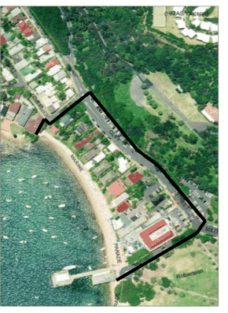
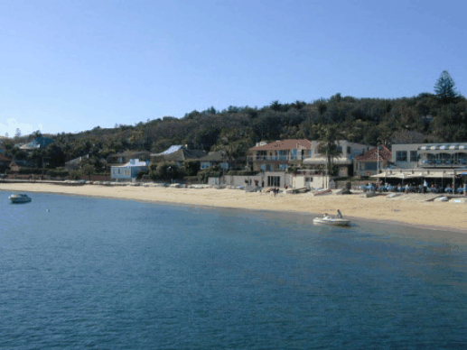
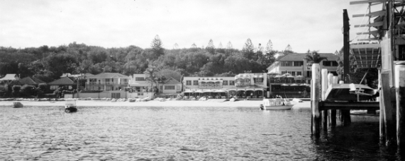
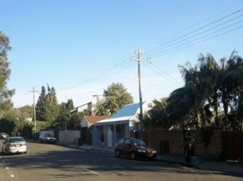
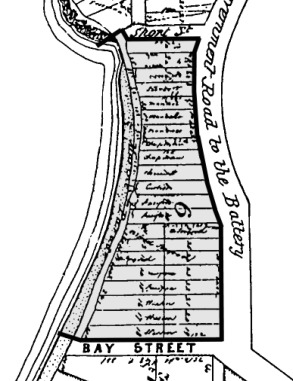
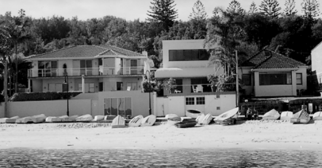
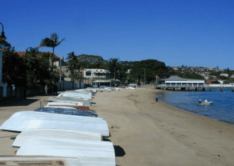
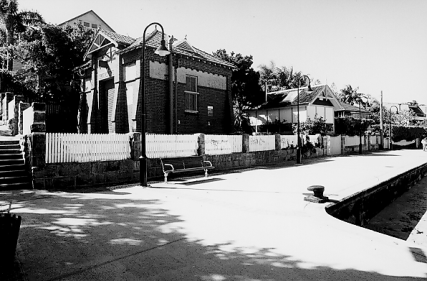
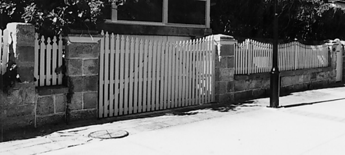

#### C3.4.7 Precinct G: Marine Parade North

#### Character statement

Part of ‘The Town of Watsons Bay’ subdivision in 1855, the precinct is bounded by Short Street to the north, Cliff Street to the east and Military Road to the south. The western boundary is formed by the waterfront promenade of Marine Parade which curves along a sandy beach contained by the wharf at its south end and a walled pedestrian link to Short Street at its north end.

Within the precinct is a range of mainly one and two storey 20th century housing on allotments of varied size and configuration, many of which can be traced back to the original subdivision. Houses generally have pitched roof forms, setbacks from side boundaries, and fenced garden space to the front and rear. Exceptions are the single storey Edwardian period Sydney Water Pumping Station at the northern end and the large Watsons Bay Hotel at the southern end of the precinct. The latter has recently been extended to three storeys, and has an adjacent restaurant. Both the hotel and pumping station are uncharacteristic, but nevertheless contributory to the historic values of the area.

Viewed from the harbour the houses are set behind a wide variety of promenade walls and fencing, backed by various types and heights of private planting (Figure 45). The houses are of relatively consistent height at ridgeline. Watsons Bay Hotel at the south end and the roof of No. 2 Short Street together with the adjacent ‘Portuguese Terraces in Cove Street at the north end form ‘bookends’ with the smaller houses in between The lower height of the buildings between the ‘bookends’ and the National Park ridgeline permits views of a deep landscaped backdrop of coral trees and National Park vegetation above the roofs (Figure 46).

Viewed from Cliff Street, the streetscape is dominated on the west side by a wide variety of fencing types, heights, materials and colours with some 2m high walls for garages that provide a dissonant edge to the west side of Cliff Street (Figure 47).  The street opens up to a large car park at the south end that breaks from the early subdivision pattern. Coral trees and sections of the sandstone cliff face within the National Park form a natural enclosure to the streetscape on the east side.

FIGURE 44  Aerial view of the precinct FIGURE 45  View of Marine Parade from the ferry wharf

> [Picture on page 70: a picture, saved as a picture (images/chapter-c3-watsons-bay-heritage-conservation-area-page-70-29.gif, 150 dpi).]

> [Picture on page 70: a picture, saved as a picture (images/chapter-c3-watsons-bay-heritage-conservation-area-page-70-30.gif, 150 dpi).]

FIGURE 46  View of precinct from

the water showing ‘bookend’ principle

> [Picture on page 71: a picture, saved as a picture (images/chapter-c3-watsons-bay-heritage-conservation-area-page-71-3.gif, 150 dpi).]

FIGURE 47  Cliff Street frontage

> [Picture on page 71: a picture, saved as a picture (images/chapter-c3-watsons-bay-heritage-conservation-area-page-71-5.gif, 150 dpi).]

FIGURE 48  Extract from 1855

‘Town of Watsons Bay’ subdivision plan FIGURE 49  Promenade wall

> [Picture on page 71: a picture, saved as a picture (images/chapter-c3-watsons-bay-heritage-conservation-area-page-71-8.gif, 150 dpi).]

> [Picture on page 71: a picture, saved as a picture (images/chapter-c3-watsons-bay-heritage-conservation-area-page-71-9.gif, 150 dpi).]

FIGURE 50  Dinghies located

on the edge of the promenade

> [Picture on page 71: a picture, saved as a picture (images/chapter-c3-watsons-bay-heritage-conservation-area-page-71-12.gif, 150 dpi).]

FIGURE 51  Water pumping station

at north end of Marine Parade

> [Picture on page 71: a picture, saved as a picture (images/chapter-c3-watsons-bay-heritage-conservation-area-page-71-15.gif, 150 dpi).]

FIGURE 52  Fencing along Marine Parade

> [Picture on page 72: a picture, saved as a picture (images/chapter-c3-watsons-bay-heritage-conservation-area-page-72-2.gif, 150 dpi).]

#### PRECINCT CONTROLS

The precinct specific controls supplement the general controls for development in Section C3.5. If there is an inconsistency between the precinct controls and the general controls, the precinct controls take precedence.

#### Topography and vegetation

C1 A landscaped edge is to be introduced between the car park and the commercial properties facing Cliff Street.

C2 Street trees are not to be planted within the narrow footpath on the west side of Cliff Street.

#### Townscape

C3 The small lot subdivision pattern is to be retained to respect the original 1855 subdivision (Figure 48).

C4 The height of existing buildings between the ‘bookends’ is to be maintained so that views from the harbour will retain a deep landscaped backdrop of coral trees and National Park vegetation.

C5 The ‘bookend’ height is not to be further extended into the precinct.

C6 The sense of enclosure within Cliff Street, formed by the natural features on the east side and fences and walls on the west side, is to be retained. The appearance of these fences and walls should be improved and upgraded when new development is proposed.

C7 The building of large expanses of car park and the amalgamation of sites for commercial development are not permitted. These would disrupt the historic, small-lot subdivision pattern for detached dwellings and detract from the townscape.

C8 Should redevelopment of a mixed use nature occur, residential uses should front Cliff Street and commercial or retail uses should front Military Road.

C9 Signage at the ferry wharf and within the hotel and restaurant complex is to be in accordance with the signage policy developed for the Military Road Commercial Centre (Precinct D).

C10  All sandstone kerbing and guttering near the corner of Cliff and Short Streets is to be retained.

C11  Sandstone retaining walls along the promenade are to be kept.

#### The waterfront

C12  Views of houses, roofs and gardens from promenade and Harbour are to be retained, unobstructed by high fences subject to privacy considerations.

C13  No new window openings are to be made in the boundary walls facing the Marine Parade promenade. When new development is proposed, existing glazed openings are to be modified to solid doors, gates, walls etc. so as to relate sympathetically to the maritime character as boatsheds, not shopfronts (Figure 49).

C14  No further increase is permitted in the existing height or bulk of the wharf building or the commercial buildings at the south end of the precinct.

C15  To prevent privatisation of the public domain, commercial development and related functions, where permissible) are to be contained within existing private property.

C16  To prevent privatisation of the public domain, the size of existing footpath areas leased for restaurant or other private uses should not be increased.

C17  All fittings and fixtures, including furniture visible from the promenade, beach or harbour, are to be of a high design quality.

C18  Commercial signs are not permitted in the public domain. Identification signs are to be discreet.

C19  Beached dinghies are permitted against the promenade edge provided these do not impede access within the public domain.

#### Views and vistas

C20  View sharing is to be retained, both within this precinct and with properties in adjacent precincts that overlook the precinct.

#### Contributory items (including heritage items)

Note: Heritage items as identified in Schedule 5 of Woollahra LEP 2014 are also contributory items. For the protection of heritage items refer to clause 5.10 of the LEP.

| Contributory items |  |
|---|---|
| 10 Marine Parade | 2 storey Art Deco styled hotel with third floor addition |
| 11-13 Marine Parade | 2 storey weatherboard restaurant with historic values |
| 18-19 Marine Parade | Single storey Inter-War semi-detached dwelling |
| 20-21 Marine Parade | Single storey Inter-War semi-detached dwelling |
| 22 Marine Parade | Single storey Victorian weatherboard cottage |

C21  Heritage items and contributory items are to be retained.

C22  Change to  contributory items is limited to sympathetic alterations and additions consistent with the controls in Section C3.6.

#### Alterations and additions to existing buildings

Watsons Bay Hotel and Doyle's Restaurant

C23  A conservation management plan is to be prepared for the Watsons Bay Hotel and the adjacent restaurant site. This should include consideration of master planning options and provide policies for appropriate future development of the sites, having regard to their heritage significance.

C24  Future proposals for alterations and additions are to comply with a conservation management plan adopted by Council.

#### Built form

The following controls apply to new dwellings, or the main new building on the site. Separate controls apply to secondary structures such as new garages, carports, ancillary buildings and the like.

#### Building siting and alignment

Front (waterfront) setbacks

C25  All buildings are to be setback from Marine Parade to provide for a garden space between the house and the promenade. The setback is to relate to the adjacent dwellings with the exception of the existing early cottage at No. 22 which is built to the Marine Parade boundary.

Streetfront setbacks – Cliff Street

C26  New buildings are to be set back two metres minimum from Cliff Street to provide for a garden space, either as a front or rear yard.

C27  A single garage may be built to the Cliff Street frontage provided it is integrated visually with the fence or wall and leaves 50% of the width of the street frontage for landscaped area to appear over the fence or wall.

Side boundary setbacks

C28  All buildings north of the existing Watsons Bay Hotel and Doyle's Restaurant buildings, including garages, are to be set back from side boundaries by 1.2m minimum (1.5m minimum for lots greater than 15m in width). This is in order to retain the detached dwelling character of the precinct and provide opportunity for views between the buildings to the harbour.

Rear setbacks

C29  Rear setbacks are to relate to the existing setback pattern, to provide rear yard space and maintain the amenity of neighbouring residential property.

#### Building height

C30  Buildings are to be a maximum of two storeys, with roofs pitched to match traditional forms.

C31  The overall height of new buildings, measured to the ridgeline, is not to exceed the predominant height of existing buildings between the ‘bookends’ when viewed from the harbour.

#### Building form

C32  New buildings are to follow the established forms of housing north of Doyle's Restaurant. These are small scale, rectilinear buildings of traditional form with pitched roofs.

C33  Flat roofed, or parapeted, buildings are not permitted.

C34  Roof ridgelines are to be parallel to side boundaries in order to minimise the visual impact of the roofs on public views and when viewed from Marine Parade or the waterfront.

#### Building character

C35  The architectural treatment of new buildings is not to contrast markedly with the established character of the area.

C36  New buildings on lots adjacent to the existing Watsons Bay Hotel and Doyle’s Restaurant buildings are to relate to the detached dwelling character of the precinct and not to the commercial buildings.

C37  The following materials are appropriate for new buildings:

a) Walls: weatherboard, exposed brickwork or rendered or painted brickwork or masonry.

b) Roofs: corrugated steel, slate, or tiles in unglazed terracotta or dark earth tones.

#### Landscaping and site coverage

C38  The building footprint plus paved surfaces (patios, pathways, tennis courts) and swimming pools together are not to exceed 75% of the site area in order to provide 25% of the site area for landscaped area, including plantings.

C39  Mature historic plantings are to be retained.

C40  In this relatively old cultural landscape, native species other than blueberry ash and lillypilly are not permitted. Refer to Section 3.5.6 - Landscaping and private open space.

#### Fences and walls

Marine Parade

C41  Fence heights are to be a maximum 1200mm above promenade level, or, where privacy from the promenade is an issue, up to 1.8m maximum with 50% transparency above 1.2m. Materials should be sandstone or face brick or rendered or painted masonry in keeping with building to which it relates (Figure 52).

Short Street and Cliff Street

C42  Fences are to be a maximum of 1.5m above footpath level, with 50% transparency above 1.2m. Materials should be traditional timber pickets, brick or masonry, rendered or painted as appropriate to building.

C43  Garages, driveway doors and pedestrian gates are to be designed as an integral part of the fence or wall. Brick or rendered masonry garages without lofts may be combined with timber fences.

Military Road

C44  Fences are to be low height walls, 1.2m maximum above footpath level and constructed from materials and style appropriate to the building.

Rear and side fences (when not street fronting)

C45  Fences are to be traditional timber paling fences no greater than 1.8m in height.

#### Car parking and access

C46  A maximum of one single garage or vehicular access door is permitted, plus one pedestrian door per property on the Cliff Street frontage.

C47  Servicing of waterfront properties is to be via existing driveways/right of ways.
