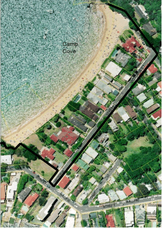
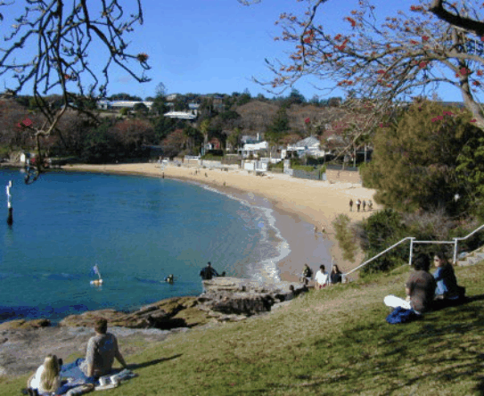
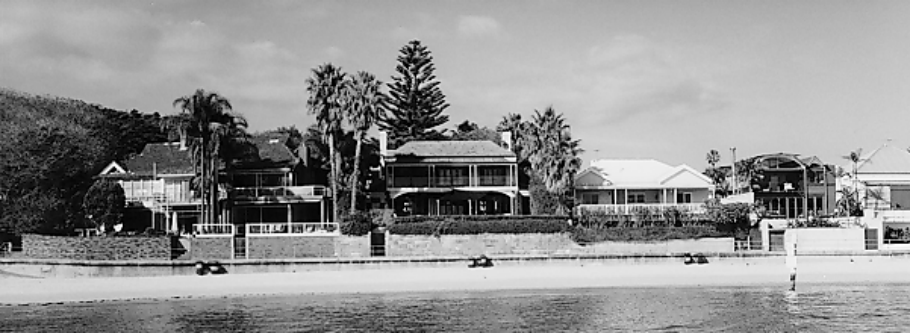
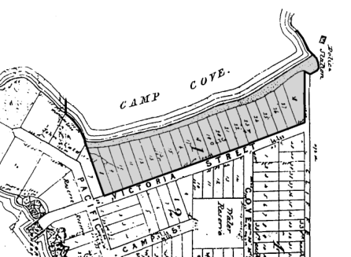
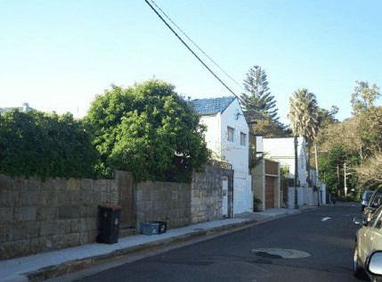
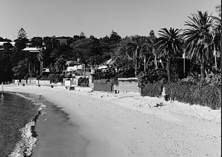
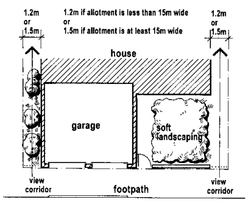
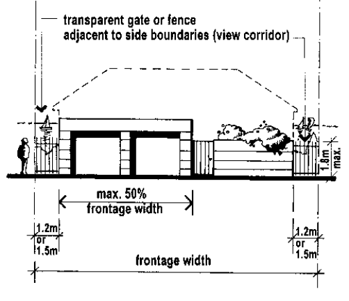
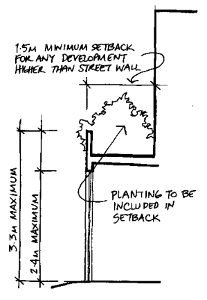

#### C3.4.8 Precinct H: Victoria Street Waterfront

#### Character statement

Part of the 1855 ‘The Town of Watsons Bay’ subdivision, , the precinct is bounded by Cliff Street, Victoria Street and the Marine Biological Research Station, together with the water frontage of Camp Cove Beach. Camp Cove Beach is enclosed by the knoll of Green (Laings) Point to the south and the Sydney Harbour National Park to the north (Figure 52).

The precinct contains a variety of mostly detached one and two storey houses on separate allotments, including a number of early buildings. The original subdivision pattern was not fully realised, however, there are a number of allotments of a consistent size that provide evidence of the original layout.

Buildings are viewed from the water against a deep backdrop of coral trees and National Park vegetation. A number of buildings within HMAS Watson detract from the backdrop, especially the long, new buildings situated along the ridge top. Early buildings with traditional verandahs and pitched roofs, enhance the maritime character.

The setting of the houses is also enhanced by cultural plantings, including Norfolk Island pines and palms, within walled front yards facing the beach and occasionally in the rear or Victoria Street garden areas (Figures 54 and 55). Viewed from Victoria Street, the high walls and dwellings/garages built to the street frontage give a built edge to the east side, softened by pockets of planting within yards. The high impermeable walls detract from the streetscape. A number of buildings with garages, including two storey structures, extend to Victoria Street alignment with no space for landscaping to soften their visual impact.

#### FIGURE 53

Aerial view of the precinct

> [Picture on page 77: a picture, saved as a picture (images/chapter-c3-watsons-bay-heritage-conservation-area-page-77-24.gif, 150 dpi).]

#### FIGURE 54

Camp Cove beach from  Green (Laings) Point Reserve

> [Picture on page 77: a picture, saved as a picture (images/chapter-c3-watsons-bay-heritage-conservation-area-page-77-27.gif, 150 dpi).]

FIGURE 55  Traditional building forms enhanced by cultural plantings at east end of Camp Cove Beach

> [Picture on page 78: a picture, saved as a picture (images/chapter-c3-watsons-bay-heritage-conservation-area-page-78-2.gif, 150 dpi).]

FIGURE 56  Extract from 1855

‘Town of Watsons Bay’ subdivision plan

> [Picture on page 78: a picture, saved as a picture (images/chapter-c3-watsons-bay-heritage-conservation-area-page-78-5.gif, 150 dpi).]

FIGURE 57  Victoria Street frontage

> [Picture on page 78: a picture, saved as a picture (images/chapter-c3-watsons-bay-heritage-conservation-area-page-78-7.gif, 150 dpi).]

FIGURE 58  Camp Cove Beach frontage

> [Picture on page 78: a picture, saved as a picture (images/chapter-c3-watsons-bay-heritage-conservation-area-page-78-9.gif, 150 dpi).]

FIGURE 59  Side boundary setbacks

> [Picture on page 78: a picture, saved as a picture (images/chapter-c3-watsons-bay-heritage-conservation-area-page-78-11.gif, 150 dpi).]

#### FIGURE 60

Garages on Victoria Street frontage

> [Picture on page 79: a picture, saved as a picture (images/chapter-c3-watsons-bay-heritage-conservation-area-page-79-3.gif, 150 dpi).]

FIGURE 61  Maximum heights

and setbacks for street walls

> [Picture on page 79: a picture, saved as a picture (images/chapter-c3-watsons-bay-heritage-conservation-area-page-79-6.gif, 150 dpi).]

#### PRECINCT CONTROLS

The precinct specific controls supplement the general controls for development in Section C3.5. If there is an inconsistency between the precinct controls and the general controls, the precinct controls take precedence.

#### Topography and vegetation

C1 Significant cultural plantings in properties along the beachfront are to be retained.

C2 New plantings are to be appropriate in scale to available space.

C3 The likely mature size of canopies of proposed plantings are to be taken into account and those that may obscure views to the HMAS Watson bushland and tree lined ridge and National Park from the Harbour are not permitted.

#### Townscape

C4 New site development is to be sited to achieve three visually distinct zones similar to most properties, that is:

a) landscaped setback at beachfront;

b)  building zone of one and two storey detached houses with setbacks from side boundaries; and

c) landscaped edge to Victoria Street.

C5 The predominant existing pattern of detached dwellings on separate allotments is to be retained to respect the existing subdivision and development pattern.

C6 The general scale established by existing buildings is to be maintained to retain views from the water of the backdrop of coral trees and National Park vegetation.

C7 New development is to increase permeability from the street to the water and provide a view corridor to the Harbour along the sides of the building.

C8 All sandstone kerbing and guttering within Victoria Street is to be retained.

C9 When the opportunity arises, the Camp Cove kiosk should be relocated to open the view corridor to the beach from the north-west end of Cliff Street.

#### The waterfront

C10  Front gardens are to be landscaped to soften the impact of buildings.

C11  Boundary walls facing the beach are to be kept low and softened by landscaping behind (refer to Section 3.5.7 Fences and Walls).

C12  Elements that evoke an early maritime character are to be retained, including traditional verandahed building forms, pitched and hipped corrugated steel or tiled roofs, chimneys and cultural plantings.

C13  Unless shaded, no reflective materials are permitted, including glass balustrades.

C14  New public or private jetties are not permitted along Camp Cove beachfront.

#### Contributory items

Note: Heritage items as identified in Schedule 5 of Woollahra LEP 2014 are also contributory items. For the protection of heritage items refer to clause 5.10 of Woollahra LEP 2014.

| Contributory items |  |
|---|---|
| Off Camp Cove Beach | Tide Gauge Building 1925 small timber structure off NE end of Camp Cove Beach [SREP 23] |
| 7 Victoria Street | Palms in beachfront garden, Norfolk Island pine in Victoria Street garden |
| 15 Victoria Street | Edwardian semi-detached dwelling, palms in beachfront garden |
| 17 Victoria Street | Edwardian semi-detached dwelling, coral tree in beachfront garden |
| 19 Victoria Street | Palms and coral tree in beachfront garden |
| 21 Victoria Street | Single storey Edwardian cottage, palms in beachfront garden |
| 23 Victoria Street | Palms and Norfolk Island pine in beachfront garden |
| 25 Victoria Street | Norfolk Island pines in beachfront garden |

C15  Heritage items and contributory items are to be retained.

C16  Change to  contributory items is limited to sympathetic alterations and additions consistent with the controls in Section C3.6.

#### Built form

The following controls apply to new dwellings, or the main new building on the site. Separate controls apply to secondary structures such as new garages, carports, ancillary buildings and the like.

#### Building siting and alignment

Streetfront setbacks

C17  The main part of the house is to follow the alignment of adjacent buildings and provide garden space between the Victoria Street wall and the house.

Side boundary setbacks

C18  All new buildings, including garages, are to be set back from side boundaries a minimum of 1.2m (1.5m on allotments greater than 15m in width) in order to retain the detached dwelling character of the precinct and allow for recovery of views to Camp Cove from Victoria Street (Figure 59).

Front (waterfront) setbacks

C19  Building setbacks from the waterfront are to relate to the alignment of adjacent significant houses provided that a garden space or lawn area is retained.

#### Building height

C20  Buildings are to be two storeys maximum so as not to block views to the National Park from the Harbour and to retain a consistency of height when viewed from the Harbour.

#### Building form

C21  Traditional forms are to be followed, i.e. simple rectilinear plan with pitched and hipped roofs and verandahs facing the waterfront (Figures 55 and 57).

C22  Flat or curved roofed buildings are not permitted.

#### Building character

C23  New development is to respect the character of adjacent contributory items when viewed from the Harbour.

#### Building materials and details

C24  The following materials are appropriate for new buildings:

a) Walls: weatherboards, sandstone, masonry or exposed, rendered or painted brickwork.

b) Roof cladding: corrugated steel, slate, or tiled in unglazed terracotta or dark earth tones.

#### Landscaping and site coverage

C25  The building footprint plus paved surfaces (patios, pathways, tennis courts and swimming pools) together are not to exceed 75% of the site area in order to provide 25% of the site area for landscaped area, including plantings.

C26  A mix of tiered planting, comprising small canopied trees, shrubs, herbaceous plants and ground covers, is preferred. Refer to Section 3.5.6 Landscaping and private open space.

#### Fences and walls

Camp Cove Beach

C27  Wall heights facing Camp Cove Beach are to be a maximum 1.2m, or, where privacy from the beach is an issue, up to 1.8m maximum with 50% visual permeability above 1.2m. They should be softened by landscaping. Appropriate materials are sandstone or rendered/painted masonry to minimise its visual impact on the beach. Glazing or reflective materials are not to be used.

Victoria Street

C28  A fence or wall is to be built along the street front boundary.

C29  Fences or walls on the street front boundary are to be 1.8m in height and are to be designed in accordance with the criteria in Figures 59 and 60. Appropriate materials are sandstone or rendered/painted masonry.

C30  Fences or walls fronting Victoria Street are to have transparent end panels adjacent to the side boundary of each property. The transparent panels are to be at least as wide as the minimum required setbacks for buildings, i.e. 1.2m for allotments up to 15m wide and 1.5m for allotments over 15m wide (measured at street frontage).

C31  At least 50% of the street frontage width is to be landscaped behind the front fence wall.

C32  Garage, driveway doors and pedestrian gates on the street alignment are to be designed as an integral part of the street wall (Figures 59 and 60).

C33  The design and materials of front fences and walls are to be compatible with appropriately designed fences in the streetscape and the heritage context of the area. Unsympathetic fences, walls and gates are to be removed and replaced with fences of traditional height and appropriate to the architectural style of the building.

Cliff Street

C34  Fences and walls facing Cliff Street are to be a maximum 1.8m in height and to be constructed in traditional timber paling or, preferably rendered, masonry.

C35  Side fences are to be traditional timber paling of a maximum 1.8m in height, reducing to 1.2m at the building alignment.

#### Car parking and access

C36 A maximum two car width single storey garage or carport structure may be built to the Victoria Street frontage provided that it is visually integrated with the street wall (Figure 60).

C37  The total street frontage width of garage or carport structures is to be no greater than 50% of the street frontage width of the property.

C38  Garages to the street frontage are to be 3.3m maximum in height. Any higher development is to be set back 1.5m from the street wall (Figure 61).
