#### C3.4.9 Precinct J: Pacific Street Waterfront

#### Character statement

Part of the 1855 subdivision, the precinct is bounded by Green Point Reserve, Pacific Street and Short Street, with water frontage to Watsons Bay (Figure 62). It contains substantial two storey waterfront houses, including a number of early buildings (Figure 63). Most lots retain their original, or early, configuration, with a number varying in width to take up the change in direction in the street.

Viewed from the Harbour against a backdrop of National Park vegetation visible above the roofs, buildings are relatively consistent in massing and height, with the exception of an intrusive residential flat building adjoining the Victoria Wharf Reserve.

Viewed from Pacific Street, a variety of pitched roofs appear above walls, fences and garages that create a built edge along the south side of Pacific Street. This is occasionally softened by pockets of landscaping whilst high, impermeable walls detract from the streetscape (Figure 64).

Many properties have large jetties extending out over rock shelves within the dry land area that forms part of the properties.  These detract from the waterfront setting of the precinct (Figure 65).

The precinct contains only one area of open space, the Victoria Wharf Reserve. This is the site of the original wharf and is a viewing platform to the city and back along Victoria Street to the vegetated ridge on which HMAS Watson is located.

FIGURE 62  Aerial view of the Precinct FIGURE 63  Pacific Street waterfront from the harbour

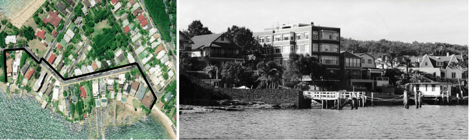

> [Picture on page 84: a picture, saved as a picture (images/chapter-c3-watsons-bay-heritage-conservation-area-page-84-21.gif, 150 dpi).]

FIGURE 64  Pacific Street Precinct at left,

with high walls forming built edge to the street.

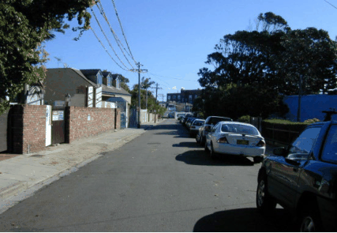

> [Picture on page 85: a picture, saved as a picture (images/chapter-c3-watsons-bay-heritage-conservation-area-page-85-3.gif, 150 dpi).]

FIGURE 65  Jetties within the Pacific Street Precinct,

extending out over rockshelves

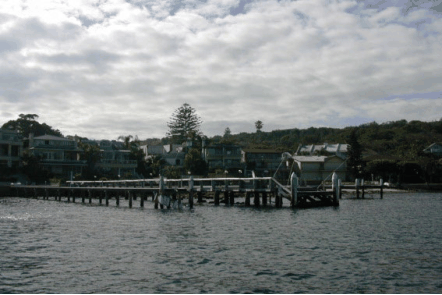

> [Picture on page 85: a picture, saved as a picture (images/chapter-c3-watsons-bay-heritage-conservation-area-page-85-6.gif, 150 dpi).]

FIGURE 66  View across the harbour

to the city from Victoria Wharf Reserve

FIGURE 67  Extract from 1855

‘Town of Watsons Bay’ subdivision plan

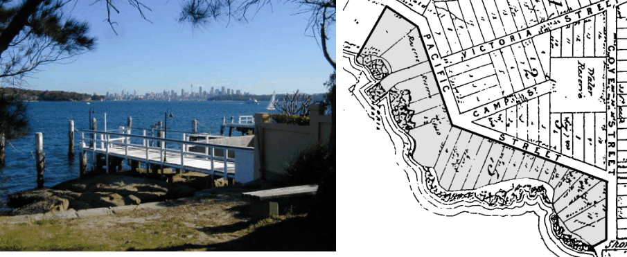

> [Picture on page 85: a picture, saved as a picture (images/chapter-c3-watsons-bay-heritage-conservation-area-page-85-11.gif, 150 dpi).]

FIGURE 68  Views to and from

adjacent precincts and beyond

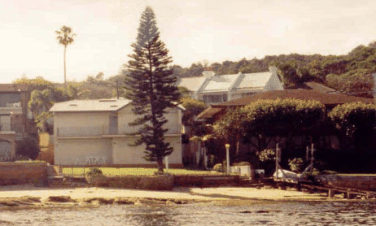

> [Picture on page 85: a picture, saved as a picture (images/chapter-c3-watsons-bay-heritage-conservation-area-page-85-14.gif, 150 dpi).]

FIGURE 69  Existing building heights

along Pacific Street waterfront

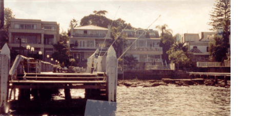

> [Picture on page 85: a picture, saved as a picture (images/chapter-c3-watsons-bay-heritage-conservation-area-page-85-17.gif, 150 dpi).]

FIGURE 70  Garages on street frontage

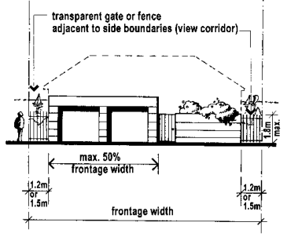

> [Picture on page 86: a picture, saved as a picture (images/chapter-c3-watsons-bay-heritage-conservation-area-page-86-2.gif, 150 dpi).]

FIGURE 71  Side boundary setbacks

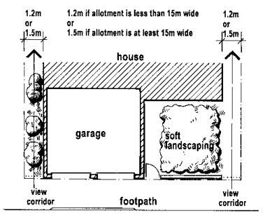

> [Picture on page 86: a picture, saved as a picture (images/chapter-c3-watsons-bay-heritage-conservation-area-page-86-4.gif, 150 dpi).]

FIGURE 72  Garages (at right) integrated with street

wall

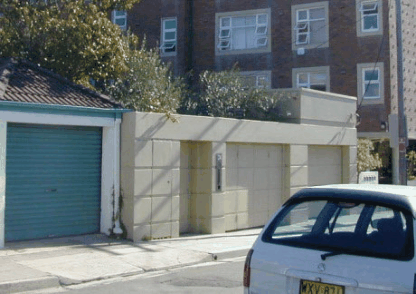

> [Picture on page 86: a picture, saved as a picture (images/chapter-c3-watsons-bay-heritage-conservation-area-page-86-7.gif, 150 dpi).]

FIGURE 73  Introduce permeability to walls and

fences

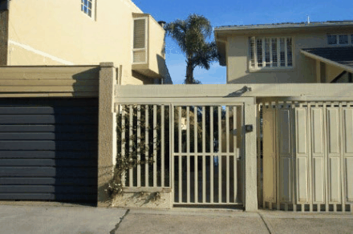

> [Picture on page 86: a picture, saved as a picture (images/chapter-c3-watsons-bay-heritage-conservation-area-page-86-10.gif, 150 dpi).]

FIGURE 74  Maximum heights and setbacks for street walls

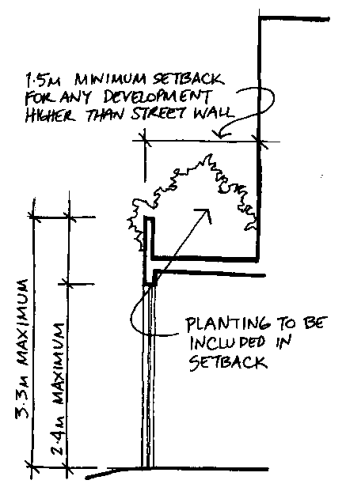

> [Picture on page 87: a picture, saved as a picture (images/chapter-c3-watsons-bay-heritage-conservation-area-page-87-2.gif, 150 dpi).]

#### PRECINCT CONTROLS

The precinct specific controls supplement the general controls for development in Section C3.5. If there is an inconsistency between the precinct controls and the general controls, the precinct controls take precedence.

#### Topography and vegetation

C1 The existing landform of ridge, slope and rock platform down to the low water mark is to be maintained.

C2 Excavation or filling of the rock platform is not permitted for any purpose, including the creation or construction of swimming pools or footings for jetties or boat ramps.

C3 The intertidal zone within private property boundaries is not to be developed.

C4 Mature historic plantings are to be retained within the grounds of early properties.

C5 For new plantings, trees are to be selected that are appropriate in scale to available space.

C6 The likely mature canopy size of proposed plantings is to be taken into account. Those that may obscure views to the HMAS Watson ridge and Sydney Harbour National Park from the adjacent Marine Parade North precinct, the Ferry Wharf and harbour ferries are not permitted.

C7 Palms are not to comprise more than 25% of site plantings. Cocos palms are not to be used, though Howea, Bangalay and Cabbage Tree palms are permitted.

#### Townscape

C8 New site development is to be sited to achieve three visually distinct zones similar to most existing properties, that is:

a)  a rockshelf/front yard at the waterfront;

b) a building zone for detached houses with setbacks from side boundaries; and

c) a zone for landscaping adjacent to the street.

C9 The pattern of relatively consistently scaled detached dwellings on separate lots is to be retained to respect the original subdivision layout (Figure 67).

C10  The general scale established by existing buildings is to be maintained so that the backdrop of national park vegetation above roofs  as viewed from the water will to be retained,.

#### The waterfront

C11  New jetties or any structures such as decking, boatsheds and cabanas, are not to be erected over the rock shelf within the inter tidal zone of private properties.

C12  To improve the visual amenity of the Harbour, the rationalisation, and sharing between neighbours of existing long jetties is encouraged.

C13  Construction of swimming pools on the rockshelf is not permitted.

#### Views and vistas

C14  View sharing with properties in adjacent precincts is to be retained. Examples are the views from the first floor of the ‘Portuguese terraces’ (Figure 66) and from the upper floors of buildings on the north side of Pacific Street.

#### Contributory items

Note: Heritage items as identified in Schedule 5 of Woollahra LEP 2014 are also contributory items. For the protection of heritage items refer to clause 5.10 of the LEP.

| Contributory items |  |
|---|---|
| 12 Pacific Street | Single storey Victorian weatherboard cottage with attic. Two storeys at waterfront. |
| 14-14a Pacific Street | 2 storey Victorian weatherboard house |
| 16 Pacific Street | 2 storey Victorian weatherboard house |
| 18 Pacific Street | 2 storey contemporary house |
| 30 Pacific Street | 2 storey Federation house |
| Victoria Street Reserve | Site of landing stage to early western jetty |
| 2 Cove Street | Sandstone rock shelves |

| Contributory items |  |
|---|---|
| 4 Cove Street | Sandstone rock shelves |
| 6 Cove Street | Sandstone rock shelves |
| 2a Pacific Street | Sandstone rock shelves |
| 2 Pacific Street | Sandstone rock shelves |
| 4 Pacific Street | Sandstone rock shelves |
| 6 Pacific Street | Sandstone rock shelves |
| 8 Pacific Street | Sandstone rock shelves |
| 10-12 Pacific Street | Sandstone rock shelves |

C15   Heritage items and contributory items are to be retained.

C16  Change to the contributory items is to be limited to sympathetic alterations and additions consistent with the controls in Section C3.6.

#### Built form

The following controls apply to new dwellings, or the main new building on the site. Separate controls apply to secondary structures such as new garages, carports, ancillary buildings and the like.

#### Building siting and alignment

Streetfront setbacks

C17  The setback of the main part of the house is to correspond to the alignments of adjacent contributory items and allow for garden space between the street wall and the house.

Side boundary setbacks

C18  All buildings, including garages built to the street alignment, are to be set back from side boundaries 1.2m minimum for allotments up to 15m in width (measured at street frontage) and 1.5m for allotments greater than 15m in width. This will retain the detached dwelling character of the precinct and to provide for view corridors to the Harbour along sides of buildings (see Figure 70).

Rear (waterfront) setbacks

C19  Building setbacks from the waterfront are to match the alignment of adjacent significant houses and provide garden space or lawn area between the rockshelf and the house.

#### Building height

C20  Buildings are limited to two storeys so as not to block views to the national park from the harbour and to retain a consistency of height when viewed from the Harbour.

#### Building form

C21  Established building forms are to be followed, i.e. simple rectilinear plan forms with pitched roofs.

C22  Roof ridgelines are to be parallel to side boundaries in order to minimise the visual impact of roofs on views and when viewed from the street and the waterfront.

C23  No flat-roofed buildings or reverse skillions are permitted.

#### Building character

C24  The architectural style of new buildings is not to stand out in marked contrast to the established character of the area.

C25  The design of new buildings is to respect the character of adjacent contributory items when viewed from the harbour.

#### Building materials and details

C26  The following materials are appropriate for new buildings:

a) Walls: face, rendered or painted brickwork or masonry.

b) Roof cladding: slate, or tiled in unglazed terracotta or dark earth tones.

#### Landscaping and site coverage

C27  The building footprint plus paved surfaces (patios, pathways, tennis courts) and swimming pools together are not to exceed 75% of the site area in order to provide 25% of the site area for landscaped area, including plantings.

C28  A mix of tiered planting, comprising small canopied trees, shrubs, herbaceous plants and ground covers, is to be achieved. Refer to Section 3.5.6 Landscaping and private open space.

#### Fences and walls

C29  A fence or wall is to be built along the Pacific Street front boundary.

C30  At least 50% of the street frontage width is to be landscaped behind the front fence/wall.

C31  Fences or walls on the street front boundary are to be 1.8m maximum in height and are to be designed in accordance with criteria in Figures 70 and 71. Acceptable materials are sandstone, brick or masonry, rendered and painted.

C32  Fences or walls fronting Pacific Street are to have transparent end panels adjacent to the side boundary of each property. The transparent panels are to be at least as wide as the minimum required setbacks for buildings, i.e. 1.2m for allotments up to 15m wide and 1.5m for allotments over 15m wide (measured at street frontage).

C33  Garage, driveway doors and pedestrian gates on the street alignment are to be designed as an integral part of the street wall but with visual permeability adjacent to the side boundaries (see Figures 70 and 71).

C34  Fences or seawalls to the harbour are to be of sandstone, 1.2m maximum in height above existing ground level.

C35  Fences facing Green (Laings) Point Reserve are to be 1.8m maximum traditional timber paling.

C36  Fences on the northeast side of Victoria Wharf Reserve are to be 1.8m high, either of timber palings, rendered masonry or contemporary vertical steel with brick base and softened by planting. Fences on the east side are to be kept low (1.2m maximum) in order to retain existing views to the harbour and constructed in masonry in keeping with building to which it relates).

#### Car parking and access

C37  A maximum two car width single storey garage or carport structure may be built to the Pacific Street frontage provided that it is visually integrated with the street wall (Figures 70 and 71).

C38 All new buildings, including garages, are to be set back from side boundaries a minimum of 1.2m (1.5m on allotments greater than 15m in width) in order to retain the detached dwelling character of the precinct and to allow for the recovery of views to the harbour from Pacific Street (Figure 68).

C39  Garages on the street frontage are to be 3.3m maximum in height. Any higher development is to be set back 1.5m from the street wall (Figure 74).
