#### C3.4.10 Precinct K: Camp Cove Village

#### Character statement

Part of the 1855 The Town of Watsons Bay subdivision, the precinct is bounded by Victoria Street, Cliff Street, Short Street and Pacific Street. This part of the early subdivision has mostly retained its historic townscape character, with low-scaled one and two storey detached houses sited on relatively small allotments. Camp Cove Reserve, originally a lagoon behind the sand dunes, is at its core.

Houses are generally built close to the street, with only small setbacks from front and side boundaries. There are limited small areas of garden space at the front behind low fences and within yards at the rear. Trees in the rear yards form a backdrop to the houses when viewed from the streets.

Buildings and groups of buildings that contribute to the character of the precinct date from two key periods: 1850s-1870s and 1910s-1930s. The precinct includes most of the timber weatherboard cottages in Watsons Bay, which is the largest concentration in Woollahra Municipality. The key contributory groups are:

#### Victoria Street

Surviving single storey weatherboard and masonry cottages, and a two storey c1930s house on a larger allotment, with Inter-War flat building at corner of Pacific Street.

#### Pacific Street

Small-scaled one and two storey brick and weatherboard cottages behind low fences and small front gardens. These soften built edge and create more uniform streetscape character than on the opposite side.

#### Cliff Street

Variety of housing dating from 19th century to early-mid 20th century, including single storey brick and early weatherboard cottages with pitched roofs. Many have very small to negligible setbacks from street with low fences that contribute to the historic townscape.

#### Cove Street

One and two storey cottages on the north-east side, with pitched roofs, set back from the street frontage behind a variety of fences, some with small front gardens. Significant group of early single storey cottages with verandahs aligned with street frontage. Larger, two storey buildings at south end, including a group of four two storey terraces (Portuguese terraces) and a two storey weatherboard house, built close to the street frontage.

#### Short Street

The single storey cottage at the intersection of Short Street and Military Road.

#### Camp Street

The laneway character with rear yards of houses set behind fences and carports.

The contrast between the modest cottages of the precinct and the large waterfront mansions of the adjoining precincts creates two visually distinct streetscape components along Victoria Street and Pacific Street. The streetscape of Cliff Street provides further contrast between low-scaled housing on one side and the rising ridge of the national park opposite. These visual distinctions reinforce the historic townscape character of the precinct.

Public views to the harbour from within the precinct from the end of Victoria Street, near the Victoria Wharf Reserve. Camp Cove Reserve provides an internal focus, with views into it from Cove Street, Pacific Street and Camp Street. There are broader vistas to HMAS Watson, and the distant spire of Our Lady Star of the Sea.

FIGURE 75  Aerial view of the precinct

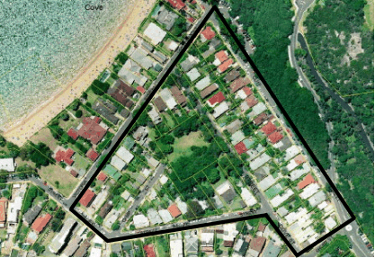

> [Picture on page 93: a picture, saved as a picture (images/chapter-c3-watsons-bay-heritage-conservation-area-page-93-15.gif, 150 dpi).]

FIGURE 76  Victoria Street

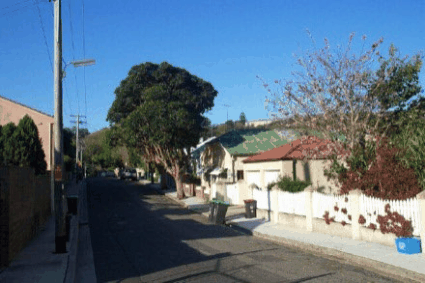

> [Picture on page 93: a picture, saved as a picture (images/chapter-c3-watsons-bay-heritage-conservation-area-page-93-17.gif, 150 dpi).]

FIGURE 77  Pacific Street

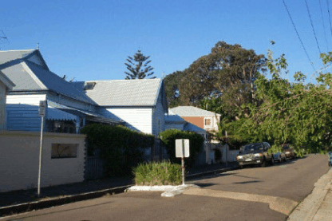

> [Picture on page 93: a picture, saved as a picture (images/chapter-c3-watsons-bay-heritage-conservation-area-page-93-19.gif, 150 dpi).]

FIGURE 78  Cliff Street

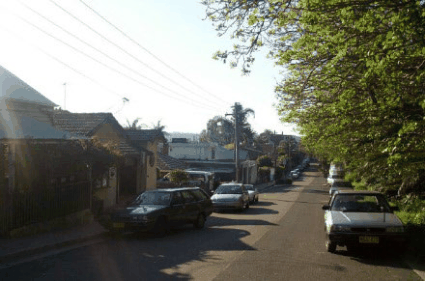

> [Picture on page 93: a picture, saved as a picture (images/chapter-c3-watsons-bay-heritage-conservation-area-page-93-21.gif, 150 dpi).]

FIGURE 79  Stone and

weatherboard cottages on Cove Street

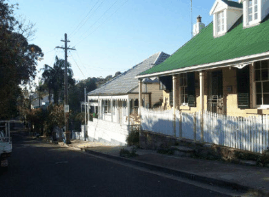

> [Picture on page 94: a picture, saved as a picture (images/chapter-c3-watsons-bay-heritage-conservation-area-page-94-3.gif, 150 dpi).]

FIGURE 80  Camp Street from Reserve

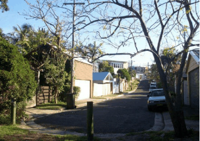

> [Picture on page 94: a picture, saved as a picture (images/chapter-c3-watsons-bay-heritage-conservation-area-page-94-5.gif, 150 dpi).]

FIGURE 81  Extract from

1855 ‘Town of Watsons Bay’ subdivision plan

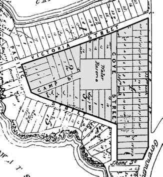

> [Picture on page 94: a picture, saved as a picture (images/chapter-c3-watsons-bay-heritage-conservation-area-page-94-8.gif, 150 dpi).]

FIGURE 82  Intersection of

Short Street and Cliff Street

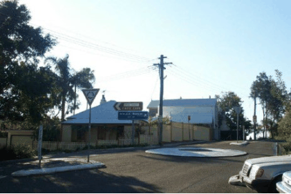

> [Picture on page 94: a picture, saved as a picture (images/chapter-c3-watsons-bay-heritage-conservation-area-page-94-11.gif, 150 dpi).]

FIGURE 83  View along

Camp Street into Camp Cove Reserve

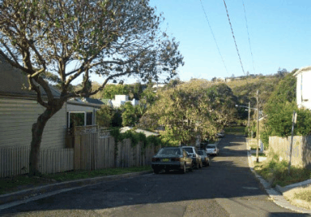

> [Picture on page 94: a picture, saved as a picture (images/chapter-c3-watsons-bay-heritage-conservation-area-page-94-14.gif, 150 dpi).]

FIGURE 84  Portuguese Terraces in Cove Street

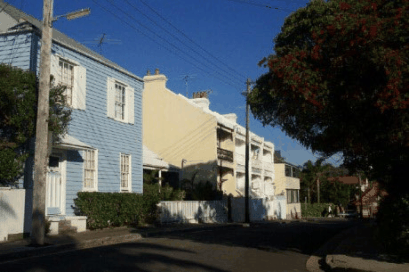

> [Picture on page 94: a picture, saved as a picture (images/chapter-c3-watsons-bay-heritage-conservation-area-page-94-16.gif, 150 dpi).]

FIGURE 85  Weatherboard and

stone cottages on Cove Street

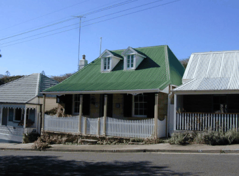

> [Picture on page 95: a picture, saved as a picture (images/chapter-c3-watsons-bay-heritage-conservation-area-page-95-3.gif, 150 dpi).]

FIGURE 86  Weatherboard cottage on Cliff Street

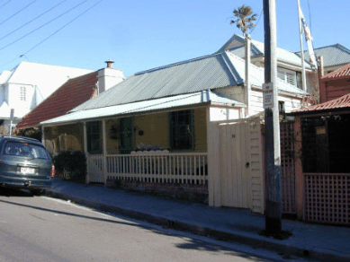

> [Picture on page 95: a picture, saved as a picture (images/chapter-c3-watsons-bay-heritage-conservation-area-page-95-5.gif, 150 dpi).]

FIGURE 87  Appropriate fencing along Victoria

Street

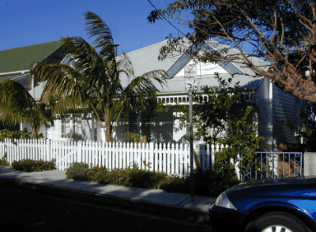

> [Picture on page 95: a picture, saved as a picture (images/chapter-c3-watsons-bay-heritage-conservation-area-page-95-8.gif, 150 dpi).]

#### PRECINCT CONTROLS

The precinct specific controls supplement the general controls for development in Section C3.5. If there is an inconsistency between the precinct controls and the general controls, the precinct controls take precedence.

#### Topography and vegetation

C1 The streetscape qualities of Cove Street are to be retained, enhanced by landscaped open space of Camp Cove Reserve and variable street trees including bottlebrushes, robinias, silky oaks and eucalyptus.

C2 Remnant sandstone kerbing and guttering are to be retained, including the section in Victoria Street (opposite the end of Cove Street, and outside No 2 Pacific Street, adjoining Short Street).

C3 The use of mainly subtropical shrubs (hibiscus, frangipani, bougainvillaea, etc.) is encouraged in front gardens.

#### Townscape

C4 The pattern of low-scaled detached dwellings and groups of dwellings on separate allotments is to be retained in order to respect the 1855 subdivision layout (Figure 81).

C5 New development is to be sited to achieve three visually distinct zones similar to most properties, that is:

a) small landscaped setback;

b) building zone of one and two storey detached houses with setbacks from side boundaries; and

c) landscaped rear yards.

C6 New development is to retain the contrasts between the character established by low-scaled one and two storey 19th century to early-mid 20th century housing behind low fences and small front gardens and the high-walled mansions on the opposite sides of Victoria Street and Pacific Street.

C7 The ‘gateway’ characteristics at the intersection of Short Street and Cliff Street are to be retained, including the distinctive single storey cottage at the corner, enhanced by a group of palms and the natural edge of Cliff Street (Figure 82).

C8 The laneway character of Camp Street is to be retained, with rear yards of houses set behind high paling fences on both sides of street. Consistency of fencing types is to be achieved in order to foster visual coherence.

C9 The sense of enclosure and natural edge on Cliff Street is to be retained, formed by coral trees, brush boxes and melaleucas from the edge of the Sydney Harbour National Park.

C10  High walls and garages on the street frontage are not to be permitted as they would detract from the streetscape appearance of houses and the historic townscape character.

#### Views and vistas

C11  Views to the harbour and Inner South Head from Short Street and from Victoria Wharf Reserve are to be retained.

C12  Vistas are to be retained to Green (Laings) Point Reserve, HMAS Watson, Camp Cove Reserve and the distant church spire.

C13  Views into Camp Cove Reserve from Cove Street and Camp Street are to be retained.

#### Contributory items

Note: Heritage items as identified in Schedule 5 of Woollahra LEP 2014 are also contributory items. For the protection of heritage items refer to clause 5.10 of the LEP.

| Contributory items |  |
|---|---|
| 18 Cliff Street | Single storey Edwardian cottage |

| Contributory items |  |
|---|---|
| 22 Cliff Street | Single storey Edwardian weatherboard cottage |
| 23 Cliff Street | Single storey 1920s weatherboard cottage |
| 28 Cliff Street | Single storey Edwardian brick cottage with second storey addition |
| 30 Cliff Street | Single storey 1920s weatherboard cottage |
| 3 Cove Street | 2 storey Victorian filigree styled terrace |
| 5 Cove Street | 2 storey Victorian filigree styled terrace |
| 7 Cove Street | 2 storey Victorian filigree styled terrace |
| 9 Cove Street | 2 storey Victorian filigree styled terrace |
| 21 Cove Street | Single storey Edwardian weatherboard cottage |
| 23 Cove Street | Single storey 1920s cottage |
| 25 Cove Street | Single storey Edwardian weatherboard cottage |
| 27 Cove Street | Single storey Edwardian timber cottage |
| 29 Cove Street | Single storey Edwardian weatherboard cottage |
| 41 Cove Street | Single storey 1920s weatherboard cottage |
| 43 Cove Street | Single storey Edwardian weatherboard cottage |
| 45 Cove Street | Single storey Edwardian weatherboard cottage |
| 1 Pacific Street | Single storey Victorian weatherboard cottage with 3 storey extension |
| 3 Pacific Street | Single storey 1920s cottage |
| 5 Pacific Street | Single storey Victorian weatherboard cottage |
| 9 Pacific Street | 2 storey Edwardian weatherboard cottage |
| 11 Pacific Street | Single storey 1920s weatherboard cottage |
| 13 Pacific Street | Single storey Edwardian weatherboard cottage |
| 15 Pacific Street | Single storey Victorian weatherboard cottage |
| 17 Pacific Street | Single storey Edwardian weatherboard cottage with attic |
| 21 Pacific Street | Single storey Victorian timber cottage |
| 4 Victoria Street | Single storey Edwardian weatherboard cottage |
| 6 Victoria Street | Single storey Victorian weatherboard cottage |
| 14 Victoria Street | Single storey Victorian weatherboard cottage |
| 16 Victoria Street | Single storey Edwardian weatherboard cottage |
| 18 Victoria Street | Single storey 1920s weatherboard cottage |
| 20 Victoria Street | Single storey Inter-War fibro house |

| Contributory items |  |
|---|---|
| 22-24 Victoria Street | 2 storey Inter-War flat building |
| Camp Cove Reserve | 2 Moreton Bay Figs, Camphor laurel, Kaffir Plum, Eucalypts, Podocarpus, Stenocarpus |

C14  Heritage items and contributory items are to be retained.

C15  Change to the  contributory items is limited to sympathetic alterations and additions consistent with the controls in Section C3.6.

#### Built form

The following controls apply to new dwellings, or the main new building on the site. Separate controls apply to secondary structures such as new garages, carports, ancillary buildings and the like.

#### Building siting and alignment

Streetfront setbacks

C16  Setbacks of new houses are to correspond to the alignment of adjacent contributory items and to provide garden space between the street and the house.

C17  Garages or carports are to be setback behind the building line.

C18  A maximum of one garage door is to be visible from the street frontage.

Side boundary setbacks

C19  All new buildings and structures, including any carport or garage, are to be set back from the side boundaries a minimum of 1.2m to retain the detached dwelling character of the precinct and respect the historic development pattern.

Rear setbacks

C20  Building setbacks are to relate to the alignment of adjacent houses provided that a rear yard space is retained.

#### Building height

C21  The height of new buildings is to be consistent with the height of neighbouring contributory items (generally a single storey plus attic).

#### Building form

C22  Established building forms are to be followed, i.e. simple rectilinear plan with traditional pitched roofs and verandahs facing the street.

C23  To relate to traditional roof forms, flat-roofed buildings are not permitted.

#### Building character

C24  The style of new buildings is to respect the character of the significant 19th to mid-20th century housing.

#### Building materials and details

C25  The following materials are appropriate for new buildings:

a) Walls: weatherboards, or exposed, rendered or painted brickwork or masonry.

b) Roof cladding: corrugated steel, slate, or tiled in unglazed terracotta or dark earth tones.

#### Landscaping and site coverage

C26  The building footprint plus paved surfaces (patios, pathways, tennis courts) and swimming pools together are not to exceed 75% of the site area in order to provide 25% of the site area for landscaped area, including plantings.

C27  For landscape planting details refer to Section 3.5.6 Landscaping and private open space.

#### Fences and walls

Front fences

C28  With the exception of Camp Street, fences are to be a maximum of 1.2m.

C29  Materials: sandstone, rendered and painted masonry, timber post and rail with chain wire inserts and timber pickets in keeping with the period of the house to which they relate.

C30  Low front fences to early cottages should be reconstructed where replaced by unsympathetic higher walls (e.g. in Victoria Street and Cliff Street).

Side and rear fences (including Camp Street)

C31 Side and rear fences, including fences on Camp Street, backing onto Camp Cove Reserve are to be 1.8m maximum in height and of traditional timber paling. Note: Appropriate front fencing types are illustrated in Section 3.5.7 Fences and walls.

#### Car parking and access

C32  With the exception of those on Camp Street, garages or carports are not to be built to street frontage and are to be set back behind the main building. Only one vehicular access driveway is permitted at the street frontage.

#### Inter-War flat buildings or multi dwelling housing

For Inter-War flat buildings, refer to Clause 3.6 Contributory items: additional built form controls.
