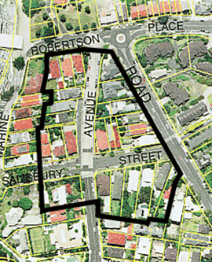
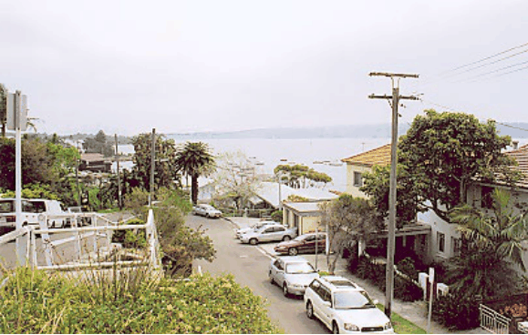
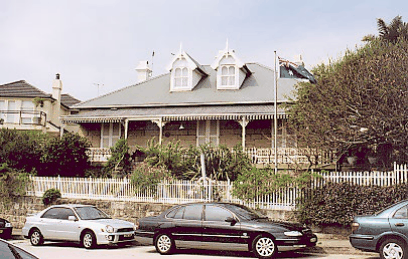
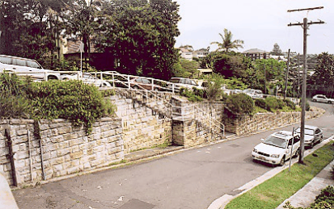
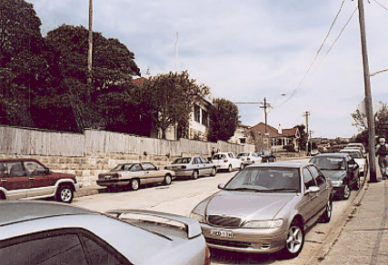
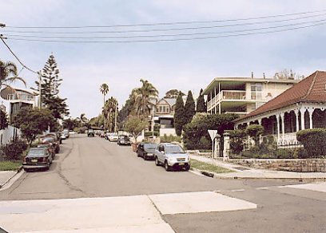
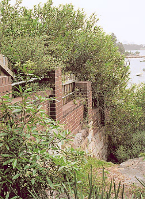

#### C3.4.11 Precinct L: Salisbury Street / Hopetoun Avenue

#### Character statement

This precinct is bounded by Robertson Place, Old South Head Road and the heritage conservation area boundary. Parts of Hopetoun Avenue and Salisbury Street cross through the precinct (Figure 88).

The buildings fronting the south side of Robertson Place include a group of three contributory c1920s bungalows and a single detached house at the Hopetoun Avenue intersection. The group is consistent in the scale, form and alignment of the buildings, which are set back from the street behind low original fences with small gardens. A garage to the street frontage disturbs the consistency of the group.

The Salisbury Street streetscape includes the historic road alignment that marks the boundary of an original land grant and the Beaconsfield Estate owned by John Robertson. The western end of the street, backed by a group of mainly cultural plantings including banana palms, mature phoenix palms, melaleucas and immature Norfolk Island pines, appears to terminate on a cliff above the waterfront, however, it makes a U-turn at this point, leading down to housing at a lower level. Cultural plantings within the south western properties include Port Jackson Figs. The street trees in the upper section of the street include palms, a water gum, a Norfolk Island pine and a melaleuca.

Significant views west to Sydney Harbour are largely retained, being partly obscured by the cultural plantings (Figure 89). There are also views from the harbour to the Church Group beyond.

The built form on the southern side of Salisbury Street includes three contributory single storey Victorian period houses and early 20th century housing. The north side, west of Hopetoun Avenue, includes a contemporary house with a curved roof overlooking the water and 1930s flats below the retaining wall. Variable fencing types exist in this precinct, including face and rendered brick and iron palisade. A large sandstone retaining wall is a significant feature of the west end of the street, forming the U-shaped cul-de-sac.

Hopetoun Avenue was formed during the 1920s, falling towards Robertson Place. It maintains significant vistas to Sydney Harbour. Few buildings on Hopetoun Avenue contribute to the significance of the Watsons Bay Heritage Conservation Area, with the exception of a heritage item, 'Bay Cottage', at 308 Old South Head Road. The remaining buildings consist of two storey detached houses with pitched roofs, fenced front gardens and later development that extends to the land grant boundary that terminates the conservation area at Salisbury Street. These residential properties provide a variety of private garden treatments, plantings and fencing types including brick, timber palings, picket, wire mesh and sandstone. A dominant significant sandstone boundary retaining wall extends along the eastern side of the street.

FIGURE 88  Aerial of the precinct

> [Picture on page 101: a picture, saved as a picture (images/chapter-c3-watsons-bay-heritage-conservation-area-page-101-2.gif, 150 dpi).]

FIGURE 89  The west end of Salisbury Street with views to the

harbour

> [Picture on page 101: a picture, saved as a picture (images/chapter-c3-watsons-bay-heritage-conservation-area-page-101-5.gif, 150 dpi).]

#### FIGURE 90

Contributory item on east side of Hopetoun Avenue

> [Picture on page 101: a picture, saved as a picture (images/chapter-c3-watsons-bay-heritage-conservation-area-page-101-8.gif, 150 dpi).]

#### FIGURE 91

Significant sandstone retaining wall

> [Picture on page 101: a picture, saved as a picture (images/chapter-c3-watsons-bay-heritage-conservation-area-page-101-11.gif, 150 dpi).]

#### FIGURE 93

Sandstone block retaining wall with traditional timber

paling fence above on the east side of Hopetoun

Avenue

> [Picture on page 101: a picture, saved as a picture (images/chapter-c3-watsons-bay-heritage-conservation-area-page-101-16.gif, 150 dpi).]

#### FIGURE 92

View along Salisbury Street to the Church Group

> [Picture on page 101: a picture, saved as a picture (images/chapter-c3-watsons-bay-heritage-conservation-area-page-101-19.gif, 150 dpi).]

FIGURE 94  Composite wall containing sandstone and face brick on Salisbury Street

> [Picture on page 102: a picture, saved as a picture (images/chapter-c3-watsons-bay-heritage-conservation-area-page-102-2.gif, 150 dpi).]

#### PRECINCT CONTROLS

The precinct specific controls supplement the general controls for development in Section C3.5. If there is an inconsistency between the precinct controls and the general controls, the precinct controls take precedence.

#### Topography and vegetation

C1 Existing height relationships are to be maintained between the higher properties (located between Old South Head Road and Hopetoun Avenue) and the lower properties (located below Hopetoun Avenue).

#### Townscape

C2 The existing subdivision patterns of deep allotments that front the public roads are to be retained. Battle-axe shaped lots are not permitted so as to retain the visual balance of the green spaces in both front and rear yards.

#### Views and vistas

C3 Existing views to the harbour are to be retained over roofs from the upper levels of the precinct, including those from Old South Head Road.

C4 Roofs are not to be cluttered by intrusive structures/services in order not to detract from views to and from the upper levels of the precinct.

C5 The plantings that currently block views west along Salisbury Street to the harbour should be removed. New or replacement plantings (on the slope down to the waterfront) are to reinstate the view corridor.

#### Contributory items

Note: Heritage items as identified in Schedule 5 of Woollahra LEP 2014 are also contributory items. Refer to clause 5.10 of the LEP for heritage conservation controls.

| Contributory items |  |
|---|---|
| Rear 308 Old South Head Road | 2 storey Edwardian house |
| Within Salisbury Street road reserve | Sandstone retaining wall to split roadway with rockery and concrete stairs |
| Within Hopetoun Avenue East road reserve | Sandstone walls |
| 2 Robertson Place | Single storey 1920s cottage |
| 4 Robertson Place | Single storey 1920s cottage |
| 6 Robertson Place | Single storey 1920s cottage |
| 2 Salisbury Street | Single storey Victorian Gothic styled cottage |
| 4 Salisbury Street | Single storey Victorian weatherboard cottage |
| 8 Salisbury Street | Single storey Victorian sandstone cottage |
| 10 Salisbury Street | Port Jackson fig |
| 1 Salisbury Street | Single storey Edwardian semi-detached dwelling |
| 3 Salisbury Street | Single storey Edwardian semi-detached dwelling |
| 7 Salisbury Street | 2 storey Inter-War flat building |
| 11 Salisbury Street | 2 storey Inter-War flat building |

C6 Heritage items and contributory items are to be retained.

C7 Change to  contributory items is limited to sympathetic alterations and additions consistent with the controls in Section C3.6.

#### Built form

The following controls apply to new dwellings, or the main new building on the site. Separate controls apply to secondary structures such as new garages, carports, ancillary buildings and the like.

#### Building siting and alignment

C8 The existing setback patterns, particularly regular or transitional, are to be maintained.

C9 Where an irregular pattern exists, new development is to be set back to correspond to the alignment of  contributory items and provide for landscaped area in front yards behind fences or walls.

C10  The alignment of new buildings is to be parallel with the street frontage, not skewed, to maintain existing streetscape patterns.

C11  Building setbacks from the rear are to correspond to the setback pattern of adjacent buildings and maintain the amenity of neighbouring residential property.

#### Building height

C12  Building heights are to respect the natural landform and topography of the precinct. Existing views from the upper levels of the precinct are not to be obstructed by development below.

#### Building form

C13  The mass and form of new buildings is to respect adjacent  contributory items.

C14  Rectilinear plans with traditional pitched roof forms are to be used to relate to the established character of the area.

#### Building materials and details

C15 The following materials are appropriate for new buildings:

a) Walls: exposed brick or rendered/ painted brickwork or masonry.

b) Pitched roofs for dwellings: slate, tiled in unglazed terracotta or dark earth tones, or slate-grey corrugated iron.

#### Landscaping and site coverage

C16  The building footprint plus paved surfaces (patios, pathways, tennis courts) and swimming pools together are not to exceed 70% of the site area in order to provide 30% of the site area for landscaped area, including plantings.

C17  For landscape planting details refer to Section 3.5.6 Landscaping and private open space.

#### Fences and walls

C18  Front fences are to be 1.2m maximum in height. Materials are to be in keeping with the building to which they relate, including rendered and painted masonry, brick, palisade or wooden pickets.

C19  Side and rear fences are to be 1.8m maximum traditional timber paling fences or, preferably rendered, masonry walls, stepping down in height to 1.2m at the front boundary line.

C20  Garages are not to be built to the street alignment, but are to be set back behind the building alignment or integrated with the building.

#### Inter-War flat buildings or multi dwelling housing

For Inter-War flat buildings, refer to Clause 3.6 Contributory items: additional built form controls.
