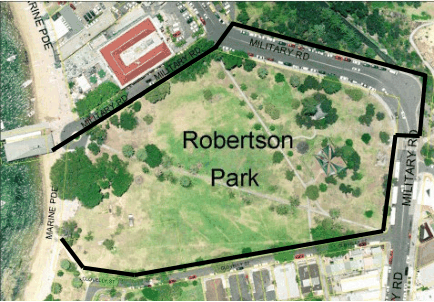
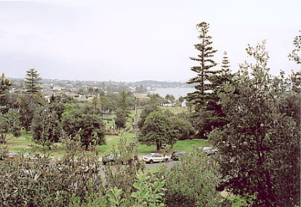
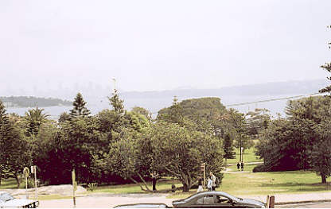
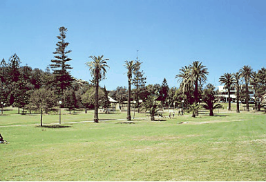
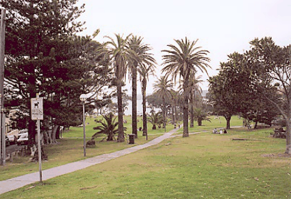

#### C3.4.12 Precinct M: Robertson Park

#### Character statement

Robertson Park is a significant historic item in the landscape and townscape of the Watsons Bay Heritage Conservation Area. The park was created in 1909 from the grounds of the mansion “Clovelly” that had been constructed on this site in the late 1820s. Its last owner was Sir John Robertson, a former Premier of NSW.

Robertson Park is the major green open space in the centre of the area. It is a natural wide amphitheatre that slopes towards the harbour, linking the open space of the waterfront to The Gap. It retains extensive views to the harbour, Gap Reserve and across Robertson Place (Figure 95).

The Park has a formal layout, containing significant cultural plantings including fig trees and Norfolk Island Pines which are remnant plantings from the grounds of 'Clovelly'. In particular, the 19th century Moreton Bay fig trees create a broad canopy over the adjacent promenade and are a significant feature of views to Robertson Park from the water. Coastal Banksias have also been planted in the park and Port Jackson figs along its southern perimeter. The edge of the park is well defined by roads, the harbour and its cultural plantings.

The section of Marine Parade that adjoins Robertson Park includes the ferry terminal that is the arrival point to Watsons Bay by boat. The waterfront promenade along the sandy beach is well defined by a sandstone wall. Each end of the promenade is defined by wharves and marine structures. A significant view corridor exists from the wharf and promenade across Robertson Park and Robertson Place to The Gap and Gap Park, with vistas to the spires of the local churches and the lighthouse.

FIGURE 95  Aerial view of the precinct

> [Picture on page 106: a picture, saved as a picture (images/chapter-c3-watsons-bay-heritage-conservation-area-page-106-24.gif, 150 dpi).]

FIGURE 96  View across Robertson Park

to Robertson Place and the harbour

> [Picture on page 106: a picture, saved as a picture (images/chapter-c3-watsons-bay-heritage-conservation-area-page-106-27.gif, 150 dpi).]

FIGURE 97  Robertson Park from the Gap

> [Picture on page 107: a picture, saved as a picture (images/chapter-c3-watsons-bay-heritage-conservation-area-page-107-2.gif, 150 dpi).]

FIGURE 98  Robertson Park

> [Picture on page 107: a picture, saved as a picture (images/chapter-c3-watsons-bay-heritage-conservation-area-page-107-4.gif, 150 dpi).]

#### FIGURE 99

Formal layout of Robertson Park including cultural plantings, showing avenue of recently-removed phoenix

palms

> [Picture on page 107: a picture, saved as a picture (images/chapter-c3-watsons-bay-heritage-conservation-area-page-107-8.gif, 150 dpi).]

#### PRECINCT SPECIFIC GUIDELINES

The precinct specific guidelines supplement the general controls for development in Section C3.5. If there is an inconsistency between these precinct guidelines and the general controls, the guidelines take precedence.

This land is in public ownership and is managed through a plan of management. It is strongly recommended that the plan of management includes or is informed by the following management policies:

G1 Mature historic plantings are to be retained. If new plantings are proposed, species are to be selected that are appropriate in scale, canopy size and character to those existing in the cultural landscape. New plantings are not to obscure existing views and vistas. Refer to Section 3.5.6 Landscaping and private open space.

G2 Existing extensive public views are to be retained between the park and the harbour, The Gap and Robertson Place.

G3 The public access is to be retained from the park to the waterfront.

G4 No new development or alterations and additions to existing buildings except where required by the management plan and consistent with the policies in the plan for siting, orientation, height limits and design.

G5 New structures are to follow established forms, i.e. simple rectilinear plan buildings with pitched roofs of a small scale.

G6 Any required new public amenity structures, including shade structures, are to be sited so as to avoid the removal of cultural plantings, retain the formal layout of the park and not obstruct existing view corridors between the harbour and the Gap.

G7 New fences and walls within Robertson Park are to be of a low, 1.2m maximum height in order to retain the open character of the park and constructed of either sandstone or grey-coloured concrete. Fencing around playground equipment is to be open and transparent.

G8 The existing public access, including disabled access, is to be retained to Robertson Park.

G9 Any new paths throughout the precinct are to be constructed using recessive colours and finishes.

G10  The management plan should incorporate a cohesive approach for the public areas along Marine Parade in terms of paving, street furniture, lighting, signage and the like.

G11  The public domain controls in Section C3.7 of this chapter apply to the publicly accessible areas of the site.

#### Contributory items

Note: Heritage items as identified in Schedule 5 of Woollahra LEP 2014 are also contributory items. Refer to clause 5.10 of the LEP for heritage conservation controls.

| Contributory items |  |
|---|---|
| Robertson Park | Three Moreton Bay figs on western edge, Port Jackson Figs on southern edge, avenue planting to be replaced, Norfolk Island Pines in SE and NE corners associated with former marine villa “Clovelly”, archaeological relics associated with “Clovelly” |
