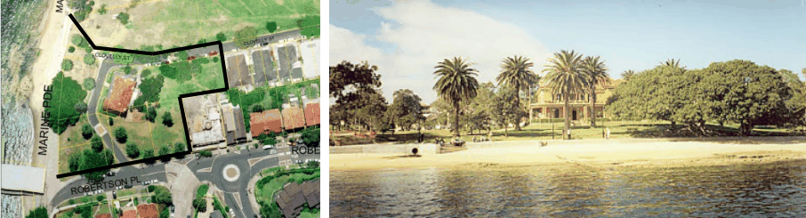
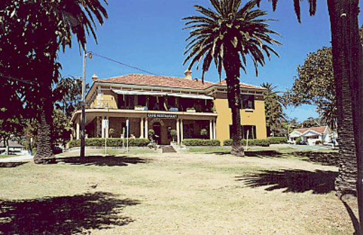

#### C3.4.13 Precinct N: Robertson Place

#### Character statement

Robertson Place is a small park located adjacent to Robertson Park. A close visual association is maintained between these two green spaces within the Watsons Bay Heritage Conservation Area (Figure 100).

Robertson Place provides the landscape setting and curtilage to Dunbar House, which was constructed from 1828 and converted to a hotel in 1854. The park slopes like an amphitheatre toward the harbour, with extensive views to the waterfront and Robertson Park. A sandstone obelisk marks the beginning of the 1803 road to Sydney.

FIGURE 100  Aerial view of the precinct FIGURE 101  Robertson Place from the harbour

> [Picture on page 109: a picture, saved as a picture (images/chapter-c3-watsons-bay-heritage-conservation-area-page-109-11.gif, 150 dpi).]

FIGURE 102  Dunbar House within an established cultural setting

> [Picture on page 109: a picture, saved as a picture (images/chapter-c3-watsons-bay-heritage-conservation-area-page-109-13.gif, 150 dpi).]

#### PRECINCT SPECIFIC GUIDELINES

The precinct specific guidelines supplement the general controls for development in Section C3.5. If there is an inconsistency between these precinct guidelines and the general controls, the guidelines take precedence.

This land is in public ownership and is managed through a plan of management and conservation management plan.  It is strongly recommended that these plans include or are informed by the following management policies:

G1 Mature historic plantings are to be retained, including the fig trees. Removed cultural plantings are to be reinstated. If new plantings are proposed, species are to be selected that are appropriate in scale, canopy size and character to those existing in the cultural landscape. New plantings are not to obscure existing views and vistas. Refer to Section 3.5.6 Landscaping and private open space.

G2 The existing extensive public views are to be retained between Robertson Place, Robertson Park and the waterfront.

G3 The existing public access, including disabled access, from Robertson Place to the waterfront is to be retained.

G4 In order to retain the curtilage and setting of Dunbar House, new development and alterations and additions to Dunbar House will only be permitted where consistent with an adopted conservation management plan and its guidelines for siting, orientation, height limits and design. New structures are to follow established forms, i.e. simple rectilinear buildings with pitched roofs of a small scale. New buildings are not to be flat roofed.

G5 No additional fencing is to be constructed except where consistent with the guidelines contained in an adopted conservation management plan. New fences and walls within Robertson Place are to be of a low, 1.2m maximum height and be constructed of either sandstone or grey-coloured concrete.

G6 No additional car parking or vehicular access is permitted.

G7 Any new paths throughout the precinct are to be constructed using recessive colours and finishes.

G8 The conservation management plan is to incorporate a cohesive approach for the public areas along Marine Parade (in terms of paving, street furniture, lighting, signage and the like).

G9 The public domain provisions in Section C3.7 of this chapter apply to the publicly accessible areas of the precinct.

#### Contributory items

Note: Heritage items as identified in Schedule 5 of Woollahra LEP 2014 are also contributory items. Refer to clause 5.10 of the LEP for heritage conservation controls.

| Contributory items |  |
|---|---|
| Within Robertson Park | 2 Port Jackson Figs, avenue of Phoenix palms parallel to the Promenade |
