#### C3.4.14 Precinct O: Gibsons Beach Waterfront and Marine Parade South

#### Character statement

This precinct consists of properties with a frontage to Marine Parade, south of Robertson Place.

The waterfront promenade is contained visually by a single storey yacht club and the Watsons Bay public baths at the north end and the two storey Pilot Station at the south end (Figure 106 and 107). A flight of steps leads up to Salisbury Road (Figure 109).

Marine Parade continues south as a walkway to Gibsons Beach, a small beach semi-detached dwelling enclosed by the Pilot Station to the north and the natural landform to the south (Figure 108). A narrow park along the promenade widens at the southern end to form Gibsons Beach Reserve with an open landscape character. The beach and the park curtilage are protected by a sandstone headland, as well as rock benches and sandstone walls to the properties above. A small creek enters the beach from the southwest. Boat sheds and jetties extend out to the point. The mixed public pathway/private driveway allows access around the small reserve behind the beach to Hopetoun Avenue.

The northern part of the precinct contains a variety of built and landscape elements that contribute to its character. These include the distinctive yacht club and Pilot Station buildings with jetties on the western side and the Inter-War period Tea Gardens, formerly the facilities for the Watsons Bay Pool at the north end (Figure 111).

Housing includes single storey detached and semi-detached dwellings (c1920s—1930s) with pitched roofs, many of which have been altered (Figure 112). Front gardens are generally set behind low walls and are open in character, elevated above the promenade toward the south

end. The two to three storey dwellings above in the southern section (some with remnant cultural plantings) are barely visible from the beach.

Street tree plantings of Casuarinas and a topped Norfolk Island pine opposite Tea Gardens enhance the waterfront setting. The tree and shrub plantings at the west end of Salisbury Street are not of heritage significance and obstruct views to the Harbour.

Properties have harbour views from the water; there are views to the spire of Our Lady Star of the Sea church and cultural plantings on the ridgeline.

Prominent garages on or close to the street frontage detract from the promenade and views from the waterfront. The visual impact of a contemporary dwelling with an uncharacteristic curved roof is partially mitigated by its relatively low scale and sympathetic landscaping when compared with larger buildings behind.

#### FIGURE 103

Aerial view of the precinct

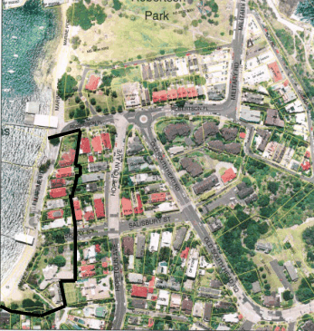

> [Picture on page 112: a picture, saved as a picture (images/chapter-c3-watsons-bay-heritage-conservation-area-page-112-3.gif, 150 dpi).]

#### FIGURE 104

Marine Parade streetscape

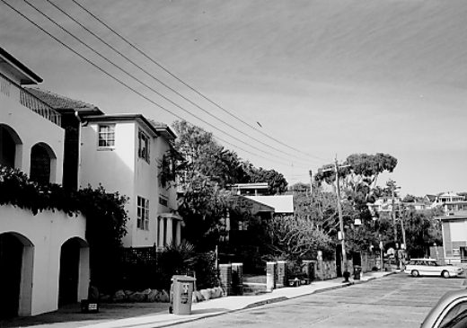

> [Picture on page 112: a picture, saved as a picture (images/chapter-c3-watsons-bay-heritage-conservation-area-page-112-6.gif, 150 dpi).]

#### FIGURE 105

Marine Parade South from the pilot station

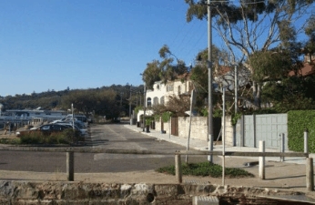

> [Picture on page 112: a picture, saved as a picture (images/chapter-c3-watsons-bay-heritage-conservation-area-page-112-9.gif, 150 dpi).]

#### FIGURE 106

Yacht club at north end

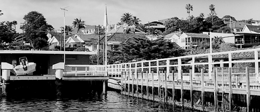

> [Picture on page 112: a picture, saved as a picture (images/chapter-c3-watsons-bay-heritage-conservation-area-page-112-12.gif, 150 dpi).]

#### FIGURE 107

Pilot Station at the south end of Marine Parade

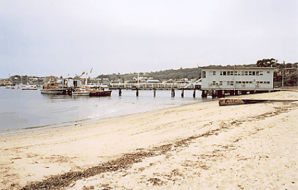

> [Picture on page 112: a picture, saved as a picture (images/chapter-c3-watsons-bay-heritage-conservation-area-page-112-15.gif, 150 dpi).]

#### FIGURE 108

North end of Gibsons Beach Reserve

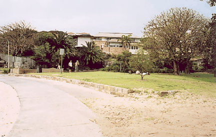

> [Picture on page 112: a picture, saved as a picture (images/chapter-c3-watsons-bay-heritage-conservation-area-page-112-18.gif, 150 dpi).]

#### FIGURE 109

Open space and steps leading up to Salisbury Street

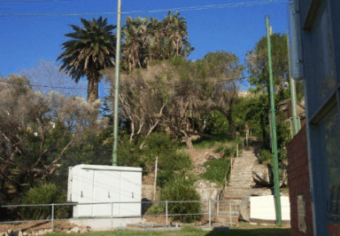

> [Picture on page 113: a picture, saved as a picture (images/chapter-c3-watsons-bay-heritage-conservation-area-page-113-3.gif, 150 dpi).]

#### FIGURE 110

Gibsons Beach from the promenade

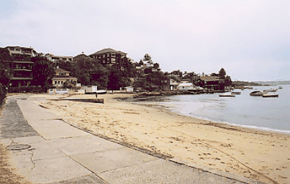

> [Picture on page 113: a picture, saved as a picture (images/chapter-c3-watsons-bay-heritage-conservation-area-page-113-6.gif, 150 dpi).]

#### FIGURE 111

‘Tea Gardens’

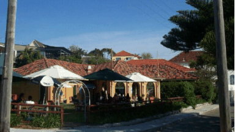

> [Picture on page 113: a picture, saved as a picture (images/chapter-c3-watsons-bay-heritage-conservation-area-page-113-9.gif, 150 dpi).]

#### FIGURE 112

Marine Parade South from the harbour

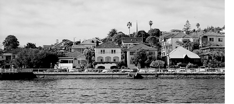

> [Picture on page 113: a picture, saved as a picture (images/chapter-c3-watsons-bay-heritage-conservation-area-page-113-12.gif, 150 dpi).]

#### FIGURE 113

Views to the harbour from Gibsons Beach

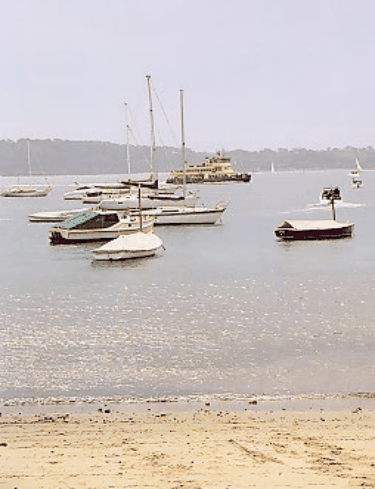

> [Picture on page 113: a picture, saved as a picture (images/chapter-c3-watsons-bay-heritage-conservation-area-page-113-15.gif, 150 dpi).]

#### PRECINCT CONTROLS

The precinct specific controls supplement the general controls for development in Section C3.5. If there is an inconsistency between the precinct controls and the general controls, the precinct controls take precedence.

#### Topography and vegetation

C1 New street and promenade planting is to be selected to provide amenity (shade, softening of hard built areas, glare reduction) for pedestrians using the marine promenade, permit views out to the harbour and create opportunities for public views both to Watsons Bay from the harbour and to the harbour from the top of Salisbury Street.

C2 Additional street or promenade trees may be introduced provided that they are appropriate for waterfront microclimatic conditions, are open-branched with relatively thin and permeable foliage, but with sufficient canopy to provide some shade — such as casuarinas. Araucarias, figs and most palms are unsuitable, although Canary Island palms may be considered.

C3 Tree and shrub plantings at west end of Salisbury Street should be replaced with species that do not exceed 5m in height, have single trunks and open branching habits. These are to be placed to frame, not obstruct views.

C4 Plantings down the steep slope between the west end, or ‘elbow’, of Salisbury Street and the waterfront should be selected to consolidate the slope while not obstructing the view. Species should be similar to the park-like plantings around.

#### Townscape

C5 The regular pattern of detached buildings on separate allotments south of Tea Gardens is to be retained in order to respect the established form and provide for public views between buildings.

#### The waterfront

C6 Views of houses, roofs and gardens from the promenade and Harbour are to be retained, unobstructed by high fences.

#### Views and vistas

C7 View sharing from private properties is to be retained within the precinct and with overlooking properties in adjacent precincts.

C8 Vistas are to be retained to Our Lady Star of the Sea church spire and cultural plantings as viewed from the harbour.

C9 Existing maritime structures, such as the yacht club and pilot station, are not to be increased in height or bulk so that views to the harbour can be enjoyed.

#### Contributory items

Note: Heritage items as identified in Schedule 5 of Woollahra LEP 2014 are also contributory items. Refer to clause 5.10 of the LEP for heritage conservation controls.

| Contributory items |  |
|---|---|
| Marine Parade | Watsons Bay Pool (Baths) [SREP Sydney Harbour] A concrete arched pool structure with timber balustrades |
| Marine Parade | Watsons Bay Ferry Pier [SREP Sydney Harbour] A timber and concrete wharf structure |
| 2 Marine Parade | Single storey Edwardian cottage with second storey addition |
| 3 Marine Parade | Single storey Edwardian cottage |
| 5 Marine Parade | 2 storey house over garages |
| 6 Marine Parade | Single storey semi -detached dwelling |
| 7 Marine Parade | Single storey semi -detached dwelling |
| 8 Marine Parade | Single storey Spanish Mission styled restaurant ‘Tea gardens’ |
| Salisbury Street | Pilot station [SREP Sydney Harbour] |
| 12 Salisbury Road | Kaffir Plum, Date palm, sandstone retaining wall to reserve |
| Within Gibsons Beach Reserve | Coral trees and phoenix palms Exposed rockfaces adjoining the promenade |

C10  Heritage items and contributory items are to be retained.

C11  Change to  contributory items is limited to sympathetic alterations and additions consistent with the controls in Section C3.6.

#### Built form

The following controls apply to new dwellings, or the main new building on the site. Separate controls apply to secondary structures such as new garages, carports, ancillary buildings and the like.

#### Building siting and alignment

Front (waterfront) setbacks

C12  All buildings are to be sited to provide a landscaped setback from Marine Parade to provide for a garden space in front. The setback and alignment are to be related to adjacent buildings and the skewed alignment pattern.

Side setbacks

C13  All buildings are to be a minimum of be set back from side boundaries by 1.5m to retain the detached building character of the precinct and provide for public views between buildings.

Rear setbacks

C14  Rear setbacks are to be similar to adjacent setbacks in order to maintain the amenity of neighbouring residential property.

#### Building height

C15  Buildings are to comply with the maximum statutory height control in Woollahra LEP 2014 and are to be a maximum of two storeys in height, with roofs pitched to match traditional forms.

C16  No increase is permitted in the height of marine structures, such as the yacht club (Figure 106) and pilot station (Figure 107), at each end of the precinct.

#### Building form

C17  Established building forms are to be used, i.e. simple rectilinear plan with pitched roofs.

C18  Buildings should not be flat-roofed or reverse skillion, in order to relate to traditional roof forms when viewed from the water.

C19  Ridgelines of roofs are to be parallel to the side boundaries in order to minimise the visual impact of roofs on views when viewed from Marine Parade and the waterfront.

#### Building character

C20  The architectural treatment of new buildings is not to stand out in marked contrast to existing  contributory items in the area.

#### Building materials and details

C21  The following materials are appropriate for new buildings:

a) Walls: preferably face brickwork or rendered/painted brickwork or masonry.

b) Roofs: slate, corrugated steel or tiles in unglazed terracotta or dark earth tones.

#### Landscaping and site coverage

C22  The building footprint and paved surfaces (patios, pathways, tennis courts) and swimming pools together are not to exceed 75% of the site area in order to provide 25% of the site area for landscaped area, including plantings.

C23  Structures and infrastructure, including swimming pools and water pipes, are to be designed (including the underside) to minimise the visual impacts upon the reserve and its significant elements (including sandstone rock shelves) when viewed from public areas.

#### Fences and walls

Marine Parade

C24  Fence heights are to be a maximum 1.2m above promenade level or, where privacy from the promenade is an issue, up to 1.8m maximum with 50% transparency above 1.2m. Acceptable materials are sandstone or face brick or rendered or painted masonry in keeping with the building to which it relates.

Robertson Place

C25  Existing low brick fences facing Robertson Place are to be retained.

Salisbury Street

C26  Fences are to be a maximum of 1.2m above footpath level and are to be in keeping with the building to which they relate. Brush fences, concrete block, or copies of iron palisade fences are not traditionally associated with houses in this precinct and are not permitted.

Gibsons Beach Reserve

C27  Fence heights are to be a maximum 1.2m above the walkway level or rockshelf or, where privacy from the reserve or security is an issue, up to an 1.8m maximum with a 50% transparency above 1.2m. Acceptable Materials are sandstone or rendered and painted masonry in keeping with the building to which it relates.

Rear and side fences (when not street or reserve fronting)

C28  Fences are to be traditional timber paling fences of 1.8m maximum height.

#### Car parking and access

C29  Garages or carports are not to be built to the street frontage, and are to be set back behind the main building whether attached or freestanding.

C30  A maximum of two garages may be visible from the street provided that a minimum of 50% of the width of the street frontage is retained for landscaped area.

C31  Parking may be accommodated in a basement or semi -basement level.

#### Gibsons Beach Reserve and Marine Parade promenade and maritime structures

Given its public ownership, it is strongly recommended that the structures and the reserve are conserved and managed through specific management plans that include or are informed by the following management policies:

C32  The existing topography and vegetation is to be maintained. New plantings are to be of the same scale and species to that existing, except where these are inconsistent with the

principal character of the precinct. New plantings are not to obscure existing public views and vistas.

C33  Existing extensive views to and from the waterfront are to be retained. No additional marine structures are to be erected in this area to retain the open landscape character of this part of the beach.

C34  The existing public access, including disabled access, is to be retained along the promenade to the beach and the reserve.

C35  New development and alterations and additions to existing buildings are not permitted except where consistent with the policies in the adopted management plan, including those for siting, orientation, height limits and design.

C36  Structures and infrastructure, including swimming pools and water pipes, are to be designed to minimise the visual impacts upon the precinct and its significant elements when viewed from public areas.

C37  No additions are to be made to the building envelopes of the existing marine structures (jetties and pilot station).

C38  New structures are to be limited to commemorative structures, public artworks, interpretive signage and the like, the number of which are to be carefully controlled so as not to result in a visual cluttering of the landscape.

C39  Beach dinghies are permitted against the promenade edge provided these do not impede public access.

C40  No additional fencing is to be constructed. If essential, any new fencing is to be low in height (1.2m maximum) and constructed of sandstone, concrete or rendered masonry in neutral tone colours.

C41  Stormwater run-off into the Harbour is to be carefully managed to protect the seahorse colony in the seagrass beds off the beach.

C42  No additional car parking or vehicular access is permitted.

C43 Any new paths throughout the precinct are to be constructed using recessive colours and finishes.

C44  The management plans should incorporate a cohesive approach for the public areas along Marine Parade, in terms of paving, street furniture, lighting, signage and the like.

C45  The public domain provisions in Section C3.7 of this chapter apply to the publicly accessible areas of the precinct.
