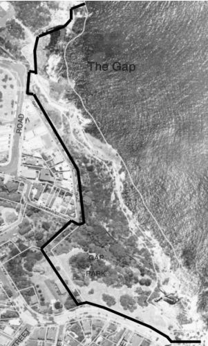
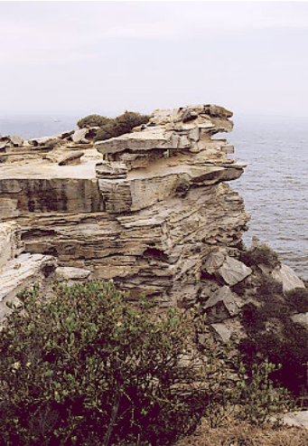
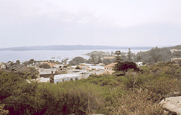
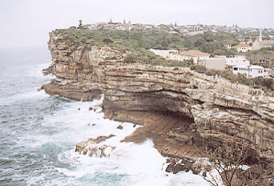
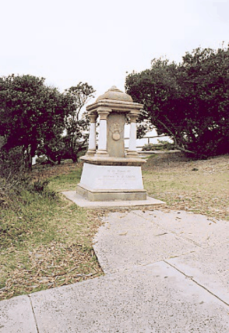

#### C3.4.15 Precinct P: Upper Gap Park

#### Character statement

Upper Gap Park forms part of the spectacular gateway to Watsons Bay on its approach from Old South Head Road.

It consists of an exposed sandstone ridge with sheer cliffs at its eastern edge, which form a rugged and dramatic coastline. Low coastal plantings soften this rocky landscape.

Extensive views to Watsons Bay and the Tasman Sea are available from throughout the park.

#### FIGURE 140

Aerial view of the precinct

> [Picture on page 119: a picture, saved as a picture (images/chapter-c3-watsons-bay-heritage-conservation-area-page-119-10.gif, 150 dpi).]

#### FIGURE 141

Sandstone cliff faces and coastal vegetation

> [Picture on page 119: a picture, saved as a picture (images/chapter-c3-watsons-bay-heritage-conservation-area-page-119-13.gif, 150 dpi).]

FIGURE 142  Extensive views from within

the Park across Watsons Bay and the harbour

> [Picture on page 119: a picture, saved as a picture (images/chapter-c3-watsons-bay-heritage-conservation-area-page-119-16.gif, 150 dpi).]

#### FIGURE 143

Sheer sandstone cliffs along east edge of precinct

> [Picture on page 119: a picture, saved as a picture (images/chapter-c3-watsons-bay-heritage-conservation-area-page-119-19.gif, 150 dpi).]

FIGURE 144  Monument at south end of the park

> [Picture on page 120: a picture, saved as a picture (images/chapter-c3-watsons-bay-heritage-conservation-area-page-120-2.gif, 150 dpi).]

#### PRECINCT GUIDELINES

The precinct specific guidelines supplement the general controls for development in Section C3.5. If there is an inconsistency between these precinct guidelines and the general controls, the guidelines take precedence.

Given its public ownership, it is strongly recommended that this precinct is conserved and managed through a specific management plan that includes or is informed by the following management policies:

G1 The existing topography and vegetation should be maintained. New plantings should be typical Hawkesbury sandstone heath community plants of the same scale and species to those existing. New plantings should not obscure existing views and vistas. Additional plantings of Norfolk Island Pines and Fig trees are not appropriate in Upper Gap Park. Existing pines and fig trees should be retained as cultural plantings.

G2 The existing extensive public views to and from Watsons Bay, Sydney Harbour and the waterfront, The Gap and within the park should be retained.

G3 To retain the open landscape setting and ruggedness of the topography, no new structures should be constructed within the park.

G4 Existing monuments should be maintained as contributory items. New structures should be limited to commemorative structures, public artworks, interpretive signage and the like, the number of which should be carefully controlled so as not to result in a visual ‘cluttering’ of the landscape.

G5 No additional fencing should be constructed. New safety fencing should be constructed as low as possible whilst still serving its purpose. It should be constructed of materials that withstand tough marine and coastal conditions, are appropriate in terms of the character of the landscape and do not obstruct views and vistas.

G6 No additional car parking or vehicular access should be provided.

G7 The existing public access (including disabled access) throughout the park should be retained. Public access within the park to The Gap should be retained.

G8 Any new paths throughout the precinct should be constructed using recessive colours and finishes.

G9 The public domain controls in Section C3.7 of this chapter apply to the publicly accessible areas of the precinct.

#### Contributory items

Note: Heritage items as identified in Schedule 5 of Woollahra LEP 2014 are also contributory items. Refer to clause 5.10 of the LEP for heritage conservation controls.

| Contributory items |  |
|---|---|
| Within Gap Park | Sandstone landforms, weathered rock formations and coastal heathland, including a sequence of ‘green open spaces’ |
