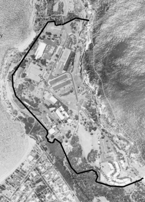
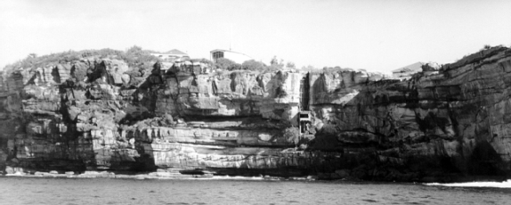
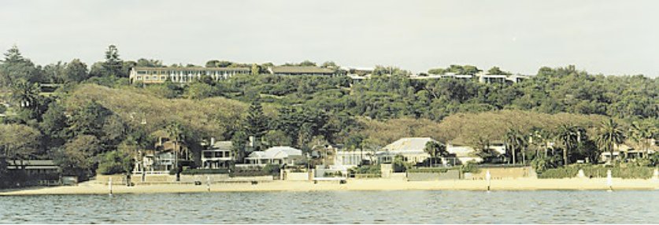
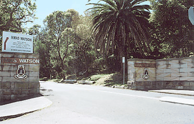
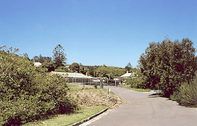

#### C3.4.16 Precinct Q: HMAS Watson

#### Character statement

This precinct comprises approximately 15 hectares of Commonwealth owned land at South Head known as HMAS Watson (Figure 147). It occupies a large portion of South Head and is surrounded by a fence that separates it from the adjoining Sydney Harbour National Park, including Inner South Head (Precinct T) and Gap Bluff (Precinct S) as well as Upper Gap Park (Precinct P).

The natural landform of the precinct consists of a ridge of sandstone with a series of rock benches, platforms and steep cliffs to the coastline along its eastern edge. Due to its dominant position on South Head over the entrance to Sydney Harbour, the precinct is highly visible from the harbour, surrounding residential areas and North and Middle Heads.

HMAS Watson is a defence training and accommodation complex which retains evidence of its historic role in the defence of Sydney Harbour including a number of gun emplacements and observation posts associated with battery and fortification sites, a former guardhouse, gun carriage coach house, married officers’ quarters and officers mess. The complex also reflects continuous change over the last 120 years, in particular since the 1950s and includes the distinctive RAN Chapel (St George the Martyr Church).

The area also retains a number of documented Aboriginal rock carvings. A conservation management plan for HMAS Watson has been recently prepared on behalf of the Department of Defence.

The land within this precinct is under the control of State or Commonwealth authorities and development within it does not require consent from Council.  The information in the DCP applying to this precinct is intended to provide a set of guidelines for use by HMAS Watson in the preparation of a management plan for the precinct and use in considering any future development in the precinct.

#### FIGURE 145

Aerial view of the precinct

> [Picture on page 123: a picture, saved as a picture (images/chapter-c3-watsons-bay-heritage-conservation-area-page-123-3.gif, 150 dpi).]

#### FIGURE 146

The sandstone cliffs that define the precinct on its east side

> [Picture on page 123: a picture, saved as a picture (images/chapter-c3-watsons-bay-heritage-conservation-area-page-123-6.gif, 150 dpi).]

FIGURE 147  HMAS Watson from the harbour with Camp Cove in the foreground

> [Picture on page 123: a picture, saved as a picture (images/chapter-c3-watsons-bay-heritage-conservation-area-page-123-8.gif, 150 dpi).]

FIGURE 148  Main Entrance to Sydney Harbour

National Park and HMAS Watson (from Cliff Street)

> [Picture on page 123: a picture, saved as a picture (images/chapter-c3-watsons-bay-heritage-conservation-area-page-123-11.gif, 150 dpi).]

FIGURE 149  HMAS Watson within its

setting of native vegetation and cultural plantings

> [Picture on page 123: a picture, saved as a picture (images/chapter-c3-watsons-bay-heritage-conservation-area-page-123-14.gif, 150 dpi).]

#### PRECINCT GUIDELINES

The precinct specific guidelines supplement the general controls for development in Section C3.5. If there is an inconsistency between these precinct guidelines and the general controls, the guidelines take precedence.

Given its public ownership, it is strongly recommended that this precinct is conserved and managed through a specific management plan that includes or is informed by the following management policies:

G1 Existing heritage and contributory items should be retained and appropriately managed.

G2 The existing topography and vegetation should be maintained.

G3 The existing bushland and mature historic plantings should be retained. The expansion of areas of native bushland is encouraged, particularly in areas adjacent to the common boundaries with the Sydney Harbour National Park to achieve compatibility and continuity along the ridgeline.

G4 If new plantings are proposed, species should be selected that are appropriate in scale, canopy size and character to those existing in the cultural landscape. New plantings should not obscure existing views and vistas.

G5 Existing extensive views should be retained from within HMAS Watson over Watsons Bay and to the waterfront.

G6 It is recommended that any alterations and additions proposed to HMAS Watson facilities be guided and managed by a conservation management plan adopted by the Department of Defence.

G7 Alterations and additions to the HMAS Watson facilities should be sited so as avoid the removal of cultural plantings and so as not to obstruct existing view corridors.

G8 Any required new buildings on the site should be located adjacent to or within the vicinity of existing buildings (within the complex of buildings) to minimise the impact of the built environment on the character of the national park.

G9 Any required new buildings within the HMAS Watson complex should be designed, and finished so as to be recessive when viewed from the harbour and surrounding areas.

G10  New development should be designed to be built into the landscape and hidden from view, with particular attention being paid to roof forms, materials and the use of recessive colours (excluding white).

G11  New fences and walls within the HMAS Watson complex should be of a low height (1.5m maximum) to retain its open character and constructed of either sandstone or timber. If higher fencing is required for security purposes, then it should be constructed of a material such as chain-wire fencing in a recessive colour that allows for view retention and minimal visual impact on the landscape when viewed from outside the complex.

G12  Any new paths throughout the precinct should be constructed using recessive colours and finishes.

G13  The location and design of any additional car parking and vehicular access facilities should comply with the policies for such elements contained within a conservation management plan adopted by the Department of Defence.

#### Contributory items

Note: Heritage items as identified in Schedule 5 of Woollahra LEP 2014 are also contributory items. Refer to clause 5.10 of the LEP for heritage conservation controls.

| Contributory items |  |
|---|---|
| HMAS Watson | Remains (footings) of former single officers’ quarters (asset 28) Cultural plantings - Coral trees. Norfolk Island Pines, Phoenix palms and Eucalyptus Natural vegetation - Sandstone formations with numerous rock benches and stepped platforms, remnant vegetation on higher ridge |
