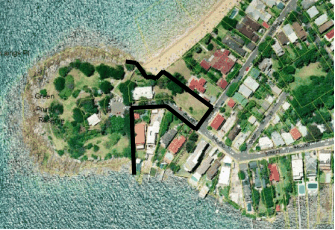
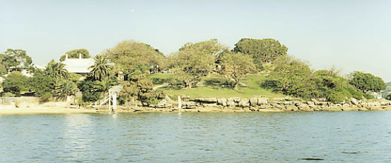
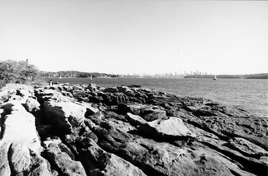
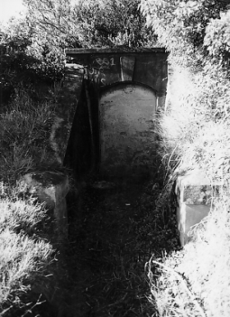
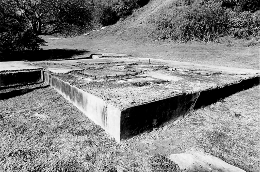
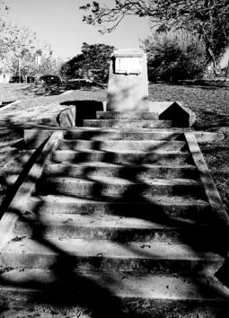

#### C3.4.17 Precinct R: Green (Laings) Point and Research Station

#### Character statement

Green (Laings) Point Reserve is a grassy elevated sandstone headland, with extensive views and water frontage to Sydney Harbour. It separates the two bays of Camp Cove and Watsons Bay (Figure 150). The area was named Green Point in 1788, and granted to Laing in 1793. The area has been formerly known as Laings or Green Point Reserve.

Apart from the former Marine Biological Research Station which is managed by the Sydney Harbour Federation Trust, this area is protected under the National Parks and Wildlife Act 1974 and managed by the National Parks and Wildlife Service. The information in the DCP applying to this precinct is intended to provide a set of guidelines for use by the National Parks and Wildlife Service in the preparation of a plan of management for the precinct and use in the assessment of development proposals.

Green (Laings) Point Precinct is a significant cultural landscape within the Watsons Bay area featuring coral and paperbark trees, a monument to the landing of the First Fleet, evidence of defence structures and the historic marine biological research station.

Contributory items include: A navigational marker (obelisk) erected in 1858 to mark the eastern passage into the harbour; A submarine miners' firing station, which operated the electronic minefield that extended across the harbour opening (1871-1892) including the officers' quarters (currently used as NPWS staff accommodation) and a concrete base for a searchlight tower; A small concrete base to the boom-winch house which is evidence of the anti-torpedo and midget submarine boom net that operated throughout World War II;

Remnants of an anti-motor torpedo boat defensive battery, including gun emplacements, magazine, crew shelter and command (observation) post; The historic former Marine Biological Research Station; and A memorial erected to the first landing at Sydney Harbour.

Views to, from and across Sydney Harbour and to, from and across Camp Cove Beach to South Head are also significant.

#### FIGURE 150

Aerial view of the precinct

> [Picture on page 126: a picture, saved as a picture (images/chapter-c3-watsons-bay-heritage-conservation-area-page-126-9.gif, 150 dpi).]

FIGURE 151  Green (Laings) Point Reserve from the harbour

with the former Marine Biological Research Station at left

> [Picture on page 126: a picture, saved as a picture (images/chapter-c3-watsons-bay-heritage-conservation-area-page-126-12.gif, 150 dpi).]

FIGURE 152  Views across the harbour to

the city from Green (Laings) Point Reserve

> [Picture on page 126: a picture, saved as a picture (images/chapter-c3-watsons-bay-heritage-conservation-area-page-126-15.gif, 150 dpi).]

FIGURE 153  Entry to the anti-motor

torpedo boat defensive battery

> [Picture on page 126: a picture, saved as a picture (images/chapter-c3-watsons-bay-heritage-conservation-area-page-126-18.gif, 150 dpi).]

FIGURE 154  Concrete base to the boom-winch house

> [Picture on page 127: a picture, saved as a picture (images/chapter-c3-watsons-bay-heritage-conservation-area-page-127-2.gif, 150 dpi).]

FIGURE 155  Phillip Memorial

> [Picture on page 127: a picture, saved as a picture (images/chapter-c3-watsons-bay-heritage-conservation-area-page-127-4.gif, 150 dpi).]

#### PRECINCT GUIDELINES

The precinct specific guidelines supplement the general controls for development in Section C3.5. If there is an inconsistency between these precinct guidelines and the general controls, the guidelines take precedence.

Both the Sydney Harbour Federation Trust (SHFT) and the National Parks and Wildlife Service (NPWS) have prepared management plans for the lands under their control. It is recommended that the individual management plans be reviewed to include or be informed by the following policies:

G1 The existing landform of the ridge, slope and rock platform down to the low water mark should be maintained.

G2 Excavation of the rock platform to create footings for jetties, boat ramps or other similar structures should not be permitted.

G3 Mature historic plantings should be retained.

G4 If new plantings are proposed, selected species should be appropriate in scale, canopy size and character to those existing in the cultural landscape.

G5 New plantings should not obscure existing views and vistas.

G6 The lower level of the reserve adjacent to the waterfront should retain its open grassy character.

G7 Jetties, boat ramps and similar structures should not be built over the rock shelf.

G8 Existing extensive views should be retained from the waterfront, particularly the views from the open lower level of Green (Laings) Point Reserve

G9 New development and alterations and additions to existing buildings should not be permitted, except where consistent with the policies contained within an adopted

conservation management plan, including those for siting, orientation, height limits and design.

G10  Unsympathetic existing development should be relocated to be less obtrusive and/or replaced with more sensitively designed structures. Alternatively, other work should be undertaken to improve the visual amenity of such structures, including design and colour alterations. The existing public toilet block should be screened from the waterfront by appropriate plantings.

G11  Fences around existing buildings within Green (Laings) Point Reserve should be of a traditional timber picket to the water side and palings at sides and rear.

G12  Height of fencing should be restricted to 1.2m maximum at the waterfront side and 1.8m at the sides and rear.

G13  No additional public car parking should be provided within the precinct in order to retain its open green character.

G14  Vehicular access to building complexes within Green (Laings) Point Reserve is to be via existing driveways only.

G15  The existing public access should be retained to all foreshore areas.

G16  Any new paths throughout the precinct should be constructed using recessive colours and finishes.

G17  The public domain provisions in Section C3.7 of this chapter apply to the publicly accessible areas of the precinct.

#### Contributory items

Note: Heritage items as identified in Schedule 5 of Woollahra LEP 2014 are also contributory items. For the protection of heritage items refer to clause 5.10 of the LEP.

| Contributory items |  |
|---|---|
| 36 Pacific Street | Single storey Victorian weatherboard Keepers Cottage |
| Green [Laings] Point Reserve | Green Point obelisk [REP23] — a Victorian sandstone obelisk Royal Australia Historical Society sandstone monument to Captain Phillip’s landing at Camp Cove on 21 January 1788 Base of winch house for WW2 anti-torpedo and midget submarine boom net Sandstone rock benches, talus deposits and Platforms Ornamental plantings to northern edge [Coral trees and Melaleucas] Remnant plantings to SW [Hills weeping fig and Port Jackson fig] |
