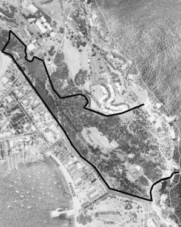
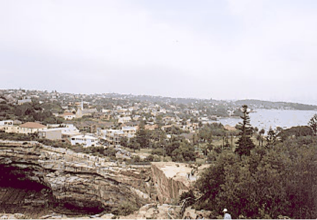
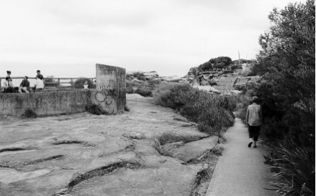

#### C3.4.18 Precinct S: Sydney Harbour National Park (Gap Bluff)

#### Character statement

Sydney Harbour National Park (Gap Bluff) Precinct is bounded by sheer sandstone cliffs on part of its eastern edge and consists mainly of a linear, uneven ridge that runs north-south as a series of platforms (narrow and wide at various points), broken by rock benches.

The area retains evidence of earlier defence structures including gun emplacements, the former artillery school and constable's cottage group.

Although a number of buildings exist within the park (currently used as the Gap Bluff Function Centre), they are dominated by the natural topography and vegetation.

Local native plants are complemented by cultural and ornamental plantings, particularly the post-World War II Norfolk Island Pines which, although they have landmark qualities, are of limited heritage landscape significance.

This area is protected under the National Parks and Wildlife Act 1974 and managed by the NPWS. The information in the DCP applying to this precinct is intended to provide a set of guidelines for use by the National Parks and Wildlife Service in the preparation of a plan of management for the precinct and use in the assessment of development proposals.

#### FIGURE 156

Aerial view of the precinct

> [Picture on page 129: a picture, saved as a picture (images/chapter-c3-watsons-bay-heritage-conservation-area-page-129-19.gif, 150 dpi).]

#### FIGURE 157

Views across Watsons Bay and the harbour to the city

> [Picture on page 129: a picture, saved as a picture (images/chapter-c3-watsons-bay-heritage-conservation-area-page-129-22.gif, 150 dpi).]

FIGURE 158  Remnants of gun emplacements and

the former artillery school are located at the north end

> [Picture on page 130: a picture, saved as a picture (images/chapter-c3-watsons-bay-heritage-conservation-area-page-130-3.gif, 150 dpi).]

#### PRECINCT GUIDELINES

The precinct specific guidelines supplement the general controls for development in Section C3.5. If there is an inconsistency between these precinct guidelines and the general controls, the guidelines take precedence.

Given its public ownership, it is strongly recommended that this precinct is conserved and managed through a specific management plan that includes or is informed by the following management policies:

G1 The existing topography and vegetation should be retained.

G2 Mature pre-1945 plantings should be retained. If new plantings are proposed in the vicinity of existing buildings, species should be selected that are appropriate in scale, canopy size and character to those within their existing curtilage. New plantings should not obscure existing public views and vistas.

G3 Beyond the curtilage of historic buildings, plantings should comprise typical Hawkesbury sandstone heath community plants on exposed platforms and eastern suburbs banksia scrub species in more moist, sheltered western aspects.

G4 The plantation of coral trees in the northwest area of the precinct adjacent to the car park in Cliff Street should be retained, but no further plantings of these trees should be added elsewhere within the park.

G5 Existing extensive views should be retained from within the Park over Watsons Bay and to the waterfront.

G6 Alterations and additions to the Gap Bluff Function Centre should be guided by and be consistent with an adopted management plan, including policies for siting, orientation, height limits and design as well as car parking.

G7 Alterations and additions to the Gap Bluff Function Centre should be sited so as to avoid the removal of cultural plantings and so as not to obstruct existing view corridors.

G8 New buildings should be orientated to minimise visual impact when viewed from the water and surrounding areas.

G9 Any required new buildings on the site should be located adjacent to the Gap Bluff Function Centre complex to minimise impact on the open green character of the National Park.

G10  Any required new buildings should be constructed at a height that is equal to or lower than that of existing buildings within the Gap Bluff Function Centre complex.

G11  New structures should follow established forms, i.e. simple rectilinear plan buildings of a small scale with pitched roofs. New development should not include flat roofed buildings. Roof colours should be recessive.

G12  Only essential new fences and walls should be erected within the National Park. These should be constructed of either sandstone or timber and be of a low, 1.2m maximum height so as to retain the open character of the park.

G13  Higher security fencing should be constructed of a material that allows for view retention and minimal visual impact on the landscape, such as black chain-wire fencing.

G14  Only essential additional car parking on existing paved surfaces should be permitted. The locations and design of any additional car parking and vehicular access facilities should be consistent with an adopted management plan.

G15  The upper and lower level car parks should be provided with additional canopy trees and perimeter shrubs to increase shade and amenity and to provide greater vegetative screening of highly reflective vehicle surfaces.

G16  The existing public access (including disabled access) should be retained throughout the National Park. The public access from the upper levels of the park to the waterfront should be retained.

G17  Any new paths throughout the precinct should be constructed using recessive colours and finishes.

G18  The public domain controls in Section C3.7 apply to the publicly accessible areas of the site.

#### Contributory items

Note: Heritage items as identified in Schedule 5 of Woollahra LEP 2014 are also contributory items. Refer to clause 5.10 of the LEP for heritage conservation controls.

| Contributory items |  |
|---|---|
| NE of the Tide Station on | Remains of the former boatshed and ramp at the inlet |
| Camp Cove Beach |  |
| South Head Sydney Harbour | Cultural plantings |
| National Park | Coral trees, Phoenix palms and Norfolk island pines along Entrance Road |
