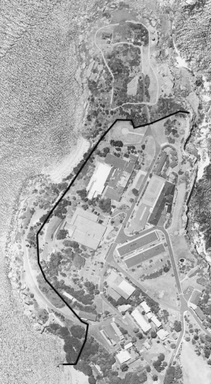
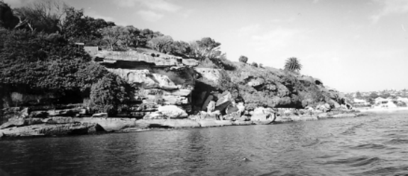
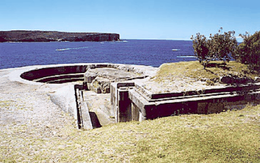
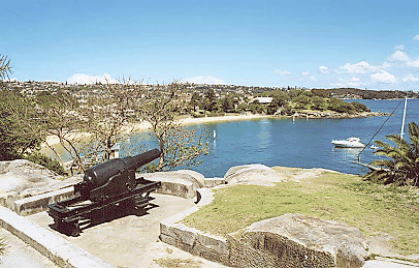
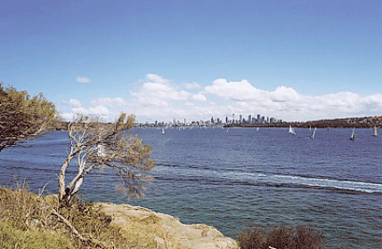
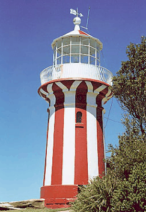

#### C3.4.19 Precinct T: Sydney Harbour National Park (Inner South Head)

#### Character statement

This precinct consists of a rugged coastline fronting both the harbour and the open sea (Figure 161). The natural topography of the west (harbour) edge and the peninsula (South Head) is marked by the historic Hornby Light and associated lighthouse keeper's cottages.

In conjunction with the adjoining HMAS Watson (Precinct Q) and Green (Laings) Point (Precinct R), this area has played an important historic role in the defence of Sydney Harbour since the 1870s.

The narrow, secluded sandy beach of Lady Bay, which disappears at high tide, is defined by sandstone rock benches and cliffs. Built evidence of the historic role this area had in the defence of Sydney Harbour exists in the form of historic gun emplacements overlooking the entrance to the harbour and Camp Cove.

The precinct also features extensive views across the harbour entrance to North Head and across the harbour to the city.

This area is protected under the National Parks and Wildlife Act 1974 and managed by the National Parks and Wildlife Service in conjunction with Gap Bluff (Precinct S) and Green (Laings) Point (Precinct R). The information in the DCP applying to this precinct is intended to provide a set of guidelines for use by the National Parks and Wildlife Service in the preparation of a plan of management for the precinct and use in the assessment of development proposals.

FIGURE 159  Aerial view of the

precinct

> [Picture on page 132: a picture, saved as a picture (images/chapter-c3-watsons-bay-heritage-conservation-area-page-132-22.gif, 150 dpi).]

FIGURE 160  Rugged coastline of sheer sandstone cliff faces

> [Picture on page 132: a picture, saved as a picture (images/chapter-c3-watsons-bay-heritage-conservation-area-page-132-24.gif, 150 dpi).]

FIGURE 161  Former defence structures and extensive

views across the entrance to the harbour

> [Picture on page 133: a picture, saved as a picture (images/chapter-c3-watsons-bay-heritage-conservation-area-page-133-3.gif, 150 dpi).]

FIGURE 162  Former gun emplacement

overlooking Camp Cove

> [Picture on page 133: a picture, saved as a picture (images/chapter-c3-watsons-bay-heritage-conservation-area-page-133-6.gif, 150 dpi).]

#### FIGURE 163

Extensive views across the harbour to the city FIGURE 164  Hornby Light

> [Picture on page 133: a picture, saved as a picture (images/chapter-c3-watsons-bay-heritage-conservation-area-page-133-9.gif, 150 dpi).]

> [Picture on page 133: a picture, saved as a picture (images/chapter-c3-watsons-bay-heritage-conservation-area-page-133-10.gif, 150 dpi).]

#### PRECINCT GUIDELINES

The precinct specific guidelines supplement the general controls for development in Section C3.5. If there is an inconsistency between these precinct guidelines and the general controls, the guidelines take precedence.

Given its public ownership, it is strongly recommended that this precinct is conserved and managed through a specific management plan that includes or is informed by the following management policies:

G1 Existing topography and vegetation should be maintained.

G2 Mature historic plantings should be retained. If new plantings are proposed, select species that are appropriate in scale, canopy size and character to those existing in the cultural landscape. New plantings should not obscure existing public views and vistas. Refer to Section 3.5.6 Landscaping and private open space.

G3 Existing extensive public views to and from the waterfront should be retained.

G4 The existing public access (including disabled access) should be retained throughout the national park. Any new paths within the precinct should be unobtrusive and not constructed of concrete. They should be edged with low border plantings to minimise the visual impact when viewed from above.

G5 Alterations and additions to existing buildings should be guided and managed by appropriate conservation policies. Alterations and additions to existing buildings should be sited so as not to obstruct existing public view corridors.

G6 No new development should occur except where consistent with the policies in the adopted management plan for siting, orientation, height limits and design.

G7 Any required new buildings (including ancillary structures for maintenance equipment and the like) on the site should be located adjacent to existing buildings to minimise the impact of the built environment on the open green character of the national park.

G8 Any required new buildings should be located and designed to minimise the visual impact of such structures when viewed from the water and surrounding public areas.

G9 Any required new buildings should be constructed at a height that is equal to or lower than the ridgeline heights of existing buildings and be surrounded by vegetation. New structures should follow established forms, i.e. simple rectilinear plan of a small scale with pitched roofs. Flat roofed buildings are not appropriate.

G10  Only essential new fences and walls should be erected within the national park. These should be of a low height (1.2m maximum) to retain the open character of the park and constructed of either sandstone or timber. Higher security fencing should be constructed of a material that allows for view retention and minimal visual impact on the landscape, such as black chain-wire fencing.

G11  No public vehicular access is permitted in this area of the national park. The location and design of car parking and vehicular access facilities (limited to maintenance/service vehicles) should be consistent with the policies for such elements in an adopted management plan.

G12  Any new paths throughout the precinct should be constructed using recessive colours and finishes.

G13 The public domain provisions in Section C3.7 apply to the publicly accessible areas of the site.

#### Contributory items

Note: Heritage items as identified in Schedule 5 of Woollahra LEP 2014 are also contributory items. Refer to clause 5.10 of the LEP for heritage conservation controls.

| Contributory items |  |
|---|---|
| Within South Head Sydney | Natural landscape Rugged Hawkesbury sandstone formations, |
| Harbour National Park | natural vegetation and sandy beaches |

> [Picture text on page 135 is stored in the PDF without readable letters (no character map), so it could not be copied; see the original PDF.]
