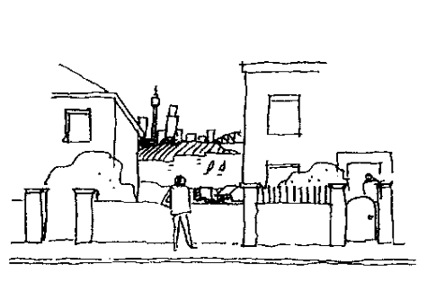
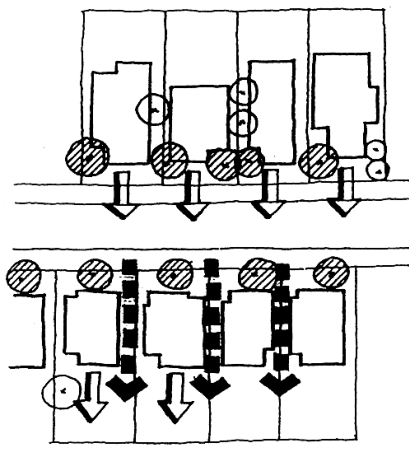
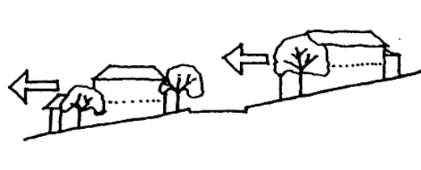

#### C3.5.4 Views and vistas

Note: The objectives for these controls are in Section C3.3 Objectives for development.

#### Controls

C1 View corridors identified from the public domain in the Watsons Bay HCA precinct map are to be retained.

C2 Development is to be designed (including bulk and heights of proposed buildings and vegetation) and located to minimise impact on existing views.

C3 Development is to include opportunities to reinstate identified blocked views and vistas.

C4 Development is not to block views to Watsons Bay from elevated locations including along Old South Head Road from Gap Park, from Robertson Park and the foreshore.

C5 Roofs of development are to be designed and oriented to ensure views from more elevated locations and visual gateways are retained.  Photomontages are to be submitted with development applications demonstrating retention of key views.

C6 Buildings must be setback from side boundaries and adjacent sections of front fences are to be transparent in order to retain and restore view corridors between the street and the harbour.

C7 Building forms are to enable a sharing of views with surrounding residences (refer to Figures 166 and 167).

#### FIGURE 165

Existing views to the harbour between building side setbacks

> [Picture on page 140: a picture, saved as a picture (images/chapter-c3-watsons-bay-heritage-conservation-area-page-140-21.gif, 150 dpi).]

#### FIGURE 166

Creating streetscapes that allow for the retention of significant views

> [Picture on page 141: a picture, saved as a picture (images/chapter-c3-watsons-bay-heritage-conservation-area-page-141-3.gif, 150 dpi).]

#### FIGURE 167

Articulated building forms and setbacks that enable view sharing

> [Picture on page 141: a picture, saved as a picture (images/chapter-c3-watsons-bay-heritage-conservation-area-page-141-6.gif, 150 dpi).]
