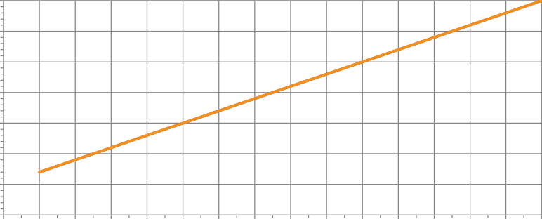
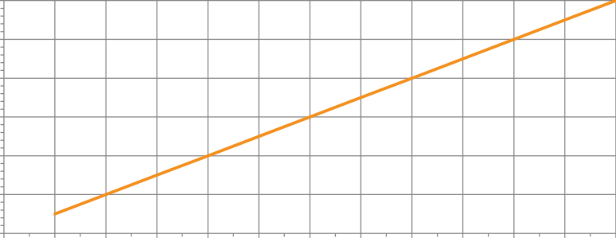
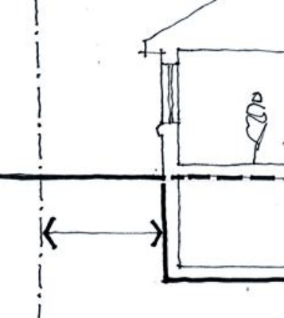

#### C3.5.5 Built form

Note: The objectives for these controls are in Section C3.3 Objectives for development.

The controls below apply to new buildings (infill development) as well as alterations and additions to existing buildings.  For contributory items, the controls below apply in addition to the built form controls for contributory items in Section C3.6.  If there is an inconsistency between the general controls and the controls for contributory items, the contributory item controls prevail.

#### Controls

#### Building footprint

C1 The building footprint is not to exceed 60% of the site area unless stated otherwise in the precinct controls. Total built upon area including paths, driveways, tennis courts, swimming pools and all hardstand areas must not exceed 75% of the site area with a minimum of 25% to be deep soil landscaped area unless stated otherwise in the precinct controls.

C2 The proportion of site coverage is to be no greater than that of adjoining properties and surrounding areas.

C3 Building footprints for residential flat buildings, manor houses, multi dwelling housing and multi dwelling housing (terraces) are limited to 40% of the site area unless stated otherwise in the precinct controls.

C4 Existing development patterns, including building footprint size and spacing between buildings, are to be retained based on precinct type. (Refer to Section C3.4 Precincts).

#### Excavation

Excavation is an accepted part of development in the Woollahra Municipality where the topography varies.  Excavation allows buildings on the sloping sites to be designed to step down and sit into the hillside, and it also enables cars and storage to be accommodated on site in an unobtrusive manner.

However, there are significant environmental impacts associated with extensive excavation, as well as external impacts, such as amenity impacts to adjoining properties during the excavation process.

Council has determined that the volume excavated from a given site should be limited to that which might reasonably be required for car parking and domestic storage requirements, and to allow the building to respond to the site topography in an appropriate manner.

C5 For a dwelling house, dual occupancy or semi-detached dwelling – the maximum volume of excavation permitted is no greater than the volume shown in Figure 168.

C6 For a residential flat building, manor house, multi dwelling housing and multi dwelling housing (terraces), or attached dwelling development – the maximum volume of excavation permitted is no greater than the volume shown in Figure 169. Note: The above volume controls in C5 and C6 do not apply to backyard swimming pools, tennis courts and the like.

C7 For any other use not addressed in C5 and C6 above – the maximum volume of excavation permitted is no greater than the volume shown in Figure 169.

C8 For a site that slopes up from the street—a variation to the volume shown in Figures 168 and 169 may be considered, however the maximum volume of excavation permitted will only be the amount needed to accommodate: car parking to comply with the maximum rates in Part E1 of this DCP and any reasonable access thereto; and storage at a rate of 20m³ per dwelling if for a dwelling house, dual occupancy, semi-detached dwelling or attached housing; or storage at a rate of 8m³ per dwelling if for a residential flat building, manor house, multi dwelling housing and multi dwelling housing (terraces) development.

C9 Sub-surface walls are no closer to the boundary than permitted by the setback controls (refer to Figure 171).

C10 Notwithstanding C9, for excavation in relation to an existing attached dwelling, semi-detached dwelling, or attached dual occupancy—excavation is not to occur under common walls, footings to common party walls, freestanding boundary walls, or footings to freestanding boundary walls.

C11 Excavation below 2m and/or within 1.5m of the boundary is accompanied by a geotechnical and hydrogeological report and a structural report demonstrating that the works will not have any adverse effect on neighbouring structures. Note: Council may identify other circumstances where these reports are required.  All reports must be prepared in accordance with Council’s guidelines. Council may also require the preparation and submission of a pre-commencement dilapidation report for properties neighbouring the development.

#### FIGURE 168

Maximum volume of excavation for:

-a dwelling house

-dual occupancy development

-a semi-detached dwelling.

> [Picture on page 144: a picture, saved as a picture (images/chapter-c3-watsons-bay-heritage-conservation-area-page-144-6.gif, 150 dpi).]

350

300

250

200

150

100

50

#### Permitted excavation m³

0 0 100 200 300 400 500 600 700 800 900 1,000 1,100 1,200 1,300 1,400 1,500

#### Site area m²

#### FIGURE 169

Maximum volume of excavation for:

- residential flat building

-manor houses

-multi dwelling housing development

-multi dwelling housing (terraces)

-attached dwellings - any other land use not addressed in controls in controls C5 to C6 of Section 3.5.5

> [Picture on page 144: a picture, saved as a picture (images/chapter-c3-watsons-bay-heritage-conservation-area-page-144-25.gif, 150 dpi).]

Excavation.

3,000

2,500

2,000

1,500

1,000

500

#### Permitted excavation m³

0 0 250 500 750 1,000 1,250 1,500 1,750 2,000 2,250 2,500 2,750 3,000

#### Site area m²

FIGURE 170

Sub-surface walls can be no closer to the

boundary than the required setback.

> [Picture on page 145: a picture, saved as a picture (images/chapter-c3-watsons-bay-heritage-conservation-area-page-145-4.gif, 150 dpi).]

#### Building siting and alignment

C12   Development is to adopt the established orientation patterns. Where adjoining buildings are oriented to face a view rather than the street, new development is to adopt this orientation.

C13 Development is to conform to the existing pattern of development within the streetscape in terms of setbacks from front boundaries and footprint size.

C14 Where there is a uniform building setback, development is to be aligned to the existing setback pattern. Development is not to be built forward of adjacent buildings.

C15 Where there are  contributory items in the street, development is to match the predominant setback of  contributory items.

C16 Where there is no uniform or predominant building setback, development is to achieve a transitional front setback between the two properties on either side.

C17 The setback of development from side and rear boundaries is to be sufficient to ensure that the residential amenity of neighbouring properties is not unduly affected.

C18 Rear setbacks are to relate to the existing building pattern, to provide rear yard space and to maintain the amenity of neighbouring residential property.

C19  Notwithstanding C18 above, a deeper rear setback may be considered where:

a) development is for a significant single storey cottage adjacent to two storey dwellings; or

b) development is on a site where the directly adjoining properties are underdeveloped; and

c) the deeper rear setback does not unreasonably impact on privacy, solar access or views of the adjoining properties.

C20 Side setbacks are to be a minimum of 1.2m (and 1.5m on lots greater than 15m in width). A variation to setback controls may be considered where the site is less than 10m wide, comprises an irregular shape allotment, contains a service easement or shares a party wall with an adjoining property.

C21 In waterfront precincts, the siting of development is to have regard to views to and from the waterfront and from the harbour.

C22    Ground floor levels of development are to be similar to those of the existing building on the site and adjacent buildings with similar natural ground levels.

#### Building height

Note: The maximum building height control is set by Woollahra LEP 2014.

C23  The height of buildings should not exceed two storeys, except where permitted otherwise by the precinct controls.

C24  New buildings and additions are not to exceed the predominant height of  contributory items in the street. Additionally, the height of a proposed new building may be limited to the height of an adjoining  contributory item (both along the ridgeline of the roof and the height to the eaves).

C25  Where a maximum building height of 8.2m applies (as specified in Woollahra LEP 2014)—the maximum external wall height is to be 6.7m to the underside of the eaves or the top of parapet (where proposed).

C26  The design of new development must conform to the predominant floor and ceiling heights in adjacent  contributory items.

C27  Development is to facilitate view sharing with surrounding buildings and from public roads and public spaces.

#### Solar access

C28 New buildings and additions are to be designed and sited so as to retain sunlight to at least 50% or 35m² with minimum dimension of 3m x 3m (whichever is smaller) of the main ground level private open space of adjacent properties for a minimum of 2 hours between 9am and 3pm on 21 June.

C29 Dwellings are to include at least one north-facing room capable of use as a habitable room.

C30  Windows to north-facing habitable rooms are to receive at least three hours of sun between 9am and 3pm on 21 June over a portion of their surface.

C31  North-facing windows to habitable rooms of neighbouring dwellings are not to have sunlight reduced to less than three hours between 9am and 3pm on 21 June over a portion of their surface.

#### Building form

C32 Buildings are not to visually overwhelm their context or be visually dominant from the street.

C33 Development is to respect the dominant form and massing of existing development within the streetscape, in particular, adjacent or nearby contributory items.

C34 The design of buildings is to respect the simple rectangular footprints and traditional pitched roof forms of existing dwellings in the area.

C35 Roof forms are to be designed to present a traditional appearance (that is, sloping with hipped, gabled or skillion roof form), when viewed from the harbour.

#### Building character

C36 The character of new buildings and additions is to be consistent with the character of nearby and surrounding  contributory items and the character of the streetscape in which they are located.

#### Dormers

C37 The design, proportions and materials of new dormer windows, where permitted, are to be appropriate to the architectural style of the building and the building’s context.

C38 Dormers detailed in a contemporary style may be permitted on non-contributory items where:

a) there would be no adverse impact on adjoining contributory items; and

b) they would not result in privacy or amenity impacts on neighbouring properties.

#### Skylights

C39 Skylights are not to be placed on the front plane of roofs or on other roof planes where they would be intrusive in views from the public domain or affect the amenity of neighbouring properties. The night-tie appearance (that is, when lit from below) is to be taken into consideration.

C40 Skylights are to be limited in number to a maximum of one per 8m2 of rear roof plane. This may be further reduced where dormer windows also exist in the same roof plane.

C41 Skylights are to be of a low profile and flush with the roof surface. Colouring is to merge with the roofing material.

#### Building materials and details

C42 Materials, finishes textures and colour schemes are to be appropriate to the architectural style of the building. No fluorescent primary colours are permitted. Intensity and hue of colour is to relate to the style of the building and to the streetscape context. Roofs are to be neutral colour range with the exception of the maintenance of original terracotta tiles.

C43 The materials and details used are to reflect but not copy the characteristic materials, colours finishes, textures and details of existing surrounding buildings.

C44 Solid to void ratios should be similar to those of  contributory items in the vicinity.

C45 Excessive areas of glazing will not be permitted.

C46 Building materials are to be referenced from the predominant materials evident in the streetscape, but detailed in a contemporary manner.

C47 External colour schemes and materials should respect the character of the streetscape and not detract from contributory items in the street.

C48 Verandahs and balconies are to be sympathetic, contemporary design tinted or reflective glass balustrades are not permitted.

C49 Security, where needed is to be provided by the least obtrusive method (such as shutters, mortice deadlocks, window locks and alarm systems).

C50 Highly visible security grilles embellished with pseudo period detail over windows and doors are not permitted. Metal security doors and window grilles may be acceptable where they use simple, unembellished rectangular bars in a vertical pattern and painted in recessive colours.

C51 Security grilles to windows are to be internally located.

#### Dual occupancy development

C52 If development is for a dual occupancy, the additional controls for dual occupancies in Part B, Chapter B3 General Development Controls of this DCP also apply (refer to Section B3.8 Additional controls for development other than dwelling houses) .
