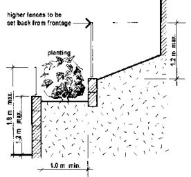

#### C3.5.7 Fences and walls

Note: The objectives for these controls are in Section C3.3 Objectives for development.

#### Controls

C1 Existing sandstone walls with   significance should be retained.

C2 Fences styles and heights are to be based on the architectural style of the building and appropriate traditional heights.

C3 Fences and gates on infill sites are to be of a contemporary design and use details and materials that conform with the building’s context.

C4 The design and materials of front fences is to be compatible with the appropriately designed fences in the streetscape and the heritage context of the area.

C5 For sloping sites, the height of fences and walls may be averaged and fences and walls may be regularly stepped.

C6 Front fences and walls are to be no higher than 1.2m above footpath level unless a taller fence is permitted in the precinct controls. Corner sites must maintain an open form front fence to maintain visibility for traffic and pedestrians.

C7 On sites where the ground level is above the footpath level, a taller fence up to 1.8m max (above footpath level) a taller fence up to 1.8m max (above footpath level) may be permitted if the upper portion of the fence above 1.2m is not more than 50% solid (see Figure 171).

C8 Gates are to be designed so as not to encroach over the street alignment when opening or closing.

#### Side and rear fences and walls

C9 Side and rear boundary fences are to be no higher than 1.8m on level sites or 1.8m as measured from the low side where there is a difference in level either side of the boundary.

C10  Where there is difference in ground level in excess of 1.2m of either side of the boundary the height of fences and walls between allotments may be up to 1.5m above the ground level of the high side.

FIGURE 171   Maximum fence and wall heights

> [Picture on page 153: a picture, saved as a picture (images/chapter-c3-watsons-bay-heritage-conservation-area-page-153-2.gif, 150 dpi).]
