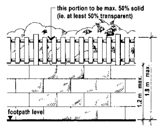

#### C3.5.8 Car parking and access

> [Picture on page 153: a picture, saved as a picture (images/chapter-c3-watsons-bay-heritage-conservation-area-page-153-4.gif, 150 dpi).]

Note: The objectives for these controls are in Section C3.3 Objectives for development.

#### Controls

Refer also to Part E of the DCP, Chapter E1 Parking and Access for parking generation rates and general parking requirements.

C1 The provision of on-site parking structures, parking areas, driveway access and servicing areas (such as loading facilities) is not a general requirement of Council and may not be permitted in any of the following circumstances:

a) if new garages or carports or parking areas would adversely affect the appearance of existing heritage or contributory items or the character of the existing building or streetscape;

b) if the parking of a vehicle will have a detrimental impact on the amenity of adjoining properties;

c) if vehicle entries and exits have a detrimental impact on pedestrian or traffic movements;

d) if inadequate sight distances will result in unsafe vehicle movement to or from the site; or

e) if there will be an adverse impact on the effective use of on-street public parking spaces or public parking management.

C2 The height and bulk of new garages and carports, whether attached or freestanding, is to be subservient to the existing building on the site and to adjacent buildings.

C3 All car parking is to be provided behind the front wall of the dwelling, preferably at the rear of the property. Exceptions may be considered only where the streetscape is characterised otherwise (in particular, in Precinct H and J).

C4 No additional vehicle crossovers are permitted off street frontages where these would result in the removal of original sandstone kerbing.

C5 In streetfront situations where a single crossover exists, it is not to be expanded to facilitate double/multiple garages.

C6 In streetfront situations where a crossover exists, new garage and carport structures are to be of a design and constructed of materials that respond to the relevant aspects of the historic context, including existing buildings and the streetscape. A sympathetic contemporary design is preferred to historic imitation.

C7 Open carport structures are preferred to garages. Where garages are proposed, they are to be designed to complement the building but also to respect  contributory items in the vicinity.

C8 Suitable garage doors (in order of preference) are: bi-fold, panelled doors, panel lift doors or roller shutter doors. Roller doors are not permitted without a masonry surround structure.

C9 Loft structures over garages will only be permitted in the few areas which are already characterised by these structures and where:

a) the form, bulk and scale of the structure will not overwhelm the existing building on the site and on adjoining properties;

b) they will not adversely affect the existing streetscape patterns and character; and

c) they can be included within a roof space of a pitch that reflects surrounding existing development.

C10  Accessways, driveways and parking spaces are to be designed to comply with the minimum requirements of AS 2890.1 1993 - Parking Facilities Part 1 Off-Street Car Parking.

C11  Driveways, parking areas or parking structures are not permitted where their location would adversely affect the existing or long term health of significant trees and vegetation.

C12  Extensive areas of excavation to facilitate car parking/access are not permitted.
