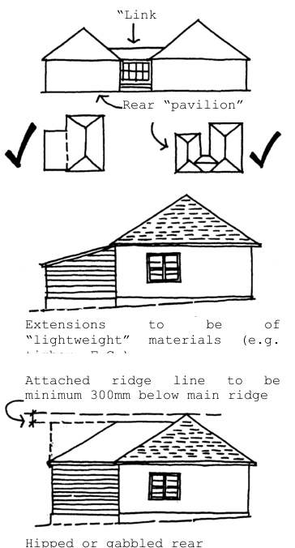
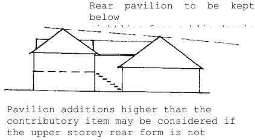
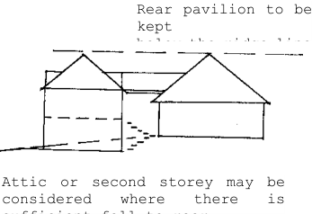
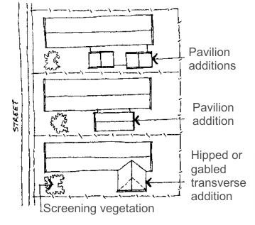
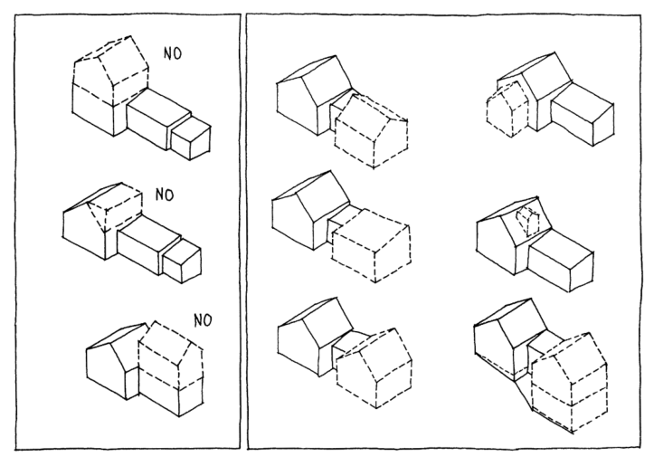

#### C3.6.1 Contributory items

Contributory items are those individual elements within the area that have heritage significance, either as heritage items or contributory items.  Contributory items are the buildings and structures, landscape elements, landmarks or other townscape features such as historic kerbs and gutters that contribute to the overall heritage significance of the Watsons Bay HCA.

The contributory items within the Watsons Bay HCA are identified on Map 3 and also listed in the various precincts in Section C3.4 Precincts of this chapter. Heritage items are listed in Woollahra LEP 2014.

The key contributors in the built form include the late 19th and early 20th century single storey cottages, in particular the early weatherboard cottages. The area retains the largest concentration of weatherboard cottages within the Woollahra Local Government Area.

Other contributory items include the historic commercial development fronting Military Road, 1930s residential flat buildings, historic churches and Inter-War period housing. Landmarks are evident throughout the area in various forms including certain buildings, monuments, trees and other natural features. These items also contribute to the significance of the area and, in some cases, its village character.

#### Objectives

O1 To ensure that heritage items and contributory items are retained and appropriately managed.

O2 To ensure that new development respects the significance of heritage items and contributory items.

O3 To ensure that the contributory single storey dwellings/cottages throughout the area, particularly the weatherboard cottages, are retained as  contributory items that also enhance the character and village scale of Watsons Bay.

O4 To ensure that new development respects the scale and character of significant single storey dwellings/cottages.

O5 To ensure that significant external and internal fabric and spaces within  contributory items are retained and appropriately conserved.

O6 To ensure that significant landmarks are retained and appropriately managed.

#### Controls

C1 Contributory items are to be retained unless overwhelming physical constraints (such as structural integrity, extensive damaged fabric and fire safety requirements) preclude this option.

C2 The significant fabric of contributory items is to be retained.

Note: Heritage items are identified in Schedule 5 of Woollahra LEP 2014. For the protection of heritage items refer to clause 5.10 of the LEP.

#### Alterations and additions to contributory items

Alterations and additions to buildings within Watsons Bay have the potential to adversely affect the streetscape and the heritage significance of the area as a whole.

To retain the heritage significance of the conservation area it is important that changes to contributory items does not adversely affect their heritage value.

Alterations and additions to existing buildings are to be designed and sited to ensure the retention of any contributory features or characteristics of the building and the streetscape in which they are located. It should also remain possible to tell the new work from the old on close inspection.

#### Objectives

O1 To ensure that alterations and additions to a contributory item do not adversely affect the character of the building and the streetscape.

O2 To ensure that alterations and additions to a contributory item that contributes to the significance of the conservation area (i.e. heritage items and contributory items) respect the contributory and/or streetscape values of these items.

O3 To ensure retention of the existing heights and form of contributory single storey dwellings/cottages.

O4 To retain existing significant fabric that contributes to the significance of individual buildings and the overall character of the area.

O5 To restore or reconstruct missing elements, where possible.

#### Siting and alignment

C1 Additions to buildings that are contributory items are to respect their height, form, character and materials.

C2 Additions to the front of contributory items are not permitted.

C3 Additions to a single storey dwelling/cottage are to occur at the rear and are to be unobtrusive when viewed from the street (Figures 172 and 174).

C4 Additions to the side of contributory items, including cottages, may be permitted in rare situations where there is insufficient space at the rear of the building and the addition would respect and enable interpretation of the original form of the existing building.

C5 Side additions to significant single storey dwellings/cottages are to be located towards the rear of the dwelling and are to be screened with vegetation (Figure 173).

#### Height of additions

C1 The height of contributory items, as they present to the street, is not to be increased. This applies irrespective of whether the building is single storey or whether it adjoins or is located between higher buildings.

C2 The height of additions is to be no greater than that of the existing building unless the addition is a pavilion form and the upper storey of the rear form is not visible when viewed from the public domain, and the additions do not adversely affect the appearance and setting of the existing building, nor its streetscape contribution.

#### Form and character

C1 Attic conversions within contributory items, including cottages, are only permitted where the upper floor can be contained wholly within the existing roof space without change to the roof pitch (Figure 174). Dormer windows may be permitted in these circumstances, but only if located in the rear roof plane.

C2 Two storey rear extensions to single storey dwellings/cottages may be permitted where:

a) the land slopes to the rear and can provide for the additional storey as a basement level;

b) the ridgeline of the addition is not to extend above the height of the ridgeline of the existing building; and

c) the roof form is to relate to the original existing roof form (Figure 172).

C3 The form (massing and building arrangement) of additions is to complement and not compete with the existing building. Additions are to generally match the roof pitch, form and proportions of the existing building. (Skillion or 'lean-to' additions may be appropriate at the rear of contributory items, as this is a traditional form of building extension.) (Figure 172 & 174).

C4 Additions to contributory items are to complement but not mimic their character (i.e. architectural design treatment or 'style').

C5 Components/elements that contribute to the significance of the building or the conservation area are not to be altered; in particular, those visible from the streetscape.

C6 The removal of unsympathetic alterations to existing buildings is encouraged, particularly when further work is undertaken.

C7 Internally, room layouts of original portions of contributory cottages are to be retained.

C8 Changes to the roof pitch (i.e. slope) of contributory items are not permitted.

C9 The eaves height of contributory items is not to be raised; for example, by constructing the roof at a higher level in order to accommodate an additional storey.

C10  Contributory items are not to be 'restyled'; i.e. their architectural style is not to be changed.

C11  Additions are not to alter original roof forms of contributory items.

#### Verandahs and balconies

C1 The enclosure or infilling of existing verandahs or balconies is not permitted.

C2 Original verandahs and balconies are not to be altered except for the reinstatement of original details and the reversal of unsympathetic alterations.

C3 Verandahs, balconies and shop awnings may be reinstated on street front elevations where evidence shows that they have previously existed. They should be reconstructed to their former appearance in terms of materials and details.

#### Materials and details

C1 The removal of original materials, details and decorative elements is not permitted unless they are in poor condition. If removed, they are to be replaced using the same or similar materials, details and decorative elements.

C2 Previously unpainted brick or stone walls/surfaces are not to be painted, rendered or bagged.

C3 Mortars for repointing and repair are to match the colour, profile of joint, texture and mix of the original mortar (usually a mixture of lime, putty and sand).

#### Dormers

C1 Dormer windows are not to be added to street front and side elevations unless documentary evidence shows that an original dormer or dormers existed in these locations as part of the original design.

C2 A dormer may be located within the rear slope of the main roof subject to consideration being given to its visual impact when viewed from the public domain, its impact on the building's significance and, where the building forms part of a group, the impact on the group's significance.

C3 More than one dormer window may be located within the rear slope of the main roof subject to the width of the roof being greater than 6m and subject to consideration of the impact on the building's significance and appearance.

C4 The overall height of the dormer window, including the pediment, must be below the main roof ridgeline by at least 300mm.

C5 The design, proportions and materials of new dormers where permitted, are to be based on traditional models, appropriate to the architectural style of the building and the building's context and have the following characteristics:

a) pediment infill for dormer windows must only be weatherboards;

b) the cheeks may be covered in weatherboard or in corrugated profile steel sheeting, depending on the building's architectural style and context;

c) windows shall be traditional double hung windows or pivoting wings with casement

> [Picture on page 162: a picture, saved as a picture (images/chapter-c3-watsons-bay-heritage-conservation-area-page-162-13.gif, 150 dpi).]
> Words printed on the picture (title and legend, copied from the PDF):
> “Link
> Rear “pavilion”
> Extensions to be of
> “lightweight” materials (e.g.
> timber F C )
> Attached ridge line to be
> minimum 300mm below main ridge

stays: and

d) dormers are not to incorporate balconies.

FIGURE 172  Rear additions to single storey dwellings

> [Picture on page 162: a picture, saved as a picture (images/chapter-c3-watsons-bay-heritage-conservation-area-page-162-17.gif, 150 dpi).]
> Words printed on the picture (title and legend, copied from the PDF):
> Rear pavilion to be kept
> below
> sightline from public domain
> Pavilion additions higher than the
> contributory item may be considered if
> the upper storey rear form is not

> [Picture on page 162: a picture, saved as a picture (images/chapter-c3-watsons-bay-heritage-conservation-area-page-162-18.gif, 150 dpi).]
> Words printed on the picture (title and legend, copied from the PDF):
> Rear pavilion to be
> kept
> below the ridge line
> Attic or second storey may be
> considered where there is

sufficient fall to rear

Hipped or gabbled rear

additions

FIGURE 173  Side additions to cottages are to be towards the rear

> [Picture on page 163: a picture, saved as a picture (images/chapter-c3-watsons-bay-heritage-conservation-area-page-163-2.gif, 150 dpi).]
> Words printed on the picture (title and legend, copied from the PDF):
> Pavilion
> additions
> Pavilion
> addition
> Hipped or
> gabled
> transverse
> addition
> Screening vegetation

FIGURE 174  Rear additions to significant single storey dwellings/cottages

> [Picture on page 163: a picture, saved as a picture (images/chapter-c3-watsons-bay-heritage-conservation-area-page-163-4.gif, 150 dpi).]
