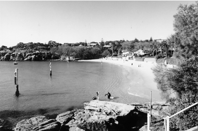
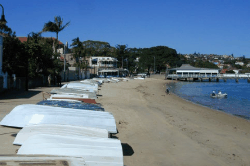
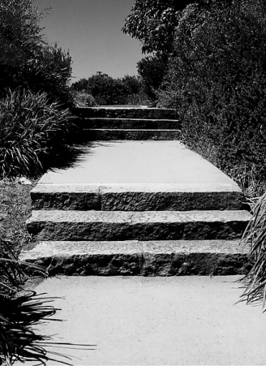

#### C3.7.1 Beaches, waterfront and public access

#### Beaches

C1 The natural qualities of the beaches should be retained and rock platforms protected.

C2 Direct public access should be retained to the beaches.

C3 Views to the beaches from the water should not be obscured by a proliferation of structures such as wharves, jetties, boat ramps, clubhouses, landings and the like. The cumulative effects of such structures should also be assessed when new structures are being considered.

Camp Cove Beach

> [Picture on page 171: a picture, saved as a picture (images/chapter-c3-watsons-bay-heritage-conservation-area-page-171-10.gif, 150 dpi).]

#### Waterfront

C4 Public promenades should be retained along the waterfront and from Marine Parade to The Gap through Robertson Park.

C5 Views from the public domain to the waterfront or the harbour should not be obscured by structures such as kiosks, public facilities such as telephone booths, wharves, jetties, and the like. The cumulative effects of such structures should also be assessed.

C6 Continuity of public access to the waterfront and along the promenade must be retained and, where possible be enhanced.

North end of Marine Parade

> [Picture on page 171: a picture, saved as a picture (images/chapter-c3-watsons-bay-heritage-conservation-area-page-171-20.gif, 150 dpi).]

#### Public access

C7 Continuous public access (including disabled access) linkages should be retained and created to the harbour foreshore.

C8 Opportunities should be retained and created for pedestrian circulation throughout the Watsons Bay area.

C9 The pedestrian network of public stairways and promenades has historic significance and should be retained, recognised and enhanced.

Pathway and steps, Sydney Harbour National Park (Inner South Head)

> [Picture on page 172: a picture, saved as a picture (images/chapter-c3-watsons-bay-heritage-conservation-area-page-172-9.gif, 150 dpi).]
