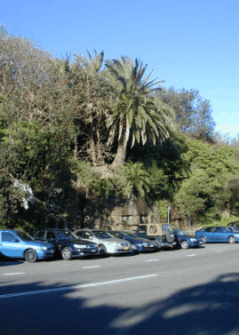
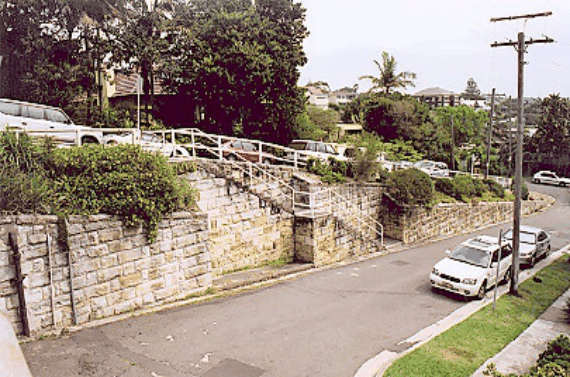
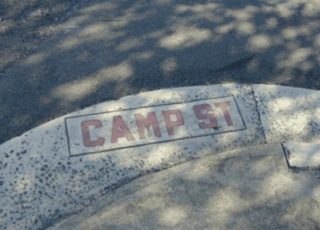
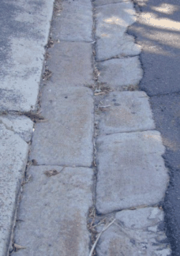

#### C3.7.2 Landscape elements and kerbs and gutters

#### Landscape elements

C1 Significant landscape elements such as cultural plantings (street trees and park vegetation), sandstone retaining walls, and steps should be retained and conserved in situ using appropriate conservation methods.

C2 New retaining walls should be of similar design to traditional retaining walls in the area in terms of their character, height and materials. Appropriate materials may include sandstone and face brick.

C3 Materials for new steps should be concrete or sandstone, depending on their function and the significance of their location.

C4 New steps and ramps should be designed and located to enhance amenity and opportunities for vistas.

Cultural plantings on Cliff Street Sandstone retaining wall along Salisbury Street

> [Picture on page 173: a picture, saved as a picture (images/chapter-c3-watsons-bay-heritage-conservation-area-page-173-14.gif, 150 dpi).]

> [Picture on page 173: a picture, saved as a picture (images/chapter-c3-watsons-bay-heritage-conservation-area-page-173-15.gif, 150 dpi).]

#### Kerbs and gutters

C5 Meaningful sections of original sandstone kerbs and gutters should be retained in situ to enhance interpretation. New paving should not adversely impact on the fabric or setting of sandstone kerbs and gutters.

C6 Kerbs and gutters that incorporate street names should be retained.

C7 Damaged original sandstone kerbs and gutters should be restored where possible or replaced with new sandstone kerbs and gutters.

C8 New kerb and guttering should be constructed in similar materials and details to that of original fabric.

C9 New sandstone kerbing should be used where appropriate to the context and is to be detailed to match the existing kerbing. Where concrete kerbs are to be used, preference should be for precast segmental elements.

C10  Original kerb alignments should be retained to preserve the character of the streets.

C11  Screen planting (using appropriate species) should be provided to off-street public car parking areas to soften their visual impact, increase shade and provide a visual barrier to adjacent residential development.

Camp Street name incorporated into gutter

> [Picture on page 174: a picture, saved as a picture (images/chapter-c3-watsons-bay-heritage-conservation-area-page-174-11.gif, 150 dpi).]

Sandstone guttering

> [Picture on page 174: a picture, saved as a picture (images/chapter-c3-watsons-bay-heritage-conservation-area-page-174-13.gif, 150 dpi).]
