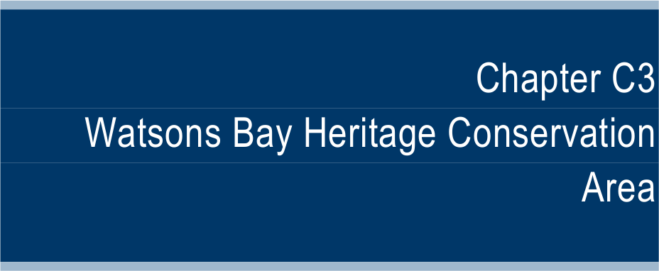

# Woollahra Development Control Plan 2015 - Chapter C3 Watsons Bay Heritage Conservation Area

> This chapter is split into 70 section file(s), one per numbered heading, in the order they appear in the PDF.

Source PDF: [chapter-c3-watsons-bay-hca.pdf](chapter-c3-watsons-bay-hca.pdf)

> [Picture on page 1: a picture, saved as a picture (images/chapter-c3-watsons-bay-heritage-conservation-area-page-1-1.gif, 150 dpi).]

### Chapter C3

### Watsons Bay Heritage Conservation

### Area

### Part C  Heritage Conservation Areas

### CHAPTER C3 APPROVED ON 27 APRIL 2015 AND COMMENCED ON 23 MAY 2015

### Last amended on 22 December 2023

<!-- sections -->
## Sections

1. [C3 Watsons Bay HCA](01-c3-watsons-bay-hca.md)
2. [C3.1.1 Background](02-c3-1-1-background.md)
3. [C3.1.2 Land where this chapter applies](03-c3-1-2-land-where-this-chapter-applies.md)
4. [C3.1.3 Development to which this chapter applies](04-c3-1-3-development-to-which-this-chapter.md)
5. [C3.1.4 Objectives](05-c3-1-4-objectives.md)
6. [C3.1.5 Relationship to other parts of the DCP](06-c3-1-5-relationship-to-other-parts-of-the-dcp.md)
7. [C3.1.6 Definitions](07-c3-1-6-definitions.md)
8. [C3.1.7 How to use this chapter](08-c3-1-7-how-to-use-this-chapter.md)
9. [C3.2.1 Historic context](09-c3-2-1-historic-context.md)
10. [C3.2.2 General character description](10-c3-2-2-general-character-description.md)
11. [C3.2.3 Statement of significance](11-c3-2-3-statement-of-significance.md)
12. [C3.2.4 Key heritage values](12-c3-2-4-key-heritage-values.md)
13. [C3.2.5 Management policy](13-c3-2-5-management-policy.md)
14. [C3.3 Objectives for development](14-c3-3-objectives-for-development.md)
15. [C3.3.1 Topography and vegetation](15-c3-3-1-topography-and-vegetation.md)
16. [C3.3.2 Townscape](16-c3-3-2-townscape.md)
17. [C3.3.3 The waterfront](17-c3-3-3-the-waterfront.md)
18. [C3.3.4 Views and vistas](18-c3-3-4-views-and-vistas.md)
19. [C3.3.5 Built form](19-c3-3-5-built-form.md)
20. [3.3.5.1 Building footprint](20-3-3-5-1-building-footprint.md)
21. [3.3.5.2 Building siting and alignment](21-3-3-5-2-building-siting-and-alignment.md)
22. [3.3.5.3 Building height](22-3-3-5-3-building-height.md)
23. [3.3.5.4 Building form](23-3-3-5-4-building-form.md)
24. [3.3.5.5 Building character](24-3-3-5-5-building-character.md)
25. [3.3.5.6 Building materials and details](25-3-3-5-6-building-materials-and-details.md)
26. [C3.3.6 Landscaping and private open space](26-c3-3-6-landscaping-and-private-open-space.md)
27. [C3.3.7 Fences and walls](27-c3-3-7-fences-and-walls.md)
28. [C3.3.8 Car parking and access](28-c3-3-8-car-parking-and-access.md)
29. [C3.3.9 Site facilities and aerial devices](29-c3-3-9-site-facilities-and-aerial-devices.md)
30. [C3.3.10 Acoustic and visual privacy](30-c3-3-10-acoustic-and-visual-privacy.md)
31. [C3.4 Precincts](31-c3-4-precincts.md)
32. [C3.4.1 Precinct A: Entrance](32-c3-4-1-precinct-a-entrance.md)
33. [C3.4.2 Precinct B: Church Group](33-c3-4-2-precinct-b-church-group.md)
34. [C3.4.3 Precinct C: Vaughan Village](34-c3-4-3-precinct-c-vaughan-village.md)
35. [C3.4.4 Precinct D: Commercial and residential flat buildings](35-c3-4-4-precinct-d-commercial-and-residential.md)
36. [C3.4.5 Precinct E: Gap Road/Dunbar Street](36-c3-4-5-precinct-e-gap-road-dunbar-street.md)
37. [C3.4.6 Precinct F: Clovelly Street](37-c3-4-6-precinct-f-clovelly-street.md)
38. [C3.4.7 Precinct G: Marine Parade North](38-c3-4-7-precinct-g-marine-parade-north.md)
39. [C3.4.8 Precinct H: Victoria Street Waterfront](39-c3-4-8-precinct-h-victoria-street-waterfront.md)
40. [C3.4.9 Precinct J: Pacific Street Waterfront](40-c3-4-9-precinct-j-pacific-street-waterfront.md)
41. [C3.4.10 Precinct K: Camp Cove Village](41-c3-4-10-precinct-k-camp-cove-village.md)
42. [C3.4.11 Precinct L: Salisbury Street / Hopetoun Avenue](42-c3-4-11-precinct-l-salisbury-street-hopetoun.md)
43. [C3.4.12 Precinct M: Robertson Park](43-c3-4-12-precinct-m-robertson-park.md)
44. [C3.4.13 Precinct N: Robertson Place](44-c3-4-13-precinct-n-robertson-place.md)
45. [C3.4.14 Precinct O: Gibsons Beach Waterfront and Marine Parade South](45-c3-4-14-precinct-o-gibsons-beach-waterfront-and.md)
46. [C3.4.15 Precinct P: Upper Gap Park](46-c3-4-15-precinct-p-upper-gap-park.md)
47. [C3.4.16 Precinct Q: HMAS Watson](47-c3-4-16-precinct-q-hmas-watson.md)
48. [C3.4.17 Precinct R: Green (Laings) Point and Research Station](48-c3-4-17-precinct-r-green-laings-point-and.md)
49. [C3.4.18 Precinct S: Sydney Harbour National Park (Gap Bluff)](49-c3-4-18-precinct-s-sydney-harbour-national-park.md)
50. [C3.4.19 Precinct T: Sydney Harbour National Park (Inner South Head)](50-c3-4-19-precinct-t-sydney-harbour-national-park.md)
51. [C3.5 General controls for all development](51-c3-5-general-controls-for-all-development.md)
52. [3.5.4 Views and vistas](52-3-5-4-views-and-vistas.md)
53. [3.5.10 Acoustic and visual privacy](53-3-5-10-acoustic-and-visual-privacy.md)
54. [C3.5.1 Topography and vegetation](54-c3-5-1-topography-and-vegetation.md)
55. [C3.5.2 Townscape](55-c3-5-2-townscape.md)
56. [C3.5.3 The waterfront](56-c3-5-3-the-waterfront.md)
57. [C3.5.4 Views and vistas](57-c3-5-4-views-and-vistas.md)
58. [C3.5.5 Built form](58-c3-5-5-built-form.md)
59. [C3.5.6 Landscaping and private open space](59-c3-5-6-landscaping-and-private-open-space.md)
60. [C3.5.7 Fences and walls](60-c3-5-7-fences-and-walls.md)
61. [C3.5.8 Car parking and access](61-c3-5-8-car-parking-and-access.md)
62. [C3.5.9 Site facilities and aerial devices](62-c3-5-9-site-facilities-and-aerial-devices.md)
63. [C3.5.10 Acoustic and visual privacy](63-c3-5-10-acoustic-and-visual-privacy.md)
64. [C3.6 Contributory items: additional built form controls](64-c3-6-contributory-items-additional-built-form.md)
65. [C3.6.1 Contributory items](65-c3-6-1-contributory-items.md)
66. [C3.6.2 Inter-War residential flat buildings](66-c3-6-2-inter-war-residential-flat-buildings.md)
67. [C3.6.3 Timber buildings](67-c3-6-3-timber-buildings.md)
68. [C3.7 Public domain](68-c3-7-public-domain.md)
69. [C3.7.1 Beaches, waterfront and public access](69-c3-7-1-beaches-waterfront-and-public-access.md)
70. [C3.7.2 Landscape elements and kerbs and gutters](70-c3-7-2-landscape-elements-and-kerbs-and-gutters.md)
