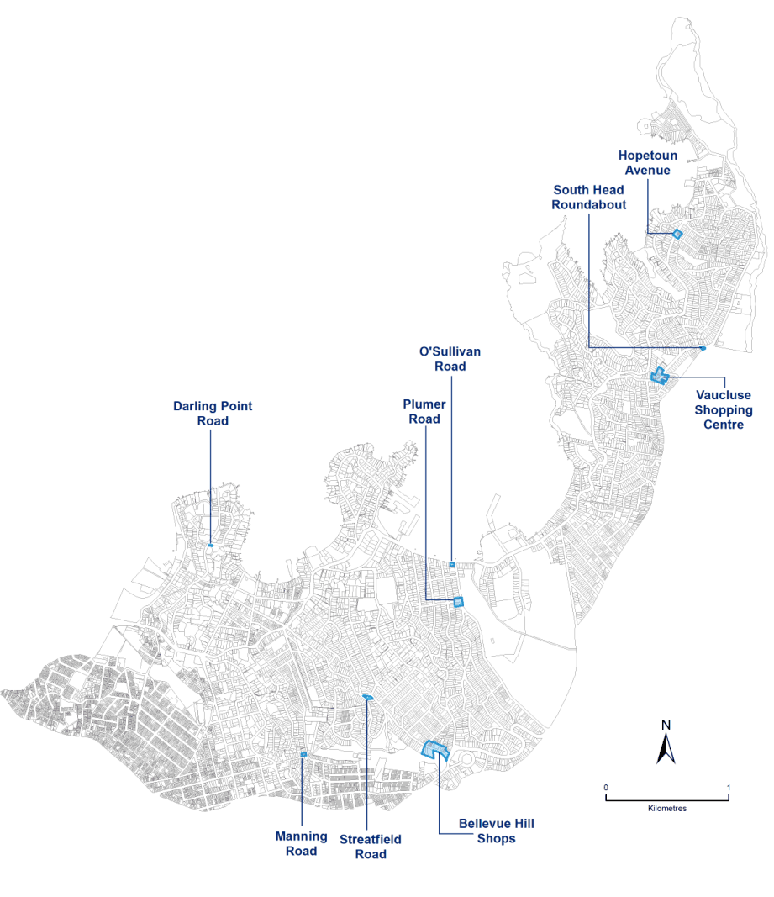

#### D1.1 Introduction

This is Chapter D1 of the Woollahra Development Control Plan 2015 (DCP), Part D Business Centres. This chapter contains controls for nine centres, zoned E1 Local Centre under Woollahra Local Environmental Plan 2014 (Woollahra LEP 2014). This chapter seeks to ensure that development has regard to its context and is compatible with the desired future character of each centre as described in this chapter.

#### D1.1.1 Land where this chapter applies

This chapter applies to the following centres, as identified on Map A (see next page): Hopetoun Avenue, Vaucluse South Head Roundabout, Vaucluse Vaucluse Shopping Village, Vaucluse Plumer Road, Rose Bay O’Sullivan Road, Rose Bay Streatfield Road, Bellevue Hill Bellevue Hill Shops, Bellevue Hill Manning Road, Woollahra Darling Point Road, Darling Point.

#### D1.1.2 Development to which this chapter applies

This chapter applies to development that requires development consent.

A key objective of the E1 zone is to provide a range of small-scale retail, business and community uses that serve the needs of people who live or work in the surrounding neighbourhood.

The E1 zone permits a limited range of retail premises including shops, restaurants and cafes, take-away food and drink premises; the zone also permits business premises, office premises, community facilities and shop top housing.  (Refer to Woollahra LEP 2014 for all the types of development permitted in the zone.)

MAP A  Land where Chapter D1 applies

> [Picture on page 8: a picture, saved as a picture (images/chapter-d1-neighbourhood-centres-page-8-2.gif, 150 dpi).]

#### D1.1.3 Objectives

The objectives of this chapter are:

O1 To support the long term retail health of the neighbourhood centres.

O2 To facilitate development in a way that reflects desired future character objectives for each centre.

O3 To preserve the small shop character of each centre.

O4 To ensure a high standard of architectural and landscape design.

O5 To ensure that development enhances the visual quality and identity of the centre through well considered design, high quality materials and facade colours that do not dominate the street.

O6 To ensure that the design and siting of development is compatible with the surrounding built form.

O7 To encourage active ground floor uses that contribute to the vitality of the centre.

O8 To encourage a complementary mix of small scale retail, business, office and residential uses compatible with the desired future character of the centre.

O9 To facilitate people living in mixed use developments in the centres, and provide for good residential amenity.

O10 To provide a range and mix of dwellings that are compatible with shops and/or business and office uses.

O11 To minimise adverse impacts of development on the amenity of adjoining and neighbouring properties.

O12 To retain significant views and vistas.

O13 To improve the amenity of public domain and pedestrian safety.

#### D1.1.4 Relationship to other parts of the DCP

This chapter is to be read in conjunction with the other parts of the DCP that are relevant to the development proposal, including: Part D: Chapter D3 General Controls for Neighbourhood and Mixed Use Centres. Part E: General Controls for All Development – this part contains chapters on Parking and Access, Stormwater and Flood Risk Management, Tree Management, Contaminated Land, Waste Management, Sustainability, Signage and Adaptable Housing. Part F: Land Use Specific Controls – this part contains chapters on Child Care Centres, Educational Establishments, Licensed Premises and Telecommunications.

#### D1.1.5 How to use this chapter

> [Picture text on page 10 is stored in the PDF without readable letters (no character map), so it could not be copied; see the original PDF.]

The primary controls for the neighbourhood centres are contained in two chapters: Chapter D1 Neighbourhood Centres; and Chapter D3 General Controls for Neighbourhood and Mixed Use Centres.
