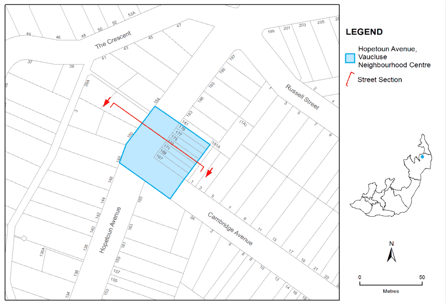
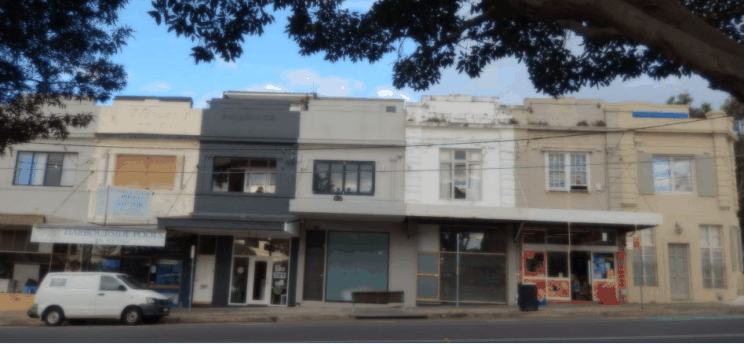
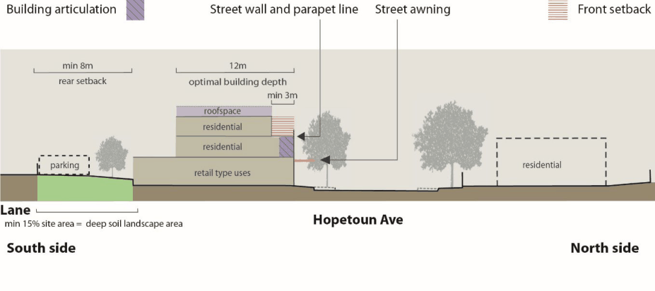

#### D1.2 Hopetoun Avenue, Vaucluse

MAP 1  Hopetoun Avenue centre map

> [Picture on page 12: a picture, saved as a picture (images/chapter-d1-neighbourhood-centres-page-12-3.gif, 150 dpi).]

#### D1.2.1 Centre character statement

The Hopetoun Avenue neighbourhood centre is located on an elevated slope on Hopetoun Avenue, at the corner of Cambridge Street Vaucluse; it is within a kilometre of Watsons Bay.

This is a relatively small centre, comprising a row of seven shop top premises, including a neighbourhood shop.  Other businesses currently located in the centre are a pool shop and food catering business.  Some of the ground floor shopfronts do not provide active uses, and one of these appears to contain a residential use.  These inactive shopfronts detract from the role of the centre, its vitality and amenity.

#### Historical development of the area

Land in and near the centre was subdivided in the early 1900s. Access to Vaucluse was by ferry landing at nearby Parsley Bay or near Gibson Reserve. Larger waterfront blocks were released and built upon first. Substantial housing development followed in the 1920s and 1930s, whilst Vaucluse Council resisted residential flat building in the municipality. The nearby Vaucluse Primary School opened in 1925.

#### Built form

The centre comprises two groups of buildings at 167-171and 173-179 Hopetoun Avenue.  These are a short row of Inter-war two storey shop top housing with some recent three storey additions. The shop top buildings are all built to the street alignment with continuous awnings and parapets. The building stock around the centre is represented by larger detached residential dwellings of generally high quality and set in generous gardens.

#### Public parks and community facilities

Gibson Park, Parsley Bay Reserve and Vaucluse Public School are located close to the centre.

#### Public domain

The asphalt footpath and minimal street furniture provide a basic standard of pedestrian amenity.

#### Access and circulation

The centre is on the Watsons Bay bus route, although most shoppers would use car transport or arrive on foot from nearby residences. On street parking is adequate for the low levels of retail activity.

#### Views and aspect

The centre enjoys a pleasant elevated north-westerly aspect. The church steeple of Our Lady Star of the Sea on New South Head Road at Watsons Bay may be seen when looking north-east from the upper levels of the shop top housing in the centre.

Hopetoun Avenue

> [Picture on page 13: a picture, saved as a picture (images/chapter-d1-neighbourhood-centres-page-13-21.gif, 150 dpi).]

#### D1.2.2 Desired future character

The Hopetoun Avenue neighbourhood centre is a small centre located within a continuous row of shop top housing.  The Inter-war buildings 167-171 and 173-179 Hopetoun Avenue make an

attractive contribution to the streetscape, exhibiting a cohesive street wall, strong character elements, and establishing the scale and character of the centre. Redevelopment within the centre should protect the fabric and character of these buildings.

The centre is located within an established residential area and there is great potential for the centre to become more of a community hub. The ground floor uses are to establish active frontages with small scale shops and services, particularly those that provide for the daily convenience needs of surrounding residents, such as a cafe, bakery and grocers. Residential uses will occur on the upper levels.

#### D1.2.3 Objectives and controls

The street diagram illustrates some of the controls, and is to be read in conjunction with the table of objectives and controls below.  Note, the maximum building height and FSR are in Woollahra LEP 2014.

FIGURE 1  Hopetoun Avenue street section

> [Picture on page 14: a picture, saved as a picture (images/chapter-d1-neighbourhood-centres-page-14-14.gif, 150 dpi).]

| Objectives | Controls |
|---|---|
| O1 To provide uses that are consistent with C1 Development supports the adaptive the desired future character of the re-use of existing shop top units. centre. C2 The ground level contains active uses, preferably shops, and cafés including outdoor dining, that meet the daily convenience needs of the local community. C3 Residential uses located above street level in the form of shop top housing. |  |
| O2 To protect the fabric and character of the C4 Development does not include infill of existing Inter-war shop top buildings. original verandahs. C5 Development includes a continuous solid suspended awning over the public footpath and along the return into Cambridge Street. |  |
| O3 To retain a coherent streetscape with a C6 Development is a maximum of three consistent street wall and parapet line. storeys. C7 Development retains two storeys built to the street alignment, as well as the continuous parapet line. C8 Development on the third level is setback from the street boundary as shown. C9 Development does not include vehicular access off Hopetoun Avenue. |  |
| O4 To encourage good building design and C10 Building articulation at the street limit building bulk. alignment is in the form of recessed balconies or loggia only. Elsewhere it may be in the form of verandahs, balconies, loggia or wall offsets. |  |

| Objectives | Controls |
|---|---|
| O5 To provide for the amenity of occupants C11 The building depth for storeys above the and adjoining properties. ground floor level is generally not more than 12m. C12 The building is setback from the rear boundary by at least 8m. C13 At least 15% of the site is provided as deep soil landscaped area. |  |
| O6 To improve the pedestrian environment. C14 Development includes advanced tree planting as a formal row of shade trees. |  |
| O7 To encourage footpath dining in areas C15 Footpath dining areas receive a minimum with good solar access. 2 hours solar access each day. |  |
