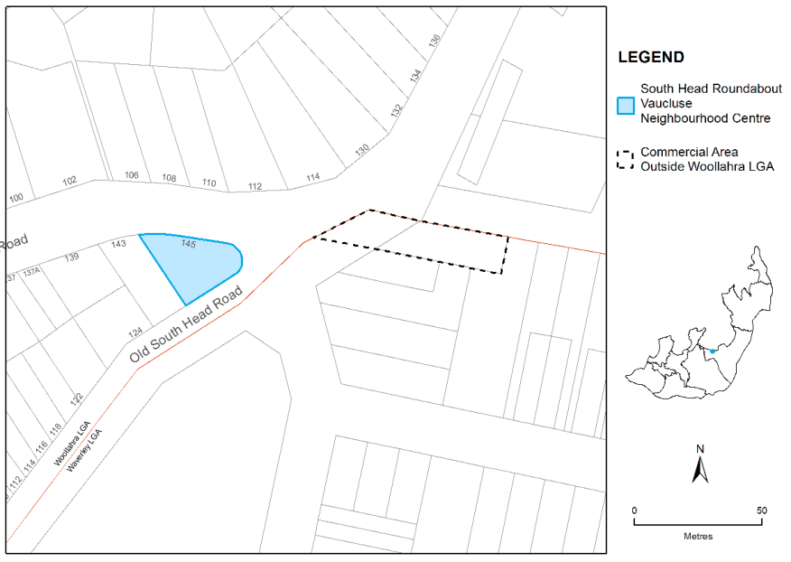
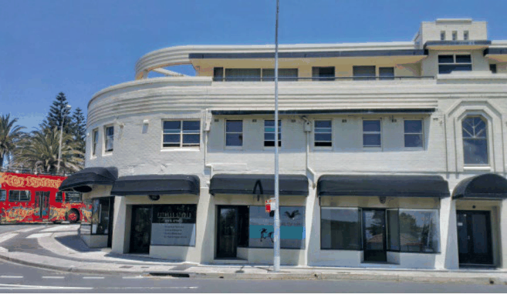

#### D1.3 South Head Roundabout, Vaucluse

MAP 2  South Head Roundabout centre map

> [Picture on page 17: a picture, saved as a picture (images/chapter-d1-neighbourhood-centres-page-17-3.gif, 150 dpi).]

#### D1.3.1 Centre character statement

South Head Roundabout shops are located on New South Head Road at the junction with Old South Head Road.  These shops are located in an Inter-war building which provides a significant landmark at this broad open intersection.  The centre provides a small selection of specialty shops and personal services, such as a hair dresser, clothes alterations, art gallery, homewares shop and fitness studio.  Residential uses occur on the upper level.

This centre is located across the road from a small group of two shopfronts currently used as a café and bakery, located in the Waverley Council area.  The connections and relationship between these centres are compromised by the relatively busy roundabout at the intersection New South Head Road and Old South Head Road.

#### Historical development of the area

New South Head Road was constructed as a link to Watsons Bay during the 1830s. The South Head Cemetery was dedicated in 1845. Land in and near the centre was subdivided in the early 1900s at the same time as a tramline along New South Head Road was introduced. However, substantial housing development did not proceed until the 1920s and 1930s. Vaucluse Council resisted residential flat building in the municipality, but there were some Inter-war flat buildings built on New South Head Road near the centre. Vaucluse High School adjacent to the centre opened in 1960, the same year that the tram service ceased.

#### Built form

This neighbourhood centre is contained in a single well conserved Inter-war building that includes a sympathetic third floor addition for residential use. The building addresses the corner at the roundabout and New South Head Road, and has a continuous parapet line and a series of canvas awnings. Across the roundabout in the Waverley Municipality is a mix of 20th century architecture of varying quality and scale, and a recent five storey residential flat building facing Christison Park.

#### Public parks and community facilities

Christison Park and the South Head Cemetery are both within 100m of the site. Christison Park offers recreational opportunities in proximity to the neighbourhood centre.

#### Public domain

The standard asphalt footpath pavement and the exposed corner situation on the roundabout afford little pedestrian amenity.

#### Access and circulation

The centre is well located on bus routes operating on both New South Head Road and Old South Head Road. It is accessible by car and provides a limited number of off-street car parking spaces. The speed and volume of vehicles moving through the roundabout compromise pedestrian amenity and safety.

#### Views and aspect

To the north-east, beyond the roundabout, the centre has a distant outlook to Christison Park. To the north, harbour views are afforded from the upper storeys of the Inter-war building.

New South Head Road and Old South Head Road

> [Picture on page 19: a picture, saved as a picture (images/chapter-d1-neighbourhood-centres-page-19-2.gif, 150 dpi).]

#### D1.3.2 Desired future character

The South Head Roundabout neighbourhood centre will continue to be a relatively small centre that provides a range of specialty shops and personal services that service the local community, and supplement the nearby Vaucluse village which provides a greater range of local convenience shops and services. Office and residential uses will occur on the upper levels.

This neighbourhood centre is located in an Inter-war building which provides a strong and visually attractive landmark at this major intersection of New South Head Road and Old South Head Road. The building is a good intact example of the ocean liner style and it is important that the building and key elements, such as the continuous parapet line, stay intact. Although the original face brickwork has been painted and the original awning has been removed, the consistent canvas awnings and under-awning signage make a positive contribution to the streetscape and this visual unity should be retained.

At the street level, large glass shop frontages provide great opportunity for interesting and attractive shopfront displays that contribute to the amenity of the pedestrian environment; the surface area of these windows should generally remain transparent to provide for permeability into shopfronts and promote active street frontages.

#### D1.3.3 Objectives and controls

| Objectives | Local controls |
|---|---|
| O1 To provide uses that are consistent C1 Development supports adaptive re-use of with the desired future character of existing retail units. the centre. C2 The ground level contains active uses, preferably a range of local and speciality shops and business premises that meet the needs of the local community. C3 The upper levels generally contain office uses, and/or residential uses. |  |
| O2 To protect the fabric and character of the C4 Development is sympathetic to the existing Inter-war building. existing character and fabric of the Inter-war building. C5 Development retains a coherent streetscape with a consistent street wall and parapet line. C6 Development is a maximum of three storeys. C7 Development reinstates a fixed stepped awning, on its original alignment, to the building façade. The colour and materials of the awning respect the architecture and character of the building. |  |
| O3 To improve the pedestrian environment C8 Development improves the existing and connections to commercial activity landscape treatment and includes on the eastern side of the roundabout. streetscape improvements. |  |
