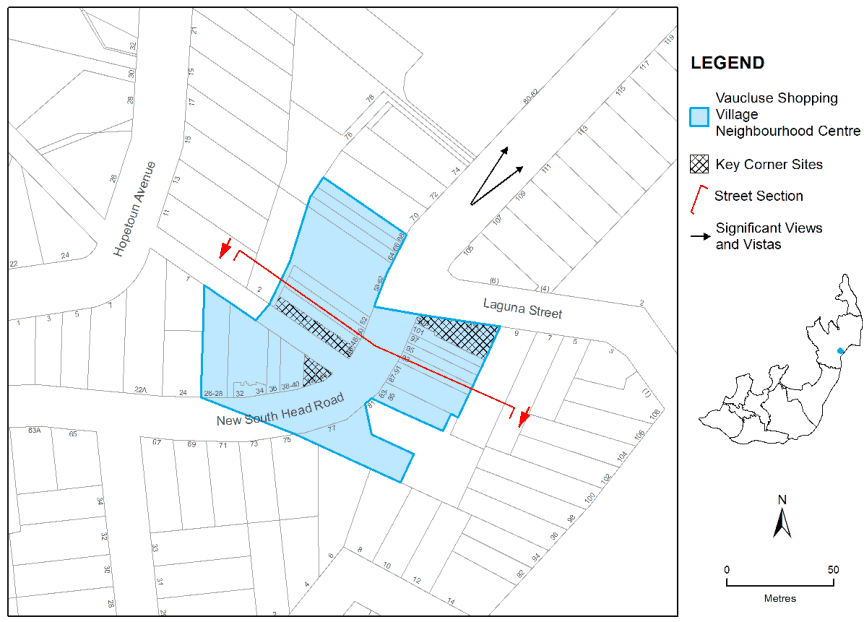
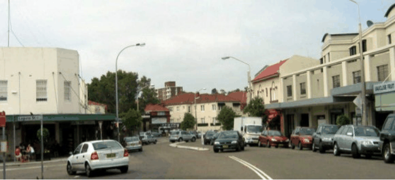
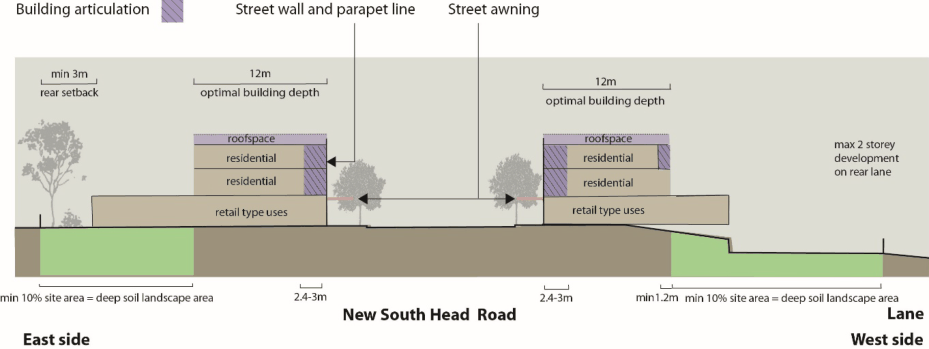

#### D1.4 Vaucluse Shopping Village, Vaucluse

MAP 3  Vaucluse Shopping Village centre map

> [Picture on page 21: a picture, saved as a picture (images/chapter-d1-neighbourhood-centres-page-21-3.gif, 150 dpi).]

#### D1.4.1 Centre character statement

Vaucluse Shopping Village is located on the ridgeline on a curved section of New South Head Road. It provides a good mix of local convenience retailing and services, including a post office, newsagent, fruit and vegetable grocer, butcher, cafes, bottle shop and florist.

The centre is characterised by two storey shop top housing, with some recent three storey infill development on the western side.

#### Historical development of the area

New South Head Road was constructed as a link to Watsons Bay during the 1830s.  In 1880 the Shaftesbury Institute was opened on land currently occupied by Samuel Park and the site known as the former Vaucluse High School. The Shaftesbury Institute operated as a girls’ reformatory and then was used an institution for non-criminal men in 1915.

Land in and near the centre was subdivided in the early 1900s and at the same time the tram line along New South Head Road was introduced. However, substantial housing development did not occur until the 1920s and 1930s.

In 1930 three acres of land from the Shaftsbury Institute grounds was dedicated to Council for public recreation purposes and named "Samuel Park”.

Although Vaucluse Council resisted residential flat building in the municipality, some Inter-war flat buildings were built on New South Head Road near the centre. In 1960, the Vaucluse High School opened. In that same year the tram service ceased.

#### Built form

The building stock in and around the centre includes 20th century architecture of varying quality.

The built form generally consists of: shop top housing in the form of predominantly two storey Inter-war buildings interspersed with more contemporary buildings; two and three storey mixed use developments at the north-eastern and south-western end of the centre;  and a two storey mixed use building on the corner of New South Head Road and Laguna Street.

The buildings generally address the street, provide continuous awnings, and have parapet or hipped rooflines.

#### Public parks and community facilities

Samuel Park, which also includes the Vaucluse Bowling Club, is located close to the centre.

#### Public domain

The centre provides a relatively good standard of pedestrian amenity, and fairly consistent footpath treatment, street furniture and planting.

#### Access and circulation

The centre is on the Watsons Bay bus route.  However, most shoppers access the centre by car and are reliant on car transport and turnover of on-street car parking spaces. Pedestrian safety is somewhat compromised by the restricted sightlines on New South Head Road.

#### Views and aspect

The north-eastern end of the shopping centre has views towards the Vaucluse Bowling Club and Samuel Park.

New South Head Road and Laguna Avenue

> [Picture on page 23: a picture, saved as a picture (images/chapter-d1-neighbourhood-centres-page-23-2.gif, 150 dpi).]

#### D1.4.2 Desired future character

The Vaucluse neighbourhood centre is a lively village that provides for the daily convenience needs of the local community.  It is expected that this role will continue and strengthen. Higher order retailing, such as banking and weekly shopping, will be provided at larger centres such as the Rose Bay local centre.

The redevelopment of the former Vaucluse High School site for seniors living will increase the residential population within walking distance of the centre and increase the demand for daily goods and personal services.  Possible redevelopment on the carwash site for mixed use development will also provide for a small extension of the centre along the eastern side. New and infill development will reinforce the village feel of the centre, providing well designed buildings that reflect the scale and rhythm of the existing built form and shopfronts.

#### D1.4.3 Objectives and controls

The street diagram illustrates some of the controls, and is to be read in conjunction with the table of objectives and controls below. Note, the maximum building height and FSR are in Woollahra LEP 2014.

FIGURE 2  Vaucluse Village street section

> [Picture on page 24: a picture, saved as a picture (images/chapter-d1-neighbourhood-centres-page-24-2.gif, 150 dpi).]

Note: Street section does not apply to 26-36 New South Head Road

| Objectives | Local controls |
|---|---|
| O1 To provide uses that are consistent with C1 Development supports adaptive re-use of the desired future character of the existing retail units. centre. C2 The ground level contains active uses, preferably local and speciality shops, business premises and cafes and restaurants that meet the needs of the local community. C3 Residential uses located above street level in the form of shop top housing. |  |
| O2 To develop a coherent streetscape with a C4 Development is a maximum of three consistent street wall. storeys at the New South Head Road frontage. O3 To ensure consistency of built form and presentation to the street. C5 For properties 26-36 New South Head Road, development provides: a) two storey street wall built to the street alignment, with a continuous and consistent parapet line; and b) an upper level setback of at least 1.2m for at least 80% of the frontage, where setback walls are aligned parallel to the street boundary. C6 For all sites other than 26-36 New South Head Road, development provides a three |  |

| Objectives | Local controls |
|---|---|
| storey street wall built to the street alignment, with a continuous and consistent parapet line above. C7 For development on the west side of the street, as identified in the street section diagram: a) building form responds to the fall of the land; and b) development is a maximum of two storeys to the rear lane. C8 Development includes a continuous solid suspended awning over the public footpath of New South Head Road and along the secondary frontage of corner sites. C9 Development does not include vehicular access off New South Head Road. |  |
| O4 To define and reinforce the corner sites C10 Development on corner sites provides in the centre. three storeys built to the street alignment with a continuous and consistent parapet line above. |  |
| O5 To encourage good building design and C11 Building articulation at the street limit building bulk. alignment is in the form of recessed balconies or loggia only. Elsewhere it may be in the form of verandahs, balconies, loggia or wall offsets. C12 At the street alignment, the depth of these balconies and loggia is between 2.4m to 3m. |  |

| Objectives | Local controls |
|---|---|
| O6 To provide for the amenity of occupants C13 The building depth for storeys above the and adjoining properties. ground floor level is generally not more than 12m. C14 For development on the eastern side of New South Head Road, the building is setback from the rear boundary by at least 3m. C15 For development on the western side of New South Head Road, the building may be built to the rear lane. C16 At least 10% of the site is provided as deep soil landscaped area. |  |
| O7 To increase tree planting in the public C17 Development which includes public domain. domain use, includes advanced tree planting in the footpath. |  |
