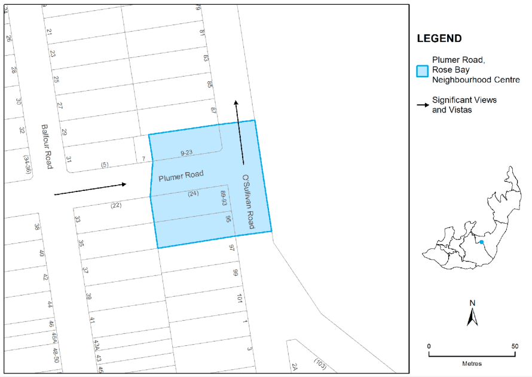
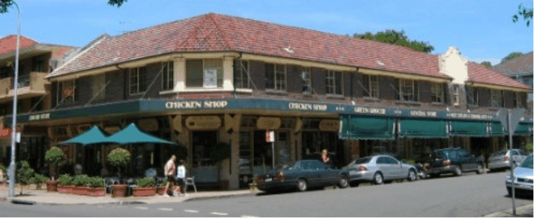

#### D1.5 Plumer Road, Rose Bay

MAP 4  Plumer Road centre map

> [Picture on page 27: a picture, saved as a picture (images/chapter-d1-neighbourhood-centres-page-27-3.gif, 150 dpi).]

#### D1.5.1 Centre character statement

The Plumer Road neighbourhood centre is a group of purpose built shops with residential uses above, located at the intersection of Plumer and O’Sullivan Roads opposite Woollahra Golf Club. This is a vibrant neighbourhood centre for the local community, providing a good range of convenience shops, including a local store, bakery, butcher and cafes.

The area has a flat topography and is characterised by mature fig trees along O’Sullivan Road. The centre is located within the Balfour Road Heritage Conservation Area, characterised by Inter-war flat buildings built between Powell Road, Salisbury Road, Plumer Road and O’Sullivan Road.

#### Historical development of the area

Speculation to create an exclusive marine estate along the esplanade at Rose Bay was commenced in the 1830s, but apart from the 1835 construction of Rose Bay Lodge (in what is now Salisbury Road) the district remained substantially undeveloped throughout the 19th century. More intensive subdivision of the land surrounding Rose Bay Lodge commenced after the introduction of the Rose Bay tram service in 1903, but development in the area was slow.

The Plumer Road shops were part of the Beresford Estate and were subdivided from 1925 to1928 as business sites. Development of residential blocks occurred in the area from the early to mid-1920s. The Balfour Road Heritage Conservation Area represents the intensified residential development of Rose Bay during the Inter-war period.

#### Built form

Like most buildings in the Balfour Road Heritage Conservation Area, the Plumer Road shops are two and three storey builder’s blocks of flats (i.e. speculative, not architect designed)  built in the 1920s and mid 1930s displaying distinctive architectural characteristics of the Inter-war Art Deco style.

The buildings form a highly distinctive collection of traditionally detailed retail building forms, dating back to the Inter-war period. Some of the important built form characteristics include continuous awnings and a hipped roof form, buildings built to the street alignment with large display windows on the ground floor, and windows and balconies overlooking the street.

#### Heritage and contributory buildings

The centre is located within the Balfour Road Conservation Area. The shop top housing at Nos 89-93 O’Sullivan Road and 9-23 Plumer Road make an important contribution to the Balfour Road HCA as they form a gateway to the centre.

#### Public parks and community facilities

Woollahra Golf Club is located immediately opposite the shops on O’Sullivan Road.

#### Public domain

The centre has high visual amenity. The continuous awnings, common fascia signage and well maintained concrete footpaths and buildings provide good amenity for pedestrians. The fig tree planting on O’Sullivan Road provides a leafy backdrop to the centre. The setback area on O’Sullivan Road facilitates outdoor dining.

#### Access and circulation

The centre is located close to the Bondi Junction to City bus route and routes on New South Head Road. However, most shoppers access the centre by foot or are reliant on car and a turnover of the on-street car parking spaces.

#### Views and aspect

The centre enjoys views to Woollahra Golf Club, and from O’Sullivan Road there is a tree canopied vista to the harbour.

Plumer Road and O’Sullivan Road

> [Picture on page 29: a picture, saved as a picture (images/chapter-d1-neighbourhood-centres-page-29-2.gif, 150 dpi).]

#### D1.5.2 Desired future character

The Plumer Road neighbourhood centre will remain a small but lively village providing for the daily convenience shopping needs of the local community, and serving as a social hub for the community to meet and interact. Higher order retailing, such as banking and weekly shopping, will be provided at larger centres including the Rose Bay and Double Bay local centres.

The centre has a high aesthetic value, predominantly derived from the Inter-war shop top buildings.  These contributory buildings should not be altered, and the consistent colour schemes applied to these buildings, awnings and signage are to be retained, as these provide a unifying theme throughout the centre and contribute to its visual amenity and character.

The existing development at 95 O’Sullivan Road detracts from the centre and any future redevelopment on this site should more suitably respond the character of the centre and the significance of the adjoining HCA.

#### D1.5.3 Objectives and controls

| Objectives | Local controls |
|---|---|
| O1 To provide uses that are consistent C1 Development supports the adaptive with the desired future character of re-use of existing shop top units. the centre. C2 The ground level contains active uses, preferably local shops, cafes and restaurants that meet the needs of the local community. C3 Residential uses are located above street level in the form of shop top housing. C4 Development provides high amenity outdoor dining in the O’Sullivan Road setback area. |  |
| O2 To maintain the existing built form so C5 Development at 89-93 O’Sullivan Road that the centre remains the “gateway” and 9-23 Plumer Road maintains existing to the Balfour Road Centre Heritage building height, scale and form. Conservation Area. C6 Parking is located at the rear of the building. No parking spaces or garages permitted in the front setback area. C7 Development maintains the existing building separation pattern to neighbouring residential lots by retaining the existing driveway crossovers on the edge of the centre. |  |
| O3 To retain and enhance the contributory C8 Development at 89-93 O’Sullivan Road buildings and ensure these retain their and 9-23 Plumer Road maintains and streetscape context. retains the heritage significant fabric. C9 Development provides a continuous awning to the street frontage to match existing awnings at 89-93 O’Sullivan Road and 9-23 Plumer Road. C10 Development does not include habitable space in the roof structure of an existing building, and does not include any dormer window. C11 Any replacement of heritage significant building fabric is of similar material and |  |

| Objectives | Local controls |
|---|---|
| type (e.g. timber for timber). C12 Development reinstates heritage significant architectural detailing as appropriate. C13 Development retains and conserves any original chimneys. C14 Development does not include any painting, bagging or rendering of original face brickwork. C15 Development retains window and door hardware that have heritage significance. C16 Development does not include any infill (by glazing or otherwise) of original verandahs or balconies. C17 Security grilles on windows and doors, if installed, complement the frame and glazing pattern, are fitted on the inside of windows or doors, and should not be visually intrusive. C18 Security fly screens, if installed, are retractable. C19 Skylights and the like, are not visible from any street frontage. Note: Solar energy systems such as photovoltaic electricity generating systems, solar hot water systems, or solar air heating systems are addressed in Chapter E6, Section 6.3 Solar Energy Systems. |  |

| Objectives | Local controls |
|---|---|
| O4 To support redevelopment of buildings C20 Development at 95 O’Sullivan Road is a that detract from the streetscape maximum of three storeys. character. C21 Development at 95 O’Sullivan Road presents a similar roof form and pitch as adjoining buildings, when viewed from the public domain. C22 Development is setback from O’Sullivan Road to match existing commercial buildings and does not include structures within the setback area. |  |
| O5 To maintain the leafy character and C23 Development which includes public ambience of O’Sullivan Road. domain use provides advanced tree planting in the O’Sullivan Road setback area that reinforces and complements the existing avenue of mature trees. |  |
| O6 To minimise the impact of signs on the C24 New signage is of a compatible design and amenity and character of the buildings colour to existing signage in the centre. and the significance of the heritage A coordinated approach to the signs conservation area. within the centre is preferred. C25 Colours used in signs are consistent with the architectural style of the building. Fluorescent and iridescent colours are not permitted. C26 Fonts used in signs are consistent with the style of the building and the historic character of the area. |  |
