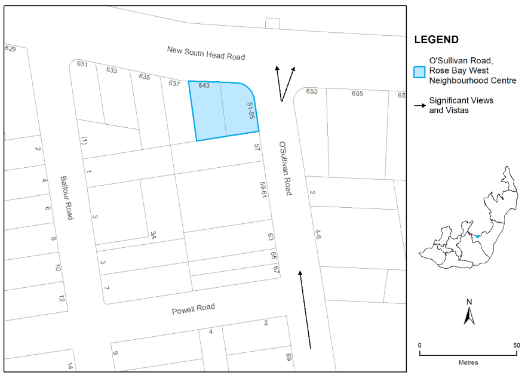
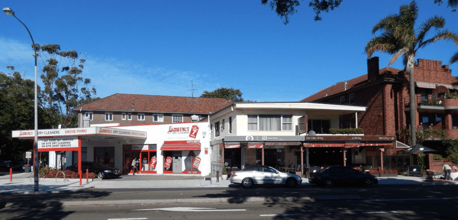
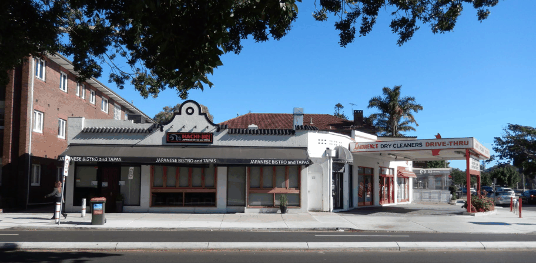

#### D1.6 O’Sullivan Road, Rose Bay

MAP 5  O’Sullivan Road centre map

> [Picture on page 33: a picture, saved as a picture (images/chapter-d1-neighbourhood-centres-page-33-3.gif, 150 dpi).]

#### D1.6.1 Centre character statement

This small group of shops, located within two buildings, is sited at the junction of New South Head Road and O’Sullivan Road. The corner site contains a single storey heritage listed building, which was originally established as a service station and is now used as a drive through dry cleaning business. The other uses in the centre are restaurants and cafes.

The location enjoys views overlooking the Rose Bay waterfront and promenade. However, the quality of the public realm is compromised by the proximity of the busy New South Head Road and a streetscape which would benefit from street trees and a consistent footpath treatment to soften the environment.

#### Historical development of the area

The Rose Bay area was originally part of the Cooper Estate. Speculation to create an exclusive Marine Estate along the esplanade commenced in the 1830s, but apart from the construction of Rose Bay Lodge in 1835, the district remained substantially undeveloped throughout the 19th century.

More intensive subdivision of the land surrounding Rose Bay Lodge commenced after the introduction of the Rose Bay tram service in 1903, but development in the area was slow. Early residential flat development in the area dates from the early to mid-1920s. The nearby Balfour Road Heritage Conservation Area represents the intensified residential development of Rose Bay during the Inter-war period.

This small neighbourhood centre occupies land subdivided from the grounds of Rose Bay Lodge in 1900, called the Beresford Estate. The three lots created at O’Sullivan Road and New South Head Road were subsequently merged and re-subdivided in 1928. In that same year, land now known as 51-55 O’Sullivan Road was developed as a service station and shops in response to the increasing number of motorists in the area. The building was constructed in the Spanish Mission style, popular at the time, and is now a heritage item.

#### Built form

The O’Sullivan Road shops occupy a single storey Spanish Mission style corner building with driveway apron (that was previously a garage and service station), and a two storey late 20th century shop top built to the New South Head Road street alignment.

Surrounding buildings are typically three storey brick builder’s blocks of flats with hipped roof form, setback from the boundary on both O’Sullivan Road and New South Head Road.

#### Heritage item

The Spanish Mission style building at 51-55 O’Sullivan Road is a heritage item. It has significance as a rare and representative surviving example of early service station architecture influenced by Californian design.

#### Public parks and community facilities

The Rose Bay promenade is located across the road from the centre on the northern side of New South Head Road.  The Woollahra Golf Club is located immediately opposite the Plumer Road shops in O’Sullivan Road.

#### Public domain

The site has excellent north and east sun access and exposure to harbour breezes. High traffic volumes, fragmented pavement areas, lack of street trees or continuous awnings and the poorly defined corner adversely affect the public domain.

#### Access and circulation

The centre is well served by bus routes on New South Head Road. However, most people dining at the restaurants or collecting dry cleaning walk to the centre, or access the centre by car.

There is an existing parking bay for three cars immediately in front of the centre on New South Head Road.  Additional on-street parking is available on the other side of New South Head Road, as well as O’Sullivan Road.

#### Views and aspect

The centre enjoys broad views over Rose Bay and a green outlook to tree lined O’Sullivan Road.

New South Head Road and O’Sullivan Road

> [Picture on page 35: a picture, saved as a picture (images/chapter-d1-neighbourhood-centres-page-35-2.gif, 150 dpi).]

> [Picture on page 35: a picture, saved as a picture (images/chapter-d1-neighbourhood-centres-page-35-3.gif, 150 dpi).]

#### D1.6.2 Desired future character

This centre has recently emerged as a small café centre with outdoor dining. There is opportunity for the amenity of the centre to improve if the existing building stock is redeveloped and improvements are made to the public domain to help soften the impact of traffic along New South Head Road, whilst maintaining views across the road to the Rose Bay promenade and Sydney Harbour.

Any redevelopment of the Spanish Mission style building must respect the existing façade elements on O’Sullivan Street, which are built to the boundary.  The existing setback of the building to New South Head Road should be maintained to preserve the corner forecourt. For example this area may be suitable as an outdoor dining area.

The corner site contains a heritage item, which has a prominent corner location. Development is to have regard to the original character of the building.

#### D1.6.3 Objectives and controls

| Objectives | Local controls |
|---|---|
| O1 To provide uses that are consistent C1 Development provides active shop frontage with the desired future character of and high amenity outdoor trading. the centre. C2 The ground level contains active uses, O2 To provide a high amenity pedestrian and preferably cafes and restaurants that outdoor trading area overlooking Rose meet the needs of the local community. Bay and the promenade. C3 Residential uses are located above street level in the form of shop top housing. |  |
| O3 To protect the fabric, character and C4 Key original architectural features of the significance of the existing Spanish building are retained. Mission style heritage building. C5 The spatial relationship of the existing forecourt to the building is retained. |  |
| O4 To support redevelopment of buildings to C6 Development is a maximum of three enhance the streetscape character. storeys. C7 Development is sympathetic to the existing character, fabric and heritage significance of the Spanish Mission style building. |  |
| O5 To protect identified views within C8 Development retains views from the the centre. centre across New South Head Road to the Rose Bay promenade and Sydney Harbour. |  |
