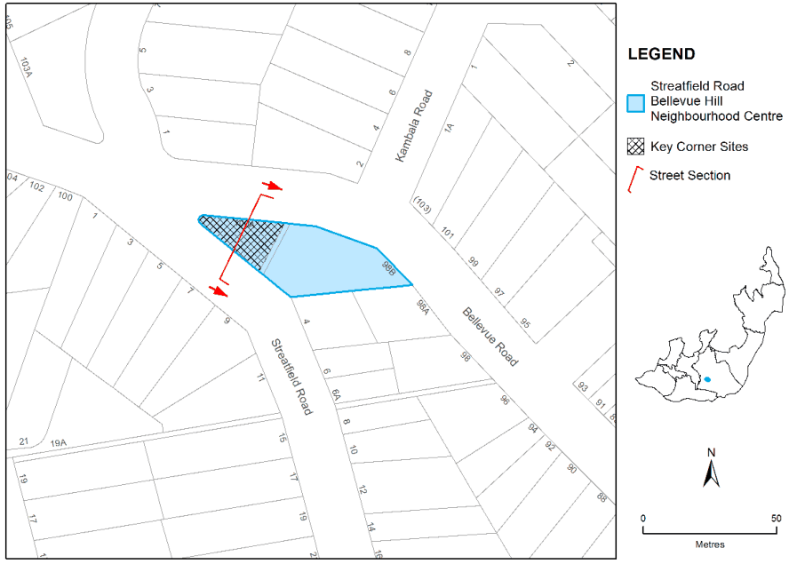
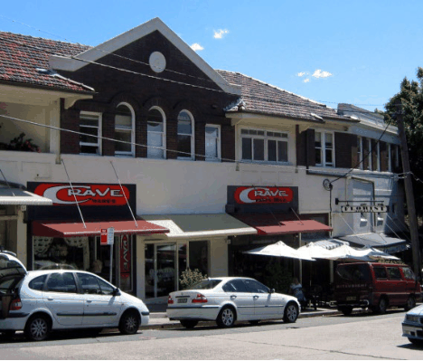
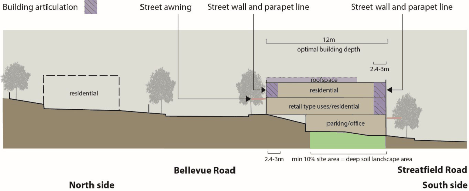

#### D1.7 Streatfield Road

MAP 6  Streatfield Road centre map

> [Picture on page 37: a picture, saved as a picture (images/chapter-d1-neighbourhood-centres-page-37-3.gif, 150 dpi).]

#### D1.7.1 Centre character statement

The Streatfield Road shops are a small group of shops on the western side of Bellevue Road, approximately halfway between Double Bay and Bellevue Hill, at the junction with Streatfield Road. The centre provides a small selection of local and specialty shops, personal services and cafes.

The appearance and amenity of this neighbourhood centre is largely defined by the Inter-war shop top building at 98B Bellevue Road, but the centre also contains two other buildings at 100A Bellevue Road.  These have a single storey elevation to Bellevue Hill Road and contain a bottle shop, dwelling house and café.

#### Historical development of the area

In the early 19th century the Bellevue Hill area was part of the Point Piper Estate, an extensive private land grant made to Cooper and Levey in 1820. The Bellevue Hill and Bellevue Park Estates were subdivided and re-subdivided from the estate between 1883 and 1912, producing smaller lots on the higher slopes and areas away from the harbour. Early urban development intensified in 1909 following the extension of the tramline along Old South Head Road.

The Streatfield Road centre is located on Point Piper Estate land subdivided in 1920. The Inter-war building at 98B Bellevue Road was purpose built shop top housing and dates from 1929.

#### Built form

The neighbourhood centre is contained in three buildings: a well conserved two to three storey Inter-war residential retail complex that follows the curve and grade of Bellevue Road, a single storey flat roof building of poorer quality, and a two storey cottage on the corner.

These buildings contain active frontages to Bellevue Road, while presenting a more residential character to the Streatfield Road elevation.

#### Access and circulation

The centre is well located adjacent to a bus stop for services operating on Bellevue Road. It is readily accessible by car with a limited number of on-street parking spaces. Pedestrian amenity and safety is compromised by vehicular traffic speeds and limited sight lines on Bellevue Road.

#### Views and aspect

The centre has a pleasant outlook along Bellevue Road.

New South Head Road and O’Sullivan Road

> [Picture on page 38: a picture, saved as a picture (images/chapter-d1-neighbourhood-centres-page-38-17.gif, 150 dpi).]

#### D1.7.2 Desired future character

The Streatfield Road shops will retain its role as a small but vibrant neighbourhood centre that meets the needs of the local community by providing a mix of daily convenience shopping, cafes as well as specialty shops and personal services.

Development should ensure a visually attractive and coherent physical environment recognising the character of the existing built environment, with a built form that addresses Bellevue Road and the corner of Bellevue Road and Streatfield Road.

The building at 98B Bellevue Road is a face brick Inter-war residential retail complex with a two storey frontage to Bellevue Road.  It is envisaged that this character will remain largely intact. This building is in good condition with much of the external fabric sympathetically maintained. The building establishes a strong street wall and parapet line that responds sensitively to the grade and curve of the site and establishes a strong street wall and parapet line that responds sensitively to the grade and curve of the site and creates a landmark presence. The original stepped awning has been replaced with lightweight structures of varying colours and styles.  The appearance of this building would be enhanced if the awnings, including the style and colour, were consistent and more sympathetic to the original character of the building. Redevelopment at 100A Bellevue Road is to complement the built form and character of the built form at 98B Bellevue Road.

#### D1.7.3 Objectives and controls

The street diagram illustrates some of the controls, and is to be read in conjunction with the table of objectives and controls below. Note, the maximum building height and FSR are in Woollahra LEP 2014.

FIGURE 3  Streatfield Road street section

> [Picture on page 39: a picture, saved as a picture (images/chapter-d1-neighbourhood-centres-page-39-24.gif, 150 dpi).]

Note: Street section refers to 100a Bellevue Road only

| Objectives | Local controls |
|---|---|
| O1 To provide uses that are consistent C1 Development supports the adaptive with the desired future character of re-use of existing shop top units at the centre. 98B Bellevue Road. C2 The ground level contains active uses, preferably local and speciality shops, business premises and cafes and restaurants that meet the needs of the local community. C3 Residential uses are located above the street level in the form of shop top housing. C4 Office uses may be located at the Streatfield Road frontage. |  |
| O2 To establish a strong and continuous built C5 Development provides two storeys built form that addresses both Bellevue Road to the Bellevue Road street alignment, and Streatfield Road. with a continuous and consistent parapet line above (refer to the street section diagram). C6 Development provides three storeys built to the corner intersection at Streatfield Road, with a continuous but stepped parapet line above. C7 Development provides a built form with small scale shopfronts that step with the street grade. C8 Development includes a continuous but stepped awning over the public footpath of Bellevue Road and around the corner radius into Streatfield Road. C9 Development at 100A Bellevue Road complements the built form and character of 98B Bellevue Road. |  |

| Objectives | Local controls |
|---|---|
| O3 To protect the fabric and character of the C10 Key original architectural features of the Inter-war building at 98A Bellevue Road. building are retained, or if required synthetically restored or replaced. C11 Development re-instates the fixed stepped awning at 98B Bellevue Road. C12 Colours used in signs are consistent with the architectural style of the building. Fluorescent and iridescent colours are not permitted. C13 Fonts used in signs are consistent with the style and character of the building. |  |
| O4 To encourage good building design and C14 At both street frontages at least 80% of limit building bulk. the articulation zone is occupied by floor area elements or recessed balconies. C15 The depth of the floor area elements and recessed balconies is between 2.4 to 3m. |  |
| O5 To provide for the amenity of occupants. C16 The building depth is generally not more than 12m. |  |
| O6 To provide good pedestrian access, C17 Development of 100A Bellevue Road amenity and connectivity between includes no more than one single width Bellevue Road and Streatfield Road. vehicle access crossing that is located on Streatfield Road. C18 Development of 100A Bellevue Road maintains a direct public accessway from Streatfield Road to Bellevue Road between properties at 98B and 100A Bellevue Road. C19 Development of 100A Bellevue Road provides at least 10% of the site as deep soil landscaped area on the boundary to 98B Bellevue Road adjacent to the accessway. |  |

#### Objectives

#### Local controls

C20  Development enhances the amenity of

O7 To improve the public domain for outdoor uses.

the footpath area.

C21 Development includes tree planting along both the Bellevue Road and Streatfield Road frontages, where this can be accommodated with the provision of awnings.
