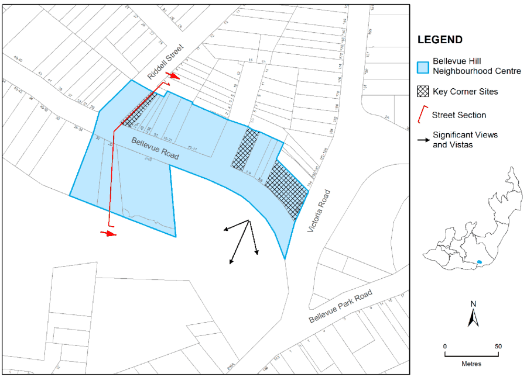
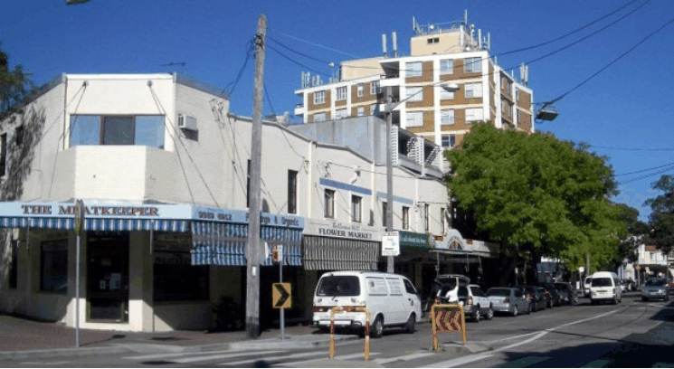
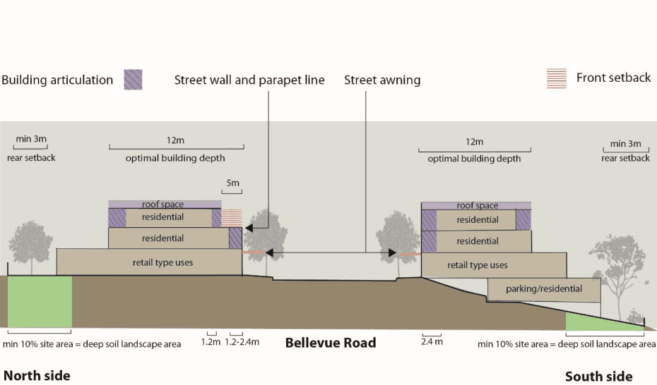

#### D1.8 Bellevue Hill Shops

MAP 7  Bellevue Hill Shops centre map

> [Picture on page 43: a picture, saved as a picture (images/chapter-d1-neighbourhood-centres-page-43-3.gif, 150 dpi).]

#### D1.8.1 Centre character statement

The Bellevue Hill Shops neighbourhood centre is a relatively large group of shops located on the ridgeline at the junction of Bellevue Road and Victoria Road (both of which are important urban collector roads linking New South Head and Old South Head Roads). To the south, the centre overlooks the upper extent of Cooper Park.

The centre provides a good mix of local convenience shopping and personal services, such as a post office, newsagent, fruit and vegetable grocer, butcher, chemist, hairdressers, real estate agents, cafes, bottle shop, and dry cleaner.

#### Historical development of the area

Hill top ‘BelleVue’ (now Bellevue Park) was known in the early 19th century for its panoramic views to the harbour and the ocean. The area was then part of the Point Piper Estate, an extensive private land grant to Cooper and Levey. The Bellevue Hill and Bellevue Park Estates were subdivided and re-subdivided from the estate between 1883 and 1912, producing smaller lots on the higher slopes away from the harbour. Following the extension of the tramline along Birriga Road in 1909 urban development intensified.

Residential flats were built on larger sites overlooking Cooper Park from the end of World War I. However, retail and business uses were not permitted on the northern side of Bellevue Road between Victoria Road and Riddell Street until 1929.  Around this time the Bellevue Hill Primary School (1925) and St Stephens Church (1928) were also established close to the centre on Victoria Road.

The centre has seen a continuous process of development, creating a vibrant mix of retail, business and residential uses.

#### Built form

The building stock in and around the centre is represented by a cross section of 20th century architecture of varying quality. This includes: Inter-war shops with one storey above for residential or commercial uses, typically built to the boundary with a street parapet line and a deep solid suspended awning over the footway. One free standing mixed use Inter-war building comprising shops at street level with two storeys of residential above at 22 Bellevue Road. A 1960s-70s large mixed use building on the western corner of Buller Street and Bellevue Road with shops at street level and a nine storey tower setback from Bellevue Road. This building has a porte cochere to Buller Street. Contemporary mixed use buildings comprising shops at street level with two to three storeys of residential above at street level, such as development at 11 Bellevue Road and the development on the corner of Bellevue Road and Victoria Road.  More recent development at 2-16 Bellevue Road is three storeys built to the street alignment with approximately six levels stepping down the hillside.

#### Parks and community facilities

Bellevue Hill Public School is immediately east of the centres with Bellevue Hill Park beyond. The eastern part of the retail centre overlooks the extensive gully of Cooper Park which runs down to Double Bay.

#### Public domain

The pedestrian amenity varies depending on the location of awnings and shade trees; for example, there is limited solar access to the footpath on the northern side.

At street level there is a variety of building setbacks, alcoves, colonnades and recessed entrances and driveways that could attract antisocial behaviour. Opportunities exist for the improvement of public domain.

#### Access and circulation

The centre is well served by buses although most shoppers drive to the centre and are reliant on turnover of limited on-street car parking spaces. Angle parking has been introduced in Riddell Street to increase yield.

A few properties on the northern side of Bellevue Road have rear lane access from Riddell Lane and can provide on-site parking.

#### Views and aspect

Good views of Cooper Park are available from upper levels at the eastern end of the centre, and from the southern side of Bellevue Road.

Bellevue Road and Riddell Street

> [Picture on page 45: a picture, saved as a picture (images/chapter-d1-neighbourhood-centres-page-45-7.gif, 150 dpi).]

#### D1.8.2 Desired future character

The Bellevue Hill Shops neighbourhood centre should continue to provide a good mix of daily convenience shopping, food premises and personal services. The development of outdoor dining will also help create a more vibrant centre.

Mixed use developments with active street frontages and residential uses above are encouraged and will promote the ongoing vitality of this centre. Street plantings and street furniture will contribute to a more visually attractive environment.

#### D1.8.3 Objectives and controls

The street diagram illustrates some of the controls, and is to be read in conjunction with the table of objectives and controls below. Note, the maximum building height and FSR are in Woollahra LEP 2014. FIGURE 4  Bellevue Hill Shops street section

> [Picture on page 46: a picture, saved as a picture (images/chapter-d1-neighbourhood-centres-page-46-6.gif, 150 dpi).]

| Objectives | Local controls |
|---|---|
| O1 To provide uses that are consistent C1 The ground level contains active uses, with the desired future character of preferably local and speciality shops, the centre. business premises and cafes and restaurants that meet the needs of the local community. C2 Residential uses are located above the street level in the form of shop top housing. |  |

| Objectives | Local controls |
|---|---|
| O2 To develop a coherent streetscape with C3 Development on the south side of a consistent street wall and consistent Bellevue Road: upper level setbacks. a) is a maximum of three storeys at the street frontage; b) is built to the street alignment, with a continuous and consistent parapet line above; and c) building form responds to the fall of the land, but does not exceed maximum LEP height for this site at any point at the rear. C4 Development on the north side of Bellevue Road: a) is a maximum of 3 storeys; b) is two storeys built to the street alignment, with a continuous and consistent parapet line above; and c) development above the second storey is set back from the street alignment by at least 5m. C5 Development includes a continuous solid suspended awning over the footpath at Bellevue Road and along the secondary frontage of corner sites. C6 Development on the north side of Bellevue Road does not include vehicular access from Bellevue Road. |  |
| O3 To encourage good building design and C7 At least 80% of the articulation zone is limit building bulk. occupied by floor area elements or balconies. C8 Building articulation at the street alignment is in the form of recessed balconies or loggia only. Elsewhere it may be in the form of verandahs, balconies, loggia or wall offsets. C9 At the street alignment on the southern side, the depth of the balconies and loggia is at least 2.4m. |  |

| Objectives | Local controls |
|---|---|
| C10 At the street alignment on the northern side, the depth of the balconies and loggia is: a) between 2.4 to 3m for the first floor; and b) at least 1.2m for the upper floor. |  |
| O4 To improve the architectural quality of C11 Alterations and additions to 13-17 building stock. Bellevue Road provide a three storey retail or commercial corner element O5 To strengthen poorly defined corners. built to both street alignments. C12 Development upgrades and reinforces the landmark corner of Victoria and Bellevue Roads by: a) building to the street alignment up to three storeys; b) improving the awning; c) increasing frontage glazing; and d) introducing a parapet line. C13 Development on corner site provides three storeys built to the street alignment with a continuous and consistent parapet line above. |  |
| O6 To provide for the amenity of occupants. C14 The building depth for storeys above the ground floor level is generally not more than 12m. C15 The building is setback from the rear boundary by at least 3m. C16 At least 10% of the site is provided as deep soil landscaped area. |  |
| O7 To encourage outdoor dining to improve C17 Development provides a small north the vitality of the centre. facing outdoor dining space with good sun access. |  |

#### Objectives

#### Local controls

O8 To enhance the visual connections between the centre and Cooper Park.

C18 At the eastern end of Bellevue Road, on the northern side, development introduces outdoor dining that has an outlook to Cooper Park.

C19 Development on the south side of Bellevue Road provides retailing units designed with an elevated outlook over Cooper Park.
