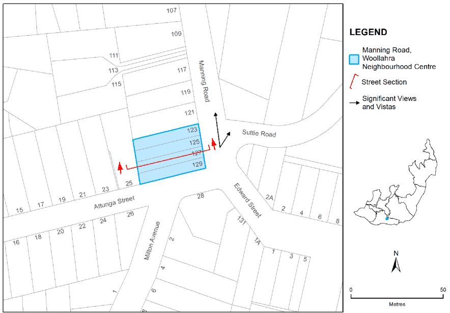
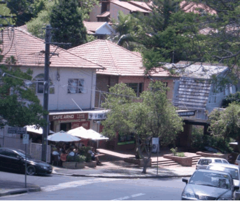
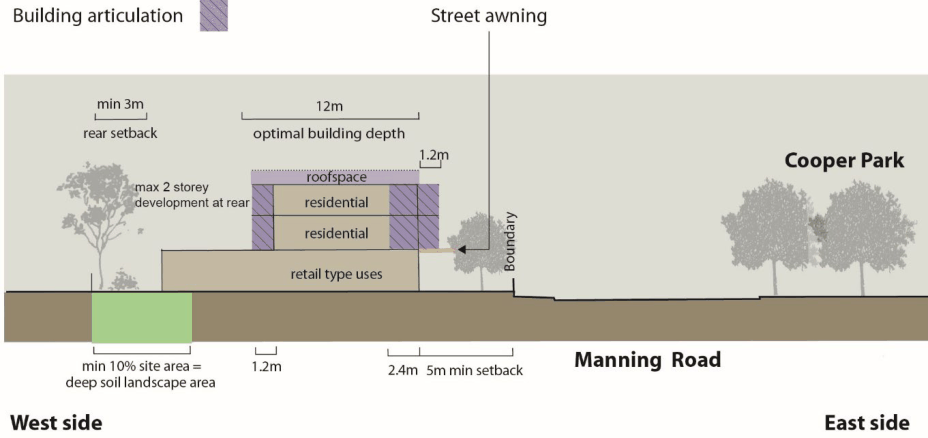

#### D1.9 Manning Road, Woollahra

MAP 8  Manning Road centre map

> [Picture on page 50: a picture, saved as a picture (images/chapter-d1-neighbourhood-centres-page-50-3.gif, 150 dpi).]

#### D1.9.1 Centre character statement

The Manning Road neighbourhood centre is located at the lower end of the Cooper Park Gully at the junction of Manning Road and Edward Street. It is a very small centre situated about midway between Double Bay and the Edgecliff Road centre.

The centre comprises four ground floor premises, currently occupied by a café and specialist services.

#### Historical development of the area

Edgecliff Road was formed in 1844 as the eastern boundary of the Cooper Estate that skirted around the top of the slopes of the Double Bay valley. The Harbour View Estate was released in 1900 and extends from Edgecliff Road down to the lower end of Cooper Park (dedicated in 1919). Following the introduction of the tram on Edgecliff Road in 1909, Inter-war subdivision of land occurred along Manning Road.

#### Built form

The small group of business and retailing premises occupy two double storey residential buildings that have been modified by the addition of awnings and hard pavement to the front setback area.

South-east of the centre along Edward Street, the built form is mainly attached housing (terraces) and cottages on small allotments with little or no front setback. Development to the north and west of the centre generally comprises large two storey detached houses and a few small residential flat blocks of three to four storeys, set in established treed gardens.

#### Public parks and community facilities

The Manning Road neighbourhood centre overlooks the Lough Playing Field and treed slopes in the filled gully of Cooper Park.

#### Public domain

The centre has reasonable pedestrian amenity with deep awnings, small street trees and a wide paved setback area for outdoor dining. The resolution of pavement levels and accessibility from the street is generally poor. Pedestrian movement to and from Cooper Park is compromised by speed of vehicular traffic and limited sightlines.

#### Access and circulation

The centre is served by buses running along Manning Road, although most people who use the centre either walk to the centre or drive, relying on the turnover of on-street car parking spaces.

#### Views and aspect

The centre faces east to the Lough Playing Field and Cooper Park.

Manning Road and Attunga Street

> [Picture on page 51: a picture, saved as a picture (images/chapter-d1-neighbourhood-centres-page-51-19.gif, 150 dpi).]

#### D1.9.2 Desired future character

The Manning Road shops are a small centre that will continue to serve the needs of the local community, particularly with uses such as cafes and neighbourhood shops. Redevelopment of the existing buildings should retain the large setback from Manning Road to provide continued opportunity for outdoor dining, as well as enhance the public realm through improved landscaping and pavement treatments.

#### D1.9.3 Objectives and controls

The street diagram illustrates some of the controls, and is to be read in conjunction with the table of objectives and controls below. Note, the maximum building height and FSR are in Woollahra LEP 2014.

FIGURE 5  Manning Road street section

> [Picture on page 52: a picture, saved as a picture (images/chapter-d1-neighbourhood-centres-page-52-6.gif, 150 dpi).]

| Objectives | Local controls |
|---|---|
| O1 To provide uses that are consistent with C1 The ground level contains active uses, the desired future character of the preferably local shops and cafes and centre. restaurants that meet the needs of the local community. C2 Residential uses are located above the street level in the form of shop top housing. C3 The existing traditional small shop front widths are maintained. |  |
| O2 To retain a coherent streetscape with a C4 Development is a maximum of three consistent street wall. storeys at the Manning Road frontage. O3 To minimise impact on adjoining C5 Development is a maximum of two residential land. storeys at the rear of the site. |  |

| Objectives | Local controls |
|---|---|
| O4 To encourage good building design and C6 Building articulation is in the form of: limit building bulk. a) projecting balconies over the front awning; and b) recessed balconies and loggia within the building mass. C7 At the street alignment: a) the projecting balconies extend from the building line onto the awning by no more than 1.2m; and b) the depth of the recessed balconies and loggia is at least 2.4m. C8 At the rear alignment, the depth of the balconies and loggia on the upper levels is at least 1.2m. |  |
| O5 To provide for the amenity of occupants C9 The building depth for storeys above the and adjoining properties. ground floor level is generally not more than 12m. C10 The building is setback from the rear boundary by at least 3m. C11 At least 10% of the site is provided as deep soil landscaped area. |  |
| O6 To retain the setback areas to Manning C12 Development is setback at least 5m from Road for outdoor dining and public use. the Manning Road boundary. O7 To improve the pedestrian connection C13 Development does not include vehicular between the centre and Cooper Park. access from Manning Road. |  |
| O8 To improve the amenity of pedestrian and C14 Development includes a continuous solid outdoor trading areas. suspended awning over the Manning Road setback area (refer to street section diagram). C15 Development includes advanced tree planting and landscape works to improve amenity of the setback area, where this can be accommodated with the provision of awnings. |  |

| Objectives | Local controls |
|---|---|
| O9 To protect views from the centre to C16 Development, including any public Cooper Park. domain improvements, maintains the views to Cooper Park. |  |
