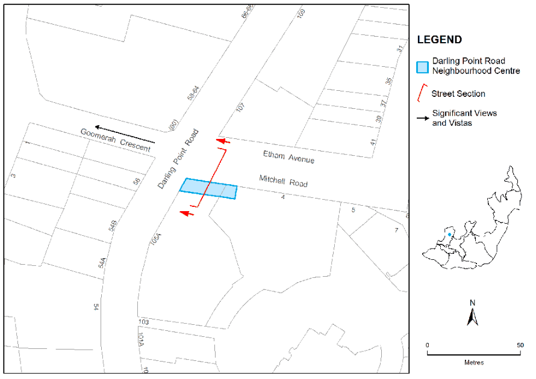
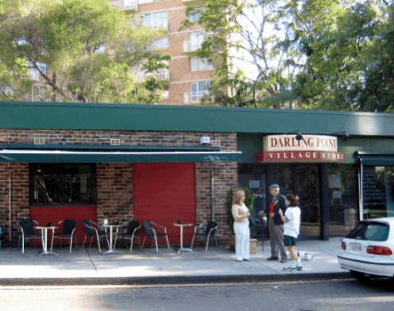
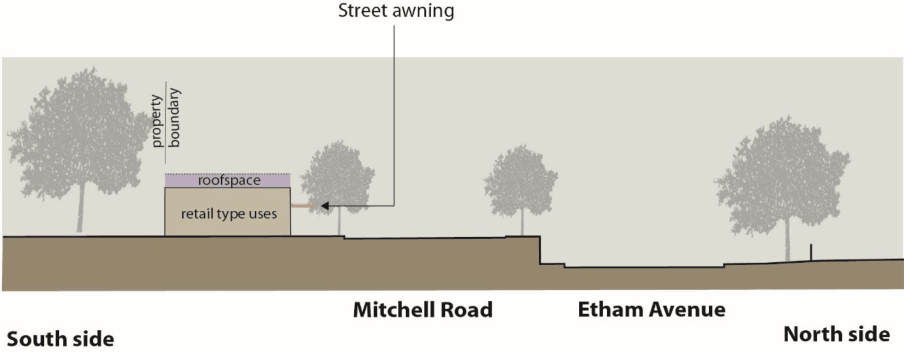

#### D1.10 Darling Point Road, Darling Point

MAP 9  Darling Point Road centre map

> [Picture on page 55: a picture, saved as a picture (images/chapter-d1-neighbourhood-centres-page-55-3.gif, 150 dpi).]

#### D1.10.1 Centre character statement

This is a very small centre comprising just the Darling Point Village Store. This is a local shop offering daily convenience goods and services and a cafe.

This centre is located on the corner of Darling Point Road, facing Mitchell Street on the perimeter of the former Babworth House Estate.  The gardens and tree canopy immediately behind the centre provide an understanding of the site’s relationship to the adjoining Babworth House Estate, which is listed as a heritage item.

#### Historical development of the area

Significant subdivision of Darling Point occurred in the early 1830s with a number of large estates established at that time. Its position and aspect to Sydney Harbour ensured that the wealthy reserved this small promontory for their grand residences.

However, by the late 1800s, smaller residences were also numerous, and during the 20th century development intensified as more allotments were subdivided from the grounds of the great houses and gentleman’s villas. The Etham Estate (1900) was one such subdivision located close to this centre.

During the second half of the 20th century, a number of high rise units were built throughout Darling Point. The Darling Point neighbourhood centre was constructed during this period.

#### Built form

This shop is located in a single storey flat roofed building. It is built to the street alignment with a small canvas awning. High rise apartment blocks are located within the grounds of the former Babworth House Estate.

There are a diverse mix of dwelling types in walking distance to the centre, including grand 19th century two storey dwelling houses, attached dwellings (terraces) and residential flat buildings.

#### Public domain

The centre has reasonable pedestrian amenity with a northerly aspect and a wide paved area for outdoor uses. Mature street trees in Darling Point Road and nearby gardens provide the centre with a leafy ambience. Amenity would be further improved if street trees were planted in the footpath outside the centre.

#### Access and circulation

The centre is served by buses running along Darling Point Road, although people tend to walk or drive to the centre.

#### Views and aspect

There is a view of the harbour looking west down Goomerah Crescent.

Mitchell Street at Darling Point Road

> [Picture on page 56: a picture, saved as a picture (images/chapter-d1-neighbourhood-centres-page-56-20.gif, 150 dpi).]

#### D1.10.2 Desired future character

The Darling Point Road centre will be a small neighbourhood centre, providing for the daily needs of the local community.

Any redevelopment of the existing shop should be in the form of a contemporary one storey building which retains the existing front setback to accommodate footpath dining. Public domain improvements, such street trees would also enhance public amenity.

#### D1.10.3 Objectives and controls

The street diagram illustrates some of the controls, and is to be read in conjunction with the table of objectives and controls below. Note, the maximum building height and FSR are in Woollahra LEP 2014.

FIGURE 6  Darling Point Road section

> [Picture on page 57: a picture, saved as a picture (images/chapter-d1-neighbourhood-centres-page-57-12.gif, 150 dpi).]

| Objectives | Local controls |
|---|---|
| O1 To provide uses that are consistent with C1 Development provides actives uses, the desired future character of the preferably a neighbourhood shop and café centre. that meet the daily convenience needs of the local community. |  |
| O2 To ensure that the building form and C2 Development provides for an scale does not detract from the interpretation of the perimeter walling Babworth House and grounds. to Babworth House. C3 Development is a maximum of one storey. C4 Development establishes a low scale and profile. C5 The roof form respects the perimeter walling to Babworth House (refer to street section diagram). |  |
| O3 To retain views to the leafy backdrop C6 Development maintains views of the provided by the gardens of the garden of the former Babworth Estate Babworth Estate. from Darling Point Road. |  |
| O4 To protect views from the public spaces C7 Development maintains the views and within the centre to the harbour. vista corridors towards the harbour from Goomerah Crescent. |  |
| O5 To improve the amenity of the pedestrian C8 Development includes all weather and outdoor dining area. protection to the shop entrance (refer to street section diagram). C9 Development includes advanced broad canopy tree planting in the footpath to provide shade and shelter (refer to street section diagram). C10 Development does not include vehicular access from Mitchell Street. |  |
