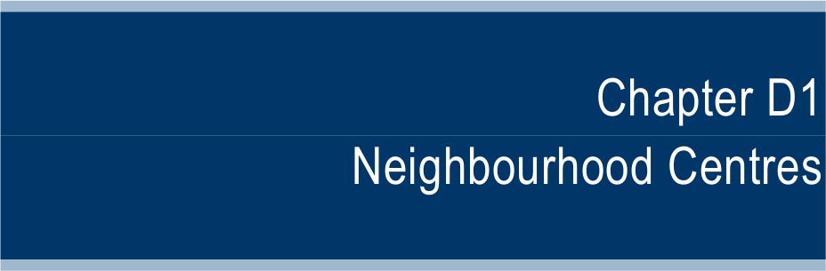

# Woollahra Development Control Plan 2015 - Chapter D1 Neighbourhood Centres

> This chapter is split into 13 section file(s), one per numbered heading, in the order they appear in the PDF.

Source PDF: [chapter-d1-neighbourhood-centres.pdf](chapter-d1-neighbourhood-centres.pdf)

> [Picture on page 1: a picture, saved as a picture (images/chapter-d1-neighbourhood-centres-page-1-1.gif, 150 dpi).]

> [Picture on page 1: a picture, saved as a picture (images/chapter-d1-neighbourhood-centres-page-1-2.gif, 150 dpi).]
> [Picture text on page 1 is stored in the PDF without readable letters (no character map), so it could not be copied; see the original PDF.]

### Part D  Business Centres

### WOOLLAHRA DEVELOPMENT CONTROL PLAN 2015

> [Picture on page 3: a picture, saved as a picture (images/chapter-d1-neighbourhood-centres-page-3-1.gif, 150 dpi).]

### Chapter D1

### Neighbourhood Centres

### Part D  Business Centres

### CHAPTER D1 APPROVED ON 27 APRIL 2015 AND COMMENCED ON 23 MAY 2015

### Last amended on 31 May 2024

<!-- sections -->
## Sections

1. [D1 Neighbourhood Centres](01-d1-neighbourhood-centres.md)
2. [D1.1 Introduction](02-d1-1-introduction.md)
3. [D1 Neighbourhood Centres](03-d1-neighbourhood-centres.md)
4. [D3 General Controls for Neighbourhood and Mixed Use Centres](04-d3-general-controls-for-neighbourhood-and.md)
5. [D1.2 Hopetoun Avenue, Vaucluse](05-d1-2-hopetoun-avenue-vaucluse.md)
6. [D1.3 South Head Roundabout, Vaucluse](06-d1-3-south-head-roundabout-vaucluse.md)
7. [D1.4 Vaucluse Shopping Village, Vaucluse](07-d1-4-vaucluse-shopping-village-vaucluse.md)
8. [D1.5 Plumer Road, Rose Bay](08-d1-5-plumer-road-rose-bay.md)
9. [D1.6 O’Sullivan Road, Rose Bay](09-d1-6-o-sullivan-road-rose-bay.md)
10. [D1.7 Streatfield Road](10-d1-7-streatfield-road.md)
11. [D1.8 Bellevue Hill Shops](11-d1-8-bellevue-hill-shops.md)
12. [D1.9 Manning Road, Woollahra](12-d1-9-manning-road-woollahra.md)
13. [D1.10 Darling Point Road, Darling Point](13-d1-10-darling-point-road-darling-point.md)
