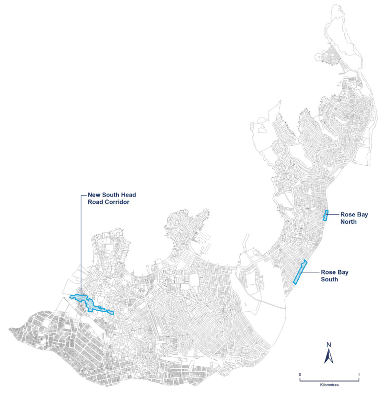

#### D2.1 Introduction

This is Chapter D2 of the Woollahra Development Control Plan 2014 (DCP), Part D Business Centres. This chapter contains controls for three centres, zoned MU1 Mixed Use under Woollahra Local Environmental Plan 2014 (Woollahra LEP 2014). This chapter seeks to ensure that development has regard to its context and is compatible with the desired future character of each centre as described in this chapter.

#### Land where this chapter applies

This chapter applies to the following centres, as identified on the map below: New South Head Road Corridor, Edgecliff Rose Bay North, Rose Bay Rose Bay South, Rose Bay.

> [Picture on page 5: a picture, saved as a picture (images/chapter-d2-mixed-use-centres-page-5-13.gif, 150 dpi).]

#### Development to which this chapter applies

This chapter applies to development that requires development consent.

A key objective of the MU1 Mixed Use zone is to integrate suitable business, office, residential, retail and other development in accessible locations so as to maximise public transport patronage and encourage walking and cycling.

The MU1 zone permits a wide range of retail premises, business premises, office premises, community facilities, restaurants and cafes and shop top housing. (Refer to Woollahra LEP 2014 for all the types of development permitted in the zone.)

#### Objectives

The objectives of this chapter are:

O1 To support the long term retail health of the mixed use centres.

O2 To facilitate development in a way that reflects desired future character objectives for each centre.

O3 To preserve the small shop character where this is indicative of the traditional streetscape.

O4 To ensure a high standard of architectural and landscape design.

O5 To ensure that the design and siting of development is compatible with the surrounding built form.

O6 To ensure that development enhances the visual quality and identity of the centre through well considered design, high quality materials and facade colours that do not dominate the street.

O7 To encourage active ground floor uses that contribute to the vitality of the centre.

O8 To encourage a complementary mix of retail, business, office and residential uses compatible with the desired future character of the centre.

O9 To facilitate people living in mixed use developments in the centres, and provide for good residential amenity.

O10 To provide a range and mix of dwellings that are compatible with retail and/or commercial uses.

O11 To minimise adverse impacts of development on the amenity of adjoining and neighbouring properties.

O12 To retain significant views and vistas.

O13 To improve the amenity of public domain and pedestrian safety.

#### Relationship to other parts of the DCP

This chapter is to be read in conjunction with the other parts of the DCP that are relevant to the development proposal, including: Part D: Chapter D3 General Controls for Neighbourhood and Mixed Use Centres. Part E: General Controls for All Development – this part contains chapters on Parking and Access, Stormwater and Flood Risk Management, Tree Management, Contaminated Land, Waste Management, Sustainability, Signage and Adaptable Housing. Part F: Land Use Specific Controls – this part contains chapters on Child Care Centres, Educational Establishments, Licensed Premises and Telecommunications. Part G: Site Specific Controls – for land at 73-79 New South Head Road, Edgecliff, the provisions of this chapter are supplemented by the relevant provisions for the land in Part G on White City.  The provisions of Part G prevail in the event of any inconsistency with Chapter D2.

#### How to use this chapter

The primary controls for the mixed use centres are contained in two chapters:

Chapter D2 Mixed Use Centres; and Chapter D3 General Controls for Neighbourhood and Mixed Use Centres.
