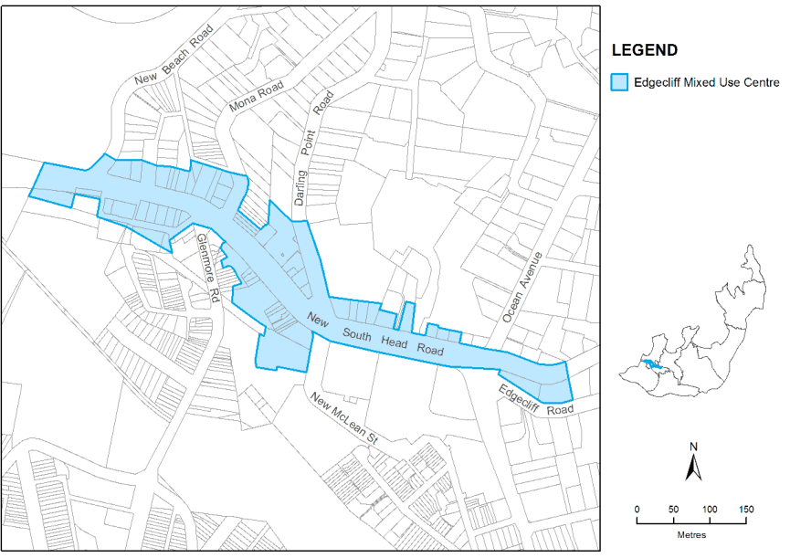
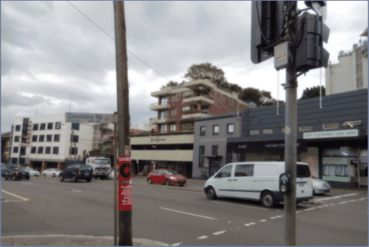
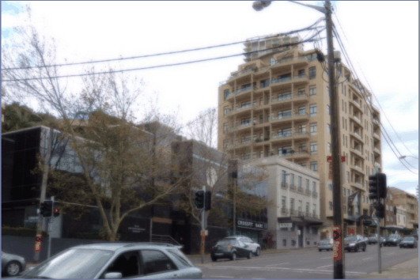

#### D2.2 New South Head Road Corridor, Edgecliff

MAP 1  Edgecliff centre map

> [Picture on page 9: a picture, saved as a picture (images/chapter-d2-mixed-use-centres-page-9-3.gif, 150 dpi).]

Notes: The controls in this chapter do not apply to Zone MU1 Mixed Use land on the eastern and western sides of Glenmore Road at Edgecliff; this land is located within the Paddington Heritage Conservation Area (HCA).  The controls for business centres in the Paddington HCA are contained in Part C of this DCP, Chapter C1 Paddington HCA. For land at 73-79 New South Head Road, Edgecliff, the provisions of this chapter are supplemented by the relevant provisions for the land in Part G of this DCP, regarding White City. The provisions of Part G prevail in the event of any inconsistency with this chapter.

#### Centre character statement

The mixed use corridor at Edgecliff applies to both sides of New South Head Road, and generally extends from New Beach Road to Edgecliff Road, excluding the land zoned E1 Local Centre between New McLean Street and Ocean Street.

The mixed use corridor developed along the tram line. Originally businesses were dependent on passing traffic, however with increased traffic volumes on street parking was replaced by transit clearways in peak periods and the retail component contracted.  As a consequence, this location has tended to attract office premises, residential flat buildings, hotel accommodation, and comparison furniture or homewares stores rather than convenience retailing.

#### Historical development

Edgecliff was extensively quarried in the early days of European settlement. The development of Edgecliff west of Ocean Street began along New South Head Road. The area was dominated for some time by the Glenrock Estate on the north side of New South Head Road, where the Ascham School is now located.

Early photographs dating from the 1860s reveal clusters of dwellings and businesses along the southern side of New South Head Road, followed by the subdivision of new areas behind the main

road. Bentley’s Bridge was a stone structure built to cross the watercourse which drained the valley behind Rushcutters Bay.  A toll gate was established for the privilege of using New South Head Road.

In September 1894 a cable tram service opened; it operated from King Street in the city to Ocean Street in Edgecliff. The tramline was extended past Edgecliff in 1898. In 1905 the tram line was electrified, but ceased operating in 1960.  Edgecliff railway station opened in 1979 when the Illawarra line was extended from Town Hall railway station to Bondi Junction.

#### Built form

Development along New South Head Road includes residential flat buildings, commercial and mixed use buildings.  These present a diverse mix of architectural styles as well as building heights, which range from single storey to approximately 12 storeys.

#### Heritage items

Woollahra LEP 2014 identifies heritage items at 2a Mona Road and on New South Head Road (Nos. 136, 188, and 287-289). The New South Head Road corridor adjoins the Paddington HCA around Glenmore Road.

#### Public parks and community facilities

There are no public parks within the New South Head Road mixed use corridor, however, Rushcutters Bay Park is located at the western end of the corridor.

#### Access and circulation

The New South Head Road mixed use corridor has excellent access to public transport. The Edgecliff train station and bus interchange is within walking distance, and the corridor contains a major road serviced by a number of bus routes.

On-street parking is limited due to transit clearways operating during peak hours.  Some sites have vehicular access from a secondary street and opportunity to include on-site parking.

#### Views

The centre is located on a ridgeline and has views west to the city and east to Double Bay.

> [Picture on page 11: a picture, saved as a picture (images/chapter-d2-mixed-use-centres-page-11-1.gif, 150 dpi).]

#### Desired future character

> [Picture on page 11: a picture, saved as a picture (images/chapter-d2-mixed-use-centres-page-11-3.gif, 150 dpi).]

This mixed use corridor is a highly urban environment and it is important that it meets high standards of visual quality and pedestrian amenity.

This part of New South Head Road is a main entry point to the Municipality and it is important that the experience and journey through the centre makes a positive impression. Everything that can be seen and experienced in the street is therefore relevant.

Development fronting New South Head Road will generally contain four to six storey mixed use buildings. Building facades, in terms of detailing and building materials, should be well designed, with particular consideration to how the buildings are interpreted from moving vehicles, so that the view driving along New South Head Road contributes to the public domain. At street level, buildings should respond to pedestrians by providing human scale design elements, interesting frontages and awnings for protection.

Development within this corridor must consider its impact on the adjoining Paddington heritage conservation area, including Glenmore Road, which is an important gateway entry to Paddington. Development should protect and respond to the character and scale of the heritage conservation area.

The New South Head Road mixed use corridor permits a range of residential and commercial land uses, including restaurants and cafes which should contribute to a more vibrant centre, particularly at night. Though certain types of convenience retailing opportunities are constrained by the restricted parking, it is expected that comparison specialist retailing, such as homewares and furniture shops, and complementary offices, such as medical suites, will capitalise on the excellent access to public transport, high visual exposure and proximity to the Sydney CBD.

#### Objectives and controls

| Objectives | Local controls |
|---|---|
| O1 To support the integration of appropriate C1 The ground level contains active uses, retail and commercial uses with housing. preferably speciality retailing and personal services that do not generate O2 To provide active street frontages. high parking demand. C2 Offices and residential uses are generally located above street level. |  |
| O3 To promote an attractive street wall C3 Facade design is of high aesthetic quality, along New South Head Road. and complements the form, roofline, fenestration, material, finishes and O4 To promote an urban environment which colour of adjoining buildings. meets high standards of visual quality. C4 Facade design incorporates similar O5 To improve the relationship of buildings proportions of glazed and non-glazed to the public domain. surfaces and achieves a balance between vertical and horizontal divisions. The extensive use of glass is avoided. C5 Facade elements are generally contained in vertical planes aligned with the street. Sloping facades are avoided. C6 Side and rear facades are the same visual quality as street facades. Large areas of blank unrelieved walls are avoided. C7 The design of the lower part of the street facade relates to the scale of pedestrians. C8 Large expanses of highly reflective, brightly coloured or black surfaces are not used on facades. C9 The front setback defines a coherent and consistent alignment to the public |  |

| Objectives | Local controls |
|---|---|
| domain. Note: For land affected by the arterial road reservation, the street alignment is determined from the reservation. C10 Structures below ground level may be permitted underneath the setback area. |  |
| O6 To improve the visual quality of the C11 Awnings are provided for mixed use and streetscape and provide for attractive commercial buildings. and comfortable pedestrian areas. C12 The design of the awnings is in harmony with the facade of the building and with other awnings in the immediate vicinity. C13 Awnings may be permitted above the setback area. C14 Public domain improvements, including street tree planting and pavement upgrading are consistent and unify the corridor. C15 Street tree planting and footpath works reduce the sensory impact of the traffic on New South Head Road. |  |
| O7 To ensure development is sympathetic to C16 At ground level, the building may have a the adjoining development. zero setback to side and rear boundaries. O8 To protect access to natural light and C17 A side boundary setback of at least 1.8m ventilation of adjoining sites. applies to the fifth storey and above, if relevant. O9 To provide for the amenity of occupants and adjoining residential uses. Note: This control is relevant to sites where the maximum building height is 20.5m in the LEP. C18 A rear setback of 2.4m applies to all levels of the building above ground level. C19 A 2.4m building articulation area applies at the rear to all levels above the first floor. The articulation area is occupied by a combination of external and internal elements. Note: This articulation area is calculated |  |

| Objectives | Local controls |
|---|---|
| from the rear setback established in C18 above. Note: Part D3.7 Acoustic and Visual Privacy also applies. |  |
| O10 To recognise the role of Glenmore Road C20 Development on land in proximity to the as an important entry to Paddington and adjoining heritage conservation area is in ensure that development protects and architectural harmony with the adjoining enhances the character of the adjoining historical buildings in respect of massing, heritage conservation area. modelling of facades, fenestration and external materials, colours and finishes. Note: Zone MU1 Mixed Use land on Glenmore Road is located within the Paddington heritage conservation area. The planning controls for that land are in Part C of this DCP, Chapter C1 Paddington HCA. |  |
| O11 To ensure that signage and structures do Refer to Part E of the DCP, Chapter E7 not compromise the visual amenity of the Signage. streetscape. Note: Advertising signage is not permitted. |  |
