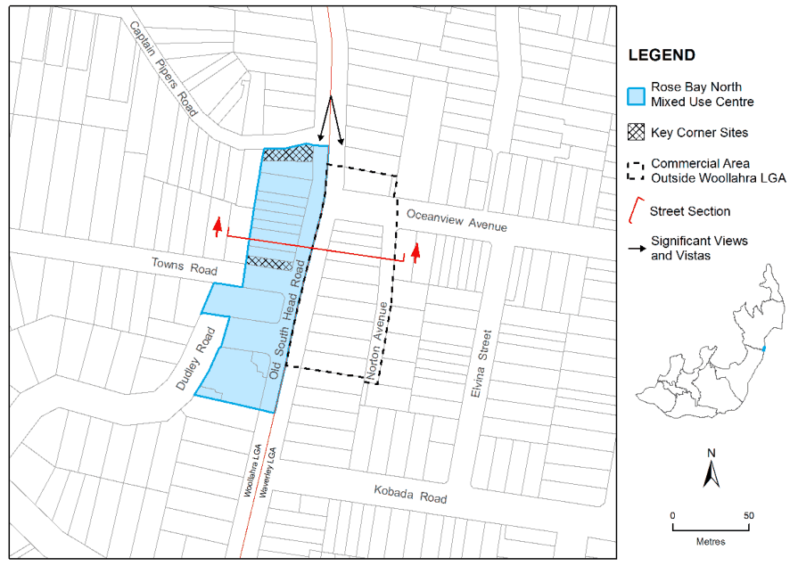
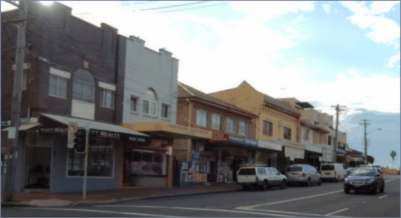
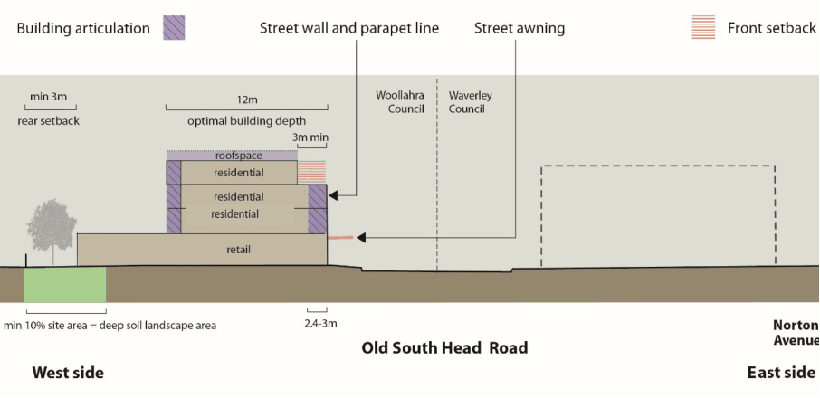

#### D2.3 Rose Bay North

MAP 2  Rose Bay North centre map

> [Picture on page 15: a picture, saved as a picture (images/chapter-d2-mixed-use-centres-page-15-3.gif, 150 dpi).]

#### Centre character statement

Rose Bay North shopping centre is located on Old South Head Road at the junction of the suburbs of Vaucluse, Rose Bay and Dover Heights. The business area is split between the Waverley Council area to the east of Old South Head Road and the Woollahra Council area to the west, with Old South Head Road forming the boundary between the two councils.

The centre, including the retail strip on the Waverley side, provides a reasonable range of services and facilities to meet the daily needs of local residents.  In particular, it includes a Coles supermarket located on the southern side of Dudley Road in the Kings Theatre building. The traditional main street development provides a range of shops including cafés, take away food stores, grocer, chemist, bakery and newsagent.

#### Historical development

Old South Head Road was formed in 1811 to provide access to the signal station at Watsons Bay. The subdivision of larger estates into town allotments occurred in the 1920s and 1930s. The Kings Theatre was constructed on the corner of Dudley Street and Old South Head Road in 1935, and was likely to be the commercial hub at that time.

#### Built form

Aside from the Coles supermarket located in the former Kings Theatre, the centre is characterised by two to four storey shop top buildings which address the street with continuous awnings.  The scale and form of buildings is generally consistent with the buildings on the Waverley side of Old South Head Road.

#### Heritage buildings

The former Kings Theatre at 694-696 Old South Head Road, built in 1935 in the Art Deco style, is a heritage item. It is a strong corner building and contributes to the character of the centre.

#### Public parks and community facilities

There are no community facilities or public parks in the centre.

#### Access and circulation

The centre is well serviced by buses and is located on a bike route on Towns Road and Old South Head Road.

There are opportunities for short stay parking of up to one hour on both sides of Old South Head Road.

Rear lane access for service vehicles is provided from Dudley Avenue for the Coles supermarket. Few other sites on the western side of Old South Head Road have rear lane access.  To facilitate this, Woollahra LEP 2014 provides a bonus floor space ratio for corner sites between Captain Pipers Road and Towns Road if vehicular access is provided to adjoining sites.

#### Views

The centre is located at the top of a south-facing slope and has a distant view of Bellevue Hill.

Old South Head Road and Towns Road

> [Picture on page 16: a picture, saved as a picture (images/chapter-d2-mixed-use-centres-page-16-23.gif, 150 dpi).]

#### Desired future character

The Rose Bay North centre provides a mix of residential and non-residential land uses with active street frontages that preserve and enhance the commercial viability of the centre.

The focus for future development is on upgrading or replacing the existing building stock well designed contemporary buildings.  These will be four storey mixed use developments, predominantly containing residential or office space above ground floor retailing. Buildings should address the street, in keeping with the traditional main street development pattern, and retain the continuous street awnings. The design, materials and colour schemes of new buildings is to be sympathetic to the character of the existing buildings.

Development in the Rose Nay North mixed use centre should not detract from the amenity of the adjoining Rose Bay and Vaucluse East residential centres.

#### Objectives and controls

The street diagram illustrates some of the controls, and is to be read in conjunction with the table of objectives and controls below.  Note, the maximum building height and FSR are in Woollahra LEP 2014.

FIGURE 1  Rose Bay North section

> [Picture on page 17: a picture, saved as a picture (images/chapter-d2-mixed-use-centres-page-17-17.gif, 150 dpi).]

| Objectives | Controls |
|---|---|
| O1 To provide uses that are consistent C1 The ground level contains active uses, with the desired future character of preferably retail, business and personal the centre. services that address the needs of the local community. C2 Offices and residential uses are generally located above street level. |  |
| O2 To achieve a consistent built form and C3 Development is a maximum four storeys. presentation to the street. C4 Development provides three storeys built to the street alignment, with a continuous and consistent parapet line above. C5 Development on the fourth level is setback at least 3m from the street boundary. C6 Development includes a continuous, solid, suspended awning over the public footpath of Old South Head Road and along the secondary frontage of corner sites. |  |
| O3 To encourage good building design and C7 Building articulation at the street limit building bulk. alignment is in the form of recessed balconies or loggia only. Elsewhere it may be in the form of verandahs, balconies, loggia or wall offsets. C8 At the street alignment, the depth of the recessed balconies and loggia is between 2.4m to 3m. |  |
| O4 To define and reinforce corner sites. C9 Development on the key corner sites to Captain Pipers Road and Towns Road (as shown in the centre map above) provides four storeys built to the street alignment with a continuous and consistent parapet line above. Note: A bonus floor space ratio applies to these corner sites. Refer to Woollahra LEP 2014 clause 4.4B. |  |

| Objectives | Controls |
|---|---|
| O5 To encourage continuous active retail C10 Development does not include vehicular street frontages. access from Old South Head Road. |  |
| O6 To provide for the amenity of occupants C11 The building depth for storeys above the and adjoining properties. ground floor level is generally not more than 12m. C12 The building is setback from the rear boundary by at least 3m. C13 At least 10% of the site is provided as deep soil landscaped area. |  |
