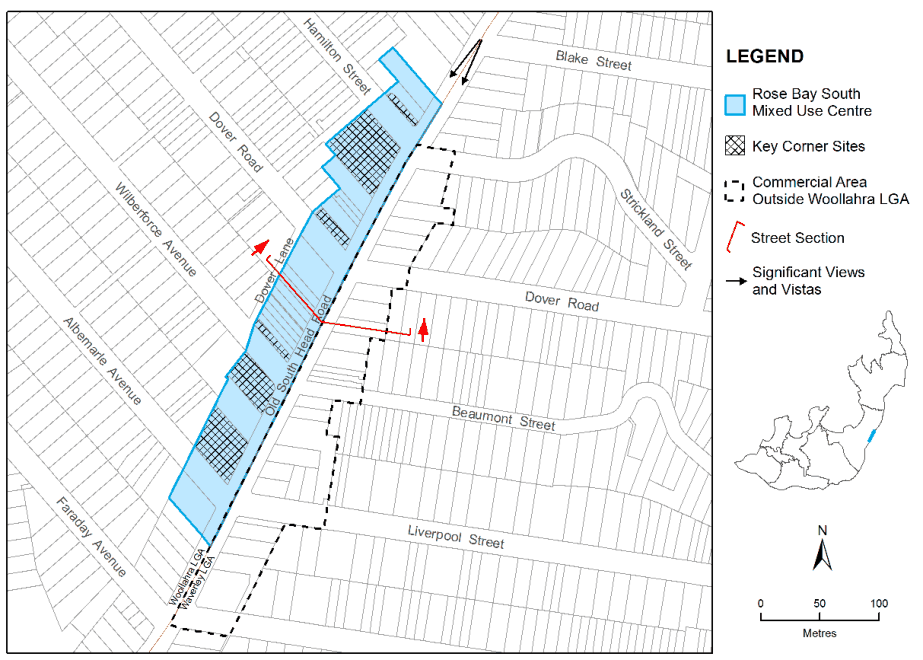
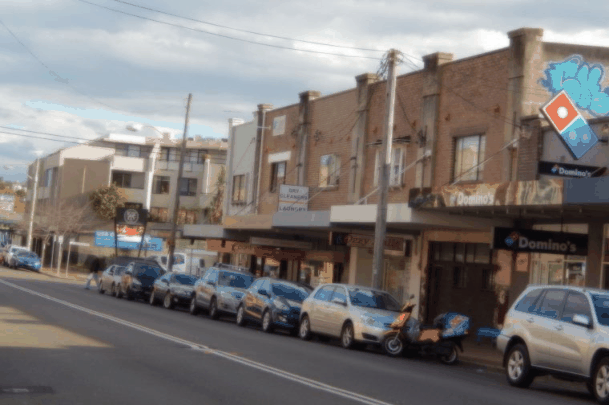
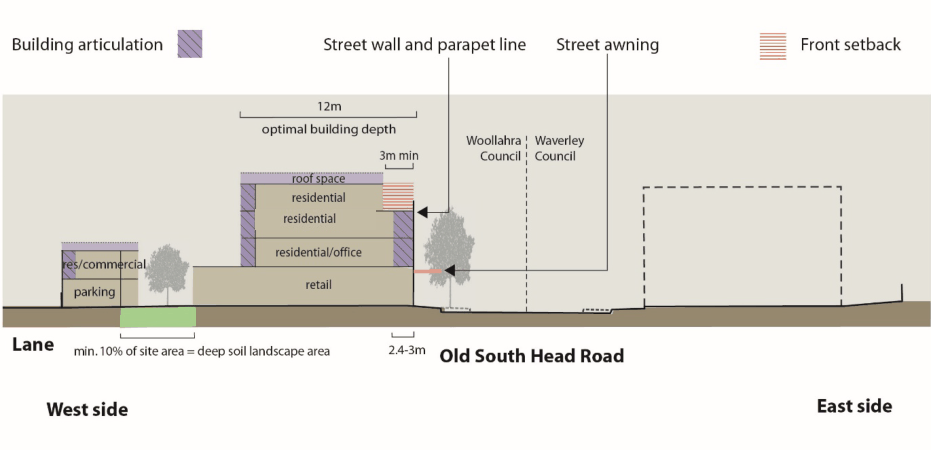

#### D2.4 Rose Bay South

MAP 3  Rose Bay South centre map

> [Picture on page 20: a picture, saved as a picture (images/chapter-d2-mixed-use-centres-page-20-3.gif, 150 dpi).]

#### Centre character statement

Rose Bay South mixed use centre is less than 2km from the Rose Bay local centre travelling east along Dover Road. It extends over at least four blocks along Old South Head Road. The centre provides a good mix of services including a range of health services for local residents, as well as a number of shops serving the cultural requirements of the local community.

As with Rose Bay North, the mixed use centre is split between Woollahra and Waverley Council areas.  The traditional main street development provides a broad range of shops including cafés, take-away food stores, hair dresser, a church and a petrol station.

#### Historical development

Old South Head Road was formed in 1811 to provide access to the signal station at Watsons Bay. The tram was extended along Old South Head Road in 1903, and this was followed by the subdivision of larger estates into town allotments in the 1920s and 1930s. The Rose Bay Uniting Church and hall at the corner of Dover Road and Old South Head Road was constructed in 1924.

#### Built form

The centre contains a mix of architectural styles, but is generally characterised by two to four storey shop top housing, with buildings addressing the street with continuous awnings.

The building stock between Wilberforce and Hamilton Streets was largely constructed in the Inter-War period and is characterised by strong rectilinear parapet lines, continuous awnings and shopfronts built to the street alignment.

#### Public parks and community facilities

The church, adjacent hall and the kindergarten are a focus for community activity.

#### Access and circulation

The centre is well serviced by buses and is located on a bike route along Old South Head Road.

There are opportunities for short stay parking of up to one hour on both sides of Old South Head Road.

Rear lane access for service vehicles is available between Wilberforce Avenue and Dover Road, and from Short Lane off Hamilton Street. To address this, Woollahra LEP 2014 provides a bonus floor space ratio for corner sites if vehicular access is provided to adjoining sites.

#### Views

The centre is located on a south-west facing slope and has a distant view of Bellevue Hill.

Old South Head Road

> [Picture on page 21: a picture, saved as a picture (images/chapter-d2-mixed-use-centres-page-21-19.gif, 150 dpi).]

#### Desired future character

The Rose Bay South centre provides a good mix of cafés and restaurants and personal services to address the local community’s needs.

As with the Rose Bay North mixed use centre, the existing building stock is due for upgrading or replacement.  The focus for future development is on upgrading or replacing the existing building stock with well designed contemporary buildings.  These will take the form of four storey mixed use development containing residential or office space above ground floor retailing.

Buildings should be built to the Old South Head Road street alignment, address the street, and provide continuous street awnings.  Redevelopment of the southern corner of Wilberforce Avenue at 498 Old South Head Road provides a significant opportunity to create a strong corner building built to the street alignment and a consistent parapet line to 494-496 Old South Head Road.

The Uniting Church at 518A Old South Head Road provides a local landmark at the Dover Road intersection.

Development in the Rose Bay South mixed use centre must not detract from the amenity of the adjoining Rose Bay residential centre.

#### Objectives and controls

The street diagram illustrates some of the controls, and is to be read in conjunction with the table of objectives and controls below.  Note, the maximum building height and FSR are in Woollahra LEP 2014.

FIGURE 2  Rose Bay South section

> [Picture on page 22: a picture, saved as a picture (images/chapter-d2-mixed-use-centres-page-22-21.gif, 150 dpi).]

| Objectives | Local controls |
|---|---|
| O1 To provide uses that are consistent C1 The ground level contains active uses, with the desired future character of preferably retail, business and personal the centre. services that address the needs of the local community. C2 Offices and residential uses are generally located above street level. |  |
| O2 To achieve a consistent built form and C3 Development is a maximum four storeys. presentation to the street. C4 For street wall and parapet line, development provides three storeys built to the street alignment, with a continuous and consistent parapet line above. C5 Development on the fourth level is setback at least 3m from the street boundary. C6 For the street awning, development includes a continuous, solid, suspended awning over the public footpath of Old South Head Road and along the secondary frontage of corner sites. |  |
| O3 To achieve a consistent built form along C7 Development is a maximum two storeys Dover Lane. and 7m height built to the lane. |  |
| O4 To support the evolution of building C8 Building articulation at the street styles through the introduction of well alignment is in the form of recessed designed contemporary buildings. balconies or loggia only. Elsewhere it may be in the form of verandahs, O5 To encourage good building design and balconies, loggia or wall offsets. limit building bulk. C9 At the street alignment, the depth of the recessed balconies and loggia is between 2.4m to 3m. |  |
| O6 To define and reinforce corner sites. C10 Development on corner sites provides four storeys built to the street alignment O7 To support redevelopment of the key site with a continuous and consistent parapet at the intersection Wilberforce Avenue line above. and Old South Head Road. |  |

| Objectives | Local controls |
|---|---|
| O8 To encourage continuous active retail C11 Development does not include vehicular street frontages. access from Old South Head Road. |  |
| O9 To provide for the amenity of occupants. C12 The building depth for storeys above the ground floor level is generally not more than 12m. C13 At least 10% of the site is provided as deep soil landscaped area. |  |
