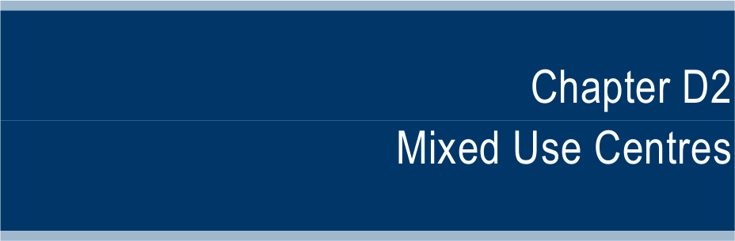

# Woollahra Development Control Plan 2015 - Chapter D2 Mixed Use Centres

> This chapter is split into 7 section file(s), one per numbered heading, in the order they appear in the PDF.

Source PDF: [chapter-d2-mixed-use-centres.pdf](chapter-d2-mixed-use-centres.pdf)

> [Picture on page 1: a picture, saved as a picture (images/chapter-d2-mixed-use-centres-page-1-1.gif, 150 dpi).]

### Chapter D2

### Mixed Use Centres

### Part D  Business Centres

### CHAPTER D2 APPROVED ON 27 APRIL 2015 AND COMMENCED ON 23 MAY 2015

### Last amended on 31 May 2024

<!-- sections -->
## Sections

1. [D2 Mixed Use Centres](01-d2-mixed-use-centres.md)
2. [D2.1 Introduction](02-d2-1-introduction.md)
3. [D2 Mixed Use Centres](03-d2-mixed-use-centres.md)
4. [D3 General Controls for Neighbourhood and Mixed Use Centres](04-d3-general-controls-for-neighbourhood-and.md)
5. [D2.2 New South Head Road Corridor, Edgecliff](05-d2-2-new-south-head-road-corridor-edgecliff.md)
6. [D2.3 Rose Bay North](06-d2-3-rose-bay-north.md)
7. [D2.4 Rose Bay South](07-d2-4-rose-bay-south.md)
