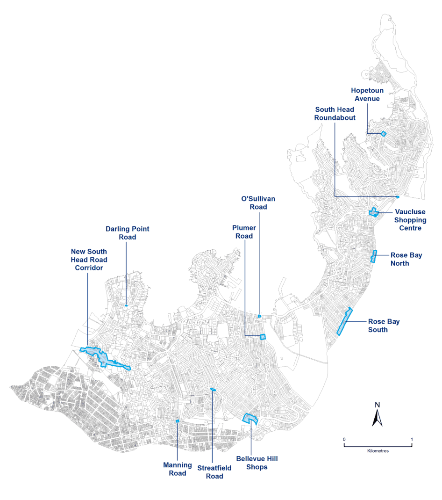

#### D3.1 Introduction

This is Chapter D3 of the Woollahra Development Control Plan 2015 (DCP), Part D Business Centres.

This chapter contains controls for twelve centres, zoned either E1 Local Centre or MU1 Mixed Use under the Woollahra Local Environmental Plan 2014 (LEP).

The controls in this chapter must be read in conjunction with the controls in Chapter

D1 Neighbourhood Centres and Chapter D2 Mixed Use Centres.

#### Land where this chapter applies

This chapter contains controls for the following centres, as identified on Map A (see next page): Hopetoun Avenue, Vaucluse; South Head Roundabout, Vaucluse; Vaucluse Shopping Village, Vaucluse Plumer Road, Rose Bay; O’Sullivan Road, Rose Bay; Streatfield Road, Bellevue Hill; Bellevue Hill Shops, Bellevue Hill; Manning Road, Woollahra; Darling Point Road, Darling Point; New South Head Road Corridor, Edgecliff; Rose Bay North, Rose Bay; and Rose Bay South, Rose Bay.

#### Relationship to other parts of the DCP

This chapter is to be read in conjunction with the other parts of the DCP that are relevant to the development proposal, including: Part B: Chapter B3 General Development Controls, but only if the proposal relates to an Inter-War flat building (refer to Section B3.8 Additional controls for development other than dwelling houses). Part D: Chapter D1 Neighbourhood Centres OR Chapter D2 Mixed Use Centres, depending on the location of the proposed development. Part E: General Controls for All Development – this part contains chapters on Parking and Access, Stormwater and Flood Risk Management, Tree Management, Contaminated Land, Waste Management, Sustainability, Signage and Adaptable Housing.

Part F: Land Use Specific Controls – this part contains chapters on Child Care Centres, Educational Establishments, Licensed Premises and Telecommunications.

MAP A  Land where Chapter D3 applies

> [Picture on page 6: a picture, saved as a picture (images/chapter-d3-general-controls-for-neighbourhood-and-mixed-use-page-6-4.gif, 150 dpi).]

#### How to use this chapter

> [Picture text on page 7 is stored in the PDF without readable letters (no character map), so it could not be copied; see the original PDF.]

This chapter establishes controls for: uses; street character; built form; building articulation; heritage and contributory buildings; acoustic and visual privacy; landscaped area and private open space; car parking and vehicular access; and site facilities.

The controls in this chapter comprise the following elements: Explanation of the topic: This provides background information on why the topic is important and how it is relevant to building design. The explanation helps determine how the general controls should be applied to development. Table of objectives and controls: The objectives describe the outcomes that proposed development is required to achieve. Applicants need to demonstrate how their development fulfils the relevant objectives for each topic.  The controls represent specific ways in which a development proposal can meet the objectives. The intent of the controls must be interpreted in the context of the topic's objectives.

Development is required to address all the relevant controls. Where there is a disparity between these general controls and the centre specific controls in Chapters D1 and D2, the centre specific controls take precedence over the general controls.
