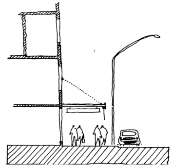

#### D3.3 Street character

The streetscape refers to the collection of visible elements that form the street, including the form and treatment of buildings, setbacks, fences and walls, landscaping and trees, driveway and street layout and surfaces, utility services and street furniture such as lighting, signs, barriers and bus shelters.

Streetscape quality helps to provide local amenity and identity. Good quality street environments are particularly important in our business centres where the community gathers and interacts. Safeguards are needed to ensure that the streetscape qualities of new development are compatible with the desired future character of the centre.

Good development contributes to a cohesive streetscape and desirable pedestrian environment. New development should recognise predominant streetscape patterns, such as building form, roof design, front setbacks, awnings and predominant materials to ensure a cohesive streetscape character.

Creating attractive and lively street environments can help to slow traffic, foster the use of streets as places for social interaction and encourage pedestrian and cyclist activity.

| Objectives | Controls |
|---|---|
| O1 To ensure development contributes to C1 The building is located as close to the active and desirable pedestrian street alignment as possible to promote environments. interaction between pedestrians and shopfronts. O2 To create an active interface between ground level retail or commercial C2 Development includes display windows properties and the street. with clear glazing to ground floor retail and commercial premises, with a maximum sill height of 0.7m. C3 The building has a clear street address and the entry to upper level development is well defined at the street frontage. C4 Access to upper level uses does not occupy more than 20% of the ground floor frontage. C5 Vehicle access is not off the active street frontage. Vehicular entries are from a secondary street, are discrete and minimise conflicts with pedestrians. |  |

| Objectives | Controls |
|---|---|
| O3 To ensure development contributes to C6 Development continues the predominant cohesive streetscapes. built form character of the street, including front setbacks, awnings, O4 To ensure development responds to parapet lines, floor to ceiling heights predominant streetscape qualities and and roof pitches. contributes to the desired future character of the centre. C7 Development maintains the predominant balance of horizontal and vertical proportions in the street. C8 Development to re-use an existing building reinstates missing façade elements and decorative details. C9 The design of the building facade uses materials that are compatible with the existing development context. |  |
| O6 To ensure that the colour of the building C10 The external painting of a building in facade is not intrusive or unreasonably bright colours, corporate colours or dominant within the streetscape, and is fluorescent colours is avoided. compatible with the desired future character of the centre. C11 Any individual business branding and identity in external painting and colour schemes is subordinate to the main colour schemes in the street. Note: Also refer to the signage controls in Part E7 of the DCP, Section 7.2.2 When external painting of a building constitutes a wall sign. |  |
| O7 To provide an attractive and comfortable C12 Development provides awnings as pedestrian environment. indicated for each centre in Chapter D1 or D2 and the street sections where relevant. C13 Awning design is a solid suspended steel box type section, with a minimum soffit height of 3.2m. C14 Awning height provides continuity with adjoining properties, follows the street grade, and is of sufficient depth to provide good shade and shelter to pedestrians (see Figure 1 below). |  |

| Objectives | Controls |
|---|---|
| C15 Under awning lighting is included; either recessed into the soffit of the awning or wall mounted on the building. C16 Development protects existing street trees and includes streetscape improvements. C17 Development includes advanced tree planting in the footpath. |  |
| O8 To ensure a safe environment by C18 Building design incorporates windows to promoting crime prevention overlook the public domain on all street through design. frontages. C19 Security features at ground level complement the design of the façade and allow window shopping and the spill of light into the street out of business hours. C20 Building design avoids dead edges at ground floor level, such as car parking frontages, blank walls and recessed spaces. |  |
| O9 To ensure that signage and structures C21 Refer to Part E of the DCP, Chapter E7 do not compromise the visual amenity of Signage. the streetscape. |  |

FIGURE 1  Awning design – suspended

steel box section type with a minimum

soffit height of 3.2m

> [Picture on page 12: a picture, saved as a picture (images/chapter-d3-general-controls-for-neighbourhood-and-mixed-use-page-12-5.gif, 150 dpi).]
