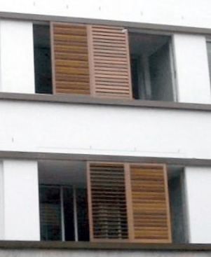
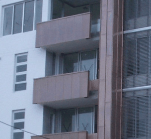

#### D3.5 Building articulation

Building articulation refers to the three dimensional modelling of a building façade. Building articulation along the street frontage establishes the relationship between a building and the street, through the use of elements like wall offsets, entry porches, loggias, balconies and bay windows.

Traditionally, buildings in the Zone E1 Local Centres and Zone MU1 Mixed Use are built to the street alignment with recessed balconies on the upper levels.

Articulation zones allow for the design of accessible and comfortable private outdoor living areas, which contribute to the liveability of residential dwellings located in business centres.

The articulation zones, through the combination of internal and external elements, also provide for more interesting and well designed buildings.  Internal elements include habitable rooms, entries, bay windows and glazed balcony. External elements within the area for building articulation include balconies, terraces, verandahs, loggias, decks, porches, external access stairs, solar protection elements such as roof overhangs, external louvered walls, screens, awnings and deep reveals, decorative architectural elements such as corbelling, projecting sills and expressed window openings.

The street section drawings in Chapters D1 and D2 of this DCP identify the area for building articulation for some centres.

#### Objectives

O1 To create a strong street address and enrich the character of the centre through appropriate building articulation.

O2 To encourage good building design and limit building bulk through articulation.

#### Controls

C1 Building articulation is provided as indicated in the street sections for the centres in Chapter D1 and D2 of the DCP.

C2 The building at the street elevation is significantly articulated to provide depth and interest to the building form. The building articulation area includes a combination of external and internal elements.

C3 Building design responds to environmental conditions such as orientation, noise, privacy and views, natural ventilation and solar access.

C4 The façade is richly articulated and expresses the different levels of the building and/or its functions.

C5 Architectural detailing and balconies do not project more than 500mm beyond the prevailing building line.

C6 Where boundary walls are visible, these include modelling.  Blank boundary walls are avoided.

FIGURE 2  Recessed balcony

FIGURE 3  Part projecting balcony

> [Picture on page 21: a picture, saved as a picture (images/chapter-d3-general-controls-for-neighbourhood-and-mixed-use-page-21-3.gif, 150 dpi).]

> [Picture on page 21: a picture, saved as a picture (images/chapter-d3-general-controls-for-neighbourhood-and-mixed-use-page-21-4.gif, 150 dpi).]
