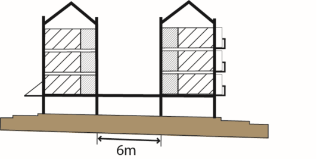
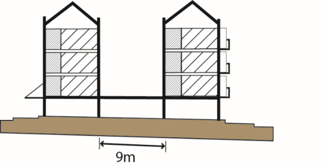
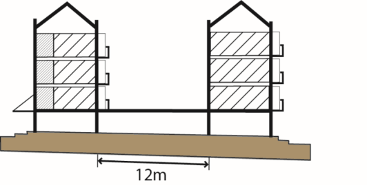
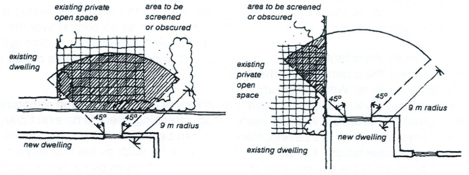
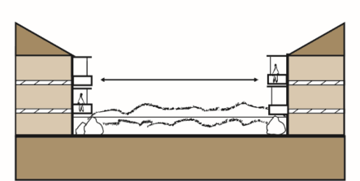
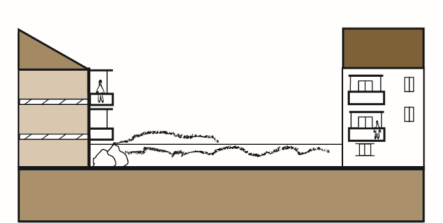
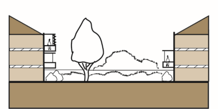

#### D3.7 Acoustic and visual privacy

Privacy is a major determinant of the ability of residents and neighbours to enjoy their home. Privacy refers to both acoustic and visual privacy. The privacy needs of residents and neighbours should influence all stages of design, from the location of dwellings and the placement of windows and private open space through to the selection of materials and construction techniques.

Visual privacy can be achieved by: layout that avoids overlooking; screening; and separation.

The level of acoustic privacy depends on the location and design of habitable rooms relative to noise sources such as common areas in the development, restaurants and cafes, late trading hours and major roads.

Residential accommodation in mixed use areas is likely to be subject to a certain level of activity noise associated with the uses that mixed use business areas accommodate such as cafes, restaurants and late trading hours. The resulting amenity impacts can be substantially mitigated by good design.

Council may require a Noise Impact Assessment as part of the development application to identify potential noise impacts and demonstrate how noise will be managed.

| Objectives | Controls |
|---|---|
| O1 To ensure adequate separation between C1 Where a development involves two or dwellings for acoustic and visual privacy. more separate buildings the minimum distance between windows facing each other is: a) 6m between non-habitable rooms; b) 9m between habitable and non-habitable rooms; and c) 12m between habitable rooms. Refer to Figure 4. |  |
| O2 To ensure adequate acoustic privacy for C2 The building is sited and designed to occupants and neighbours. minimise the transmission of external noise to other buildings on the site and O3 To encourage building design, on adjacent land. construction and use of materials that minimise conflicts between commercial C3 The internal layout of rooms, courtyards, and residential uses. terraces and balconies, the use of openings, screens and blade walls, and choice of materials, is designed to |  |

| Objectives | Controls |
|---|---|
| minimise the transmission of noise externally. C4 The bedroom areas are separated, by way of barriers or distance, from on-site noise sources such as active recreation areas, car parks, vehicle access-ways and service equipment areas. C5 Noise impact associated with goods delivery and garbage collection, particularly early morning, is minimised. C6 For a restaurant or café, the design and operation minimises the impact of noise associated with late night operation on nearby residents. C7 A rear courtyard is only permitted for restaurant or café use if Council is satisfied that the use and hours of operation will not a have an unreasonable impact on residential amenity. Note: Council may require a Noise Impact Assessment as part of the development application. |  |
| O4 To ensure adequate visual privacy for C8 Views to adjacent private open space are occupants and neighbours. protected and screened consistent with Figure 5 below. C9 Visual privacy is protected by providing adequate distance between opposite windows of neighbouring dwellings where a direct view is not restricted by screening or planting. C10 Windows and balconies of upper level dwellings are designed to prevent overlooking of the private open space of any lower level dwellings directly below, and within, the same development. C11 Balconies are located and designed to provide privacy for occupants of the |  |

> [Picture on page 26: a picture, saved as a picture (images/chapter-d3-general-controls-for-neighbourhood-and-mixed-use-page-26-1.gif, 150 dpi).]

#### Objectives

#### Controls

building when viewed from the street or nearby public space.

FIGURE 4  Minimum distances for visual and acoustic privacy in mixed use centres Source: AMCORD, 1995

s t r e et                                  st r e et

> [Picture on page 26: a picture, saved as a picture (images/chapter-d3-general-controls-for-neighbourhood-and-mixed-use-page-26-9.gif, 150 dpi).]

> [Picture on page 26: a picture, saved as a picture (images/chapter-d3-general-controls-for-neighbourhood-and-mixed-use-page-26-10.gif, 150 dpi).]

> [Picture on page 26: a picture, saved as a picture (images/chapter-d3-general-controls-for-neighbourhood-and-mixed-use-page-26-11.gif, 150 dpi).]

#### Habitable room

A room used for normal

domestic activities that

includes: a bedroom, living

room, lounge room, music

room, television room, dining

room, sewing room, study,

playroom, sunroom and

kitchen.

#### Non-habitable room

A room of a specialized

service nature occupied

neither frequently nor for

extended periods, including a

bathroom, laundry, water

closet, food storage pantry,

walk in wardrobe, corridor,

hallway, lobby or clothes

drying room.

FIGURE 5  Acceptable screening of views to adjacent open spaces

> [Picture on page 27: a picture, saved as a picture (images/chapter-d3-general-controls-for-neighbourhood-and-mixed-use-page-27-2.gif, 150 dpi).]

> [Picture on page 27: a picture, saved as a picture (images/chapter-d3-general-controls-for-neighbourhood-and-mixed-use-page-27-3.gif, 150 dpi).]

> [Picture on page 27: a picture, saved as a picture (images/chapter-d3-general-controls-for-neighbourhood-and-mixed-use-page-27-4.gif, 150 dpi).]

> [Picture on page 27: a picture, saved as a picture (images/chapter-d3-general-controls-for-neighbourhood-and-mixed-use-page-27-5.gif, 150 dpi).]

#### FIGURE 6

Ensure adequate separation between

unscreened balconies. Privacy at ground

floor level provided by suitable sill heights

and planting

#### FIGURE 7

Careful location of balconies can increase

privacy and reduce their separation

#### FIGURE 8

Vegetation and balcony screening can

increase separation to ensure privacy
